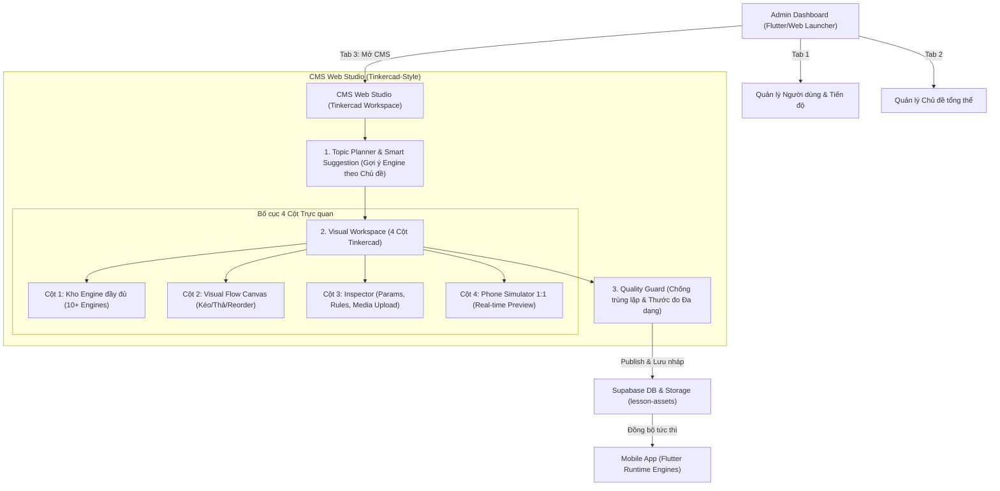

# KẾ HOẠCH TỔNG THỂ: CMS WEB STUDIO (TINKERCAD-STYLE) & HỆ THỐNG ĐỒNG BỘ ENGINE ĐA CHỦ ĐỀ

Tài liệu này tổng hợp toàn bộ giải pháp kiến trúc, luồng người dùng (User Flow), bản đồ đồng bộ dữ liệu giữa Mobile <-> Web CMS, và hệ thống gợi ý Engine theo chủ đề đại diện nhằm giúp Admin dễ dàng tạo ra các bài học tương tác thú vị, trực quan và không bị trùng lặp.

---

## 1. TỔNG QUAN KIẾN TRÚC & LUỒNG ĐIỀU HƯỚNG (USER FLOW)



---

## 2. BẢN ĐỒ ĐỒNG BỘ DỮ LIỆU: CHỦ ĐỀ ĐẠI DIỆN -> ENGINE TƯƠNG TÁC
Hệ thống kết nối trực tiếp với các engine đã có sẵn trong mã nguồn Mobile (`lib/experiments/`) và chuẩn hóa lên Web CMS:

| Lĩnh vực / Chủ đề đại diện | Engine tương tác | Tệp nguồn Mobile thực thi | Trải nghiệm học viên & Mục tiêu sư phạm |
| :--- | :--- | :--- | :--- |
| **Hình học & Không gian 3D** | `solid3D`<br>`polygonVertices`<br>`symmetryMirror`<br>`tangramRotate` | `space_workspace.dart`<br>`discovery_catalog.dart` | • Tự tay xoay khối 3D, kéo thanh trượt dài/rộng/cao.<br>• Kéo các đỉnh đa giác để khám phá góc & diện tích.<br>• Vẽ phản chiếu qua trục gương; xoay mảnh ghép Tangram. |
| **Đại số & Hàm số** | `graph`<br>`causalLab`<br>`balanceScale` | `slide_lesson_workspace.dart`<br>`curriculum_workspace.dart` | • Kéo slider tìm hệ số $a, b$ khớp với đường thẳng mục tiêu.<br>• Khám phá tích số $X \times Y$ trong phòng thí nghiệm nhân quả.<br>• Cân đĩa trực quan tìm ẩn số $X$. |
| **Khoa học máy tính & Thuật toán** | `robotRoute`<br>`loopBuilder`<br>`sequenceTiles` | `discovery_catalog.dart`<br>`curriculum_workspace.dart` | • Lập trình đường đi cho Robot (Lên, Xuống, Trái, Phải).<br>• Lắp ghép vòng lặp `repeat` để tối ưu số câu lệnh.<br>• Kéo đổi thứ tự các bước thực thi thuật toán. |
| **Vật lý & Khoa học tự nhiên** | `causalExperiment`<br>`strata3D`<br>`globe3D`<br>`resourceBudget` | `curriculum_workspace.dart`<br>`space_workspace.dart` | • Thí nghiệm nguyên nhân - kết quả (lực, vận tốc, trọng lực).<br>• Xem mặt cắt địa tầng trầm tích và quả địa cầu 3D.<br>• Phân bổ tài nguyên (nhiên liệu, pin, năng lượng). |
| **Tư duy logic & Ngôn ngữ** | `evidenceBoard`<br>`categorySort`<br>`clozeBank`<br>`matchPairs` | `curriculum_workspace.dart` | • Chọn các thẻ bằng chứng để suy luận giả thuyết.<br>• Phân loại các mục vào đúng nhóm danh mục.<br>• Điền từ khuyết vào chỗ trống; Ghép thẻ tương ứng. |
| **Dẫn nhập & Kiểm tra nhanh** | `story`<br>`quiz` | `slide_lesson_workspace.dart` | • Dẫn dắt bằng câu chuyện (RichText, KaTeX, ảnh/GIF).<br>• Trắc nghiệm suy luận ngắn gọn. |

---

## 3. CƠ CHẾ GỢI Ý & HỖ TRỢ ADMIN KHI LÊN KẾ HOẠCH BÀI HỌC MỚI

### 3.1. Smart Topic Onboarding (Gợi ý khung giáo án mẫu)
Khi Admin bấm **"Tạo Chủ đề mới"** và chọn lĩnh vực (ví dụ: *Hình học 3D*), CMS tự động nạp sẵn **Khung giáo án 4 bước chuẩn Brilliant**:
1. **Khám phá ban đầu (Intuition):** Sử dụng `story` + hình ảnh GIF thực tế.
2. **Thao tác thử nghiệm (Playground):** Sử dụng `solid3D` hoặc `polygonVertices` để người học tự tay kéo nghịch và nhận ra quy luật.
3. **Suy luận có hướng dẫn (Guided Deduction):** Sử dụng `sequenceTiles` hoặc `clozeBank` để phát biểu lại quy luật.
4. **Thử thách chốt (Challenge):** Sử dụng `evidenceBoard` hoặc `quiz` bẫy tư duy để kiểm tra độ hiểu sâu.

### 3.2. Keyword Engine Matcher
Khi Admin gõ tiêu đề bài học:
* Nhập: *"Góc", "Tam giác", "Diện tích"* -> CMS nổi bật icon đề xuất: `polygonVertices`, `solid3D`.
* Nhập: *"Vòng lặp", "Đường đi", "Bước làm"* -> CMS đề xuất: `robotRoute`, `loopBuilder`, `sequenceTiles`.
* Nhập: *"Vận tốc", "Tỉ lệ", "Độ dốc"* -> CMS đề xuất: `graph`, `causalLab`.

### 3.3. Anti-Monotony Guard (Bộ cảnh báo chống đơn điệu & trùng lặp)
* **Thước đo Đa dạng Cơ chế (Mechanism Diversity Meter):** Nếu trong 1 chủ đề có hơn 50% số bài là Trắc nghiệm, thanh đo sẽ hiện cảnh báo màu vàng và gợi ý đổi sang các engine trực quan.
* **Kiểm tra trùng lặp (Duplicate Checker):** So sánh nội dung câu hỏi và cơ chế giải với các bài đã xuất bản trong cùng chủ đề. Nếu độ tương đồng > 70%, CMS đưa ra cảnh báo để Admin tinh chỉnh lại mục tiêu bài học.

---

## 4. BẢN ĐẶC TẢ GIAO DIỆN CMS WORKSPACE (TINKERCAD-STYLE)

```
+-----------------------------------------------------------------------------------------------------------------------+
| TOP BAR: [Logo] | Chủ đề: Hình học không gian | Bài: Tính thể tích lăng trụ | [Undo/Redo] | [AI Assistant] | [Publish]|
+-------------------+------------------------------------+--------------------------------+-----------------------------+
| CỘT 1: PALETTE    | CỘT 2: FLOW CANVAS                 | CỘT 3: INSPECTOR & MEDIA       | CỘT 4: PHONE SIMULATOR      |
| (Kho Engine)      | (Không gian lắp ráp Tinkercad)     | (Thuộc tính & Tải ảnh)         | (Trình giả lập 1:1)         |
|                   |                                    |                                |                             |
| Dẫn nhập:         | +-------------------------------+  | Thuộc tính Slide #2:           |     +-----------------+     |
| [ Story / KaTeX ] | | [1] Mở đầu: Lăng trụ trong đời|  | - Loại engine: [ solid3D     ] |     |  [ 12:00 ] [5G] |     |
|                   | +-------------------------------+  |                                |     |                 |     |
| Khám phá:         |                |                   | - Dạng khối: [ Hộp chữ nhật  ] |     | Xưởng khối 3D   |     |
| [ solid3D       ] |                v                   | - Giới hạn thanh trượt:        |     |                 |     |
| [ polygonVerts  ] | +-------------------------------+  |   Chiều dài (W): [ 1 - 5 ]     |     |     +-----+     |     |
| [ causalLab     ] | | [*] Thử nghiệm: Xưởng khối 3D |  |   Chiều cao (H): [ 1 - 5 ]     |     |    /     /|     |     |
| [ graph         ] | |  (Đang chọn chỉnh sửa)        |  |   Chiều sâu (D): [ 1 - 5 ]     |     |   +-----+ +     |     |
|                   | +-------------------------------+  | - Giá trị mục tiêu:            |     |   |     |/      |     |
| Logic & Code:     |                |                   |   target_volume = [ 12 ]       |     |   +-----+       |     |
| [ robotRoute    ] |                v                   |                                |     |                 |     |
| [ loopBuilder   ] | +-------------------------------+  | - Upload minh họa từ máy tính: |     | Dài:  [===O===] |     |
| [ sequenceTiles ] | | [3] Đố vui: Thể tích thay đổi |  |   [ Tải ảnh lên (.png/.svg) ]  |     | Cao:  [==O====] |     |
|                   | +-------------------------------+  |                                |     | Sâu:  [====O==] |     |
| Thử thách:        |                |                   | - Lời khuyên khi làm đúng/sai: |     |                 |     |
| [ evidenceBoard ] |                v                   |   + Khi W*H*D < 12: "Chưa đủ"  |     |   [ KIỂM TRA ]  |     |
| [ quiz          ] | [ + Thêm Slide mới vào luồng ]     |   + Gợi ý: "Hãy thử tăng H lên"|     | (Bấm chơi thử)  |     |
+-------------------+------------------------------------+--------------------------------+-----------------------------+
```

---

## 5. DANH SÁCH NHIỆM VỤ THỰC THI (ACTIONABLE TASK BREAKDOWN)

### GIAI ĐOẠN 1: MỞ RỘNG DATA CONTRACT & ENGINE SCHEMA
- [x] **Task 1.1:** Cập nhật `cms/src/domain.ts`:
  - Khai báo mở rộng `type Engine` bao gồm đầy đủ 10+ engine.
  - Xây dựng kiểu dữ liệu `config` đa hình (Polymorphic Slide Config) hỗ trợ thông số cho từng engine (tọa độ đỉnh, kích thước 3D, lệnh robot, quy trình sắp xếp).
- [x] **Task 1.2:** Cập nhật `lib/data/models/slide_lesson.dart` trên Mobile:
  - Bổ sung các engine mới vào danh sách `slideEngineNames`.
  - Cập nhật hàm `validSlideLesson` để xác thực hợp lệ các cấu hình bài học mới tải từ CMS.
- [x] **Task 1.3:** Kết nối bộ nạp Slide trên Mobile:
  - Cập nhật `lib/experiments/slide_lesson_workspace.dart` để khi gặp engine mới, tự động nhúng widget tương ứng từ `space_workspace.dart` và `discovery_catalog.dart`.

### GIAI ĐOẠN 2: QUẢN LÝ MEDIA & TẢI ẢNH TỪ MÁY TÍNH
- [x] **Task 2.1:** Cập nhật `cms/src/repository.ts`:
  - Thêm phương thức `uploadAsset(file: File): Promise<string>` giao tiếp với Supabase Storage bucket `lesson-assets`.
- [x] **Task 2.2:** Cập nhật giao diện Story/Inspector trong `cms/src/Studio.tsx`:
  - Thêm nút tải file ảnh và khu vực kéo-thả (Dropzone).
  - Tự động điền URL trả về vào trường `image_url` và hiển thị ảnh thumbnail xem trước.

### GIAI ĐOẠN 3: TÁI CẤU TRÚC GIAO DIỆN TINKERCAD WORKSPACE
- [x] **Task 3.1:** Tái cấu trúc layout 4 cột trong `cms/src/Studio.tsx` và `cms/src/styles.css`:
  - Xây dựng Cột 1 (Palette) phân nhóm engine trực quan.
  - Cột 2 (Canvas) kéo thả sắp xếp các slide bài học.
  - Cột 3 (Inspector) tinh chỉnh biến số động.
- [x] **Task 3.2:** Nâng cấp Phone Simulator trong `cms/src/Player.tsx`:
  - Bổ sung trình giả lập cho `solid3D` (Canvas 3D hộp), `robotRoute` (Lưới robot), `sequenceTiles` (Kéo đổi thứ tự).
  - Kết nối trạng thái thay đổi ở Cột 3 phản hồi lập tức lên Cột 4 (Zero-latency preview).

### GIAI ĐOẠN 4: HỆ THỐNG GỢI Ý & CHỐNG TRÙNG LẶP CHO ADMIN
- [x] **Task 4.1:** Tích hợp bộ gợi ý chủ đề (Topic Recipe & Template Generator):
  - Khi tạo chủ đề mới, tự động đề xuất 4 slide mẫu theo đúng môn học.
- [x] **Task 4.2:** Bổ sung thanh đo đa dạng (Diversity Meter) và bộ kiểm tra trùng lặp (Duplicate Checker) trước khi Publish.
- [x] **Task 4.3:** Bổ sung Tab "Studio Soạn Thảo" vào thanh điều hướng Admin Dashboard trong Mobile/Web launcher.


## 6. Trạng thái triển khai (2026-11-09)

Đã triển khai lại giao diện Admin/CMS mới, 21 engine và adapter mobile, media upload, Topic Planner và Quality Guard. Tên ứng dụng là Matlingo Admin; Studio là một chức năng. Backend đã áp dụng các migration cộng thêm và kiểm tra sửa/đồng bộ bài có sẵn trong transaction hoàn tác. Báo cáo phạm vi, các preset và bằng chứng kiểm thử: `docs/CMS_TINKERCAD_IMPLEMENTATION.md`.
