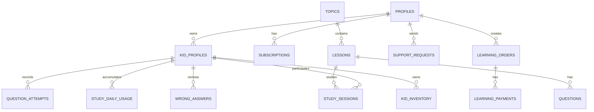

# TÀI LIỆU ĐẶC TẢ KỸ THUẬT VÀ KIẾN TRÚC HỆ THỐNG
# DỰ ÁN: MATHLINGO (PRM393 — FA26)

---

## 1. TỔNG QUAN DỰ ÁN (PROJECT OVERVIEW)

### 1.1. Giới thiệu
**MathLingo** là nền tảng ứng dụng di động giáo dục thông minh hỗ trợ học Toán dành riêng cho học sinh Tiểu học (từ Lớp 1 đến Lớp 5). Ứng dụng kết hợp giữa phương pháp sư phạm gợi mở (Socratic Method), cơ chế trò chơi hóa (Gamification), cùng công nghệ nhận diện giọng nói (STT) và trí tuệ nhân tạo (AI Tutor). Đồng thời, hệ thống cung cấp cổng giám sát toàn diện cho phụ huynh nhằm quản lý tiến độ, thời lượng học tập và các gói đăng ký dịch vụ của gia đình.

### 1.2. Mục tiêu hệ thống
* **Đối với học sinh**: Biến việc học toán thành hành trình phiêu lưu khám phá bản đồ kho báu; xây dựng thói quen học tập đều đặn qua Streak; rèn luyện tư duy tự lập với gia sư Cú Socratic mà không bị phụ thuộc vào lời giải sẵn.
* **Đối với phụ huynh**: Nắm bắt chính xác thời lượng học tập thực tế (đo lường bằng giây qua nhịp tim hệ thống Heartbeat), kiểm soát thời gian sử dụng thiết bị (Screen-time control), và quản lý tài khoản dùng chung cho tối đa 3 bé trong một gói Plus.
* **Đối với quản trị viên & giáo viên biên soạn (Staff/Admin)**: Quản lý tập trung ngân hàng câu hỏi, soạn thảo bài học linh hoạt theo từng khối lớp và đối soát thanh toán an toàn, minh bạch.

### 1.3. Công nghệ sử dụng (Tech Stack)

| Thành phần | Công nghệ / Thư viện | Vai trò |
|---|---|---|
| **Frontend Framework** | **Flutter 3.x / Dart 3.x** | Xây dựng ứng dụng đa nền tảng (Android, iOS, Web, Desktop) với giao diện Material 3. |
| **Quản lý trạng thái (State)** | **Provider (`ChangeNotifier`)** | Quản lý state toàn cục qua `AppStateProvider`, hỗ trợ Realtime Stream Subscription. |
| **Backend & Cơ sở dữ liệu** | **Supabase (PostgreSQL 15+)** | Quản lý Auth, Row Level Security (RLS), bảng quan hệ, Triggers và các Stored Procedures (RPC). |
| **Serverless Computing** | **Supabase Edge Functions (Deno / TypeScript)** | Xử lý cổng thanh toán (VNPay, MoMo), đối soát giao dịch, hoàn tiền và cổng giao tiếp AI. |
| **Trí tuệ nhân tạo (AI)** | **Google Gemini API (via `ai-tutor`)** | Nhận diện đề toán từ hình ảnh (OCR) và phản hồi gợi ý từng bước theo phương pháp Socratic. |
| **Xử lý âm thanh & Giọng nói** | **Speech-to-Text (`SpeechService`)** | Nhận diện giọng nói tiếng Việt và chuẩn hóa thành số/phép tính cho trẻ nhỏ. |
| **Mạng & Đồng bộ ngoại tuyến** | **HTTP, WebSocket, `StudyCache` (Outbox)** | Tự động lưu bài làm và gửi bù khi mạng gián đoạn, lắng nghe thay đổi qua Supabase Realtime. |

---

## 2. KIẾN TRÚC HỆ THỐNG (SYSTEM ARCHITECTURE)

Hệ thống được xây dựng theo mô hình kiến trúc phân lớp sạch (Clean Layered Architecture), đảm bảo tính module hóa cao, dễ bảo trì và mở rộng:

```
┌─────────────────────────────────────────────────────────────┐
│                    PRESENTATION LAYER                       │
│  - Screens & Popups (Features: Auth, Main, Learning, Admin) │
│  - Custom Widgets (MascotOwl3D, RoleUI, Interactive Math)   │
└──────────────────────────────┬──────────────────────────────┘
                               │ (Watch / Read State)
┌──────────────────────────────▼──────────────────────────────┐
│                    STATE MANAGEMENT LAYER                   │
│  - AppStateProvider (Auth state, Active kid, Subscriptions) │
│  - StudyHeartbeatQueue (Đo nhịp học định kỳ 20 giây)        │
└──────────────────────────────┬──────────────────────────────┘
                               │ (Call Operations)
┌──────────────────────────────▼──────────────────────────────┐
│                      DATA LAYER                             │
│  - Repositories: Study, Commerce, Auth, Kid, AI Tutor       │
│  - Models: KidProfile, StudySession, LearningOrder, Question│
│  - Offline Outbox: StudyCache (Đồng bộ khi có mạng lại)     │
└──────────────────────────────┬──────────────────────────────┘
                               │ (Network / RPC / REST)
┌──────────────────────────────▼──────────────────────────────┐
│                   SUPABASE CLOUD BACKEND                    │
│  - Supabase Auth (Email + SMTP Verification)                │
│  - PostgreSQL + Row Level Security (RLS) + PL/pgSQL RPC     │
│  - Edge Functions (VNPay, MoMo, Reconcile, AI Tutor)        │
└─────────────────────────────────────────────────────────────┘
```

### 2.1. Quản lý trạng thái toàn cục (`AppStateProvider`)
* `AppStateProvider` kế thừa `ChangeNotifier` và tích hợp `WidgetsBindingObserver` để theo dõi vòng đời ứng dụng (`resumed`, `paused`, `detached`).
* Khi ứng dụng bị đưa xuống nền (`paused`), hệ thống tự động khóa Cổng phụ huynh (`lockParentPortal()`) để đảm bảo an toàn.
* Tự động kết nối `AccountLiveSync` qua Realtime Channels để cập nhật tức thì khi có thay đổi từ các bảng: `kid_profiles`, `subscriptions`, `learning_orders`.

### 2.2. Cơ chế Chống gian lận & Đồng bộ Ngoại tuyến (Offline Resiliency)
* **Server-side Grading**: Toàn bộ việc chấm điểm, trừ tim, cộng kinh nghiệm (XP) và tính sao đều do các hàm RPC trên PostgreSQL đảm nhiệm (`answer_learning_session`, `complete_learning_session`). Phía client không tự ý sửa đổi điểm số.
* **Outbox Pattern**: Khi học sinh gửi câu trả lời mà mạng bị ngắt quãng, `StudyCache` sẽ lưu câu trả lời cục bộ và tự động "flush" (gửi bù) ngay khi tín hiệu mạng hoặc nhịp heartbeat tiếp theo được kích hoạt.

---

## 3. CƠ SỞ DỮ LIỆU & SERVERLESS BACKEND

### 3.1. Các bảng dữ liệu cốt lõi (Core Tables)



1. **`kid_profiles`**: Quản lý từng hồ sơ học sinh (biệt danh, khối lớp 1–5, avatar, số tim hiện có, tổng số sao, trạng thái hoạt động/lưu trữ).
2. **`study_sessions` & `question_attempts`**: Lưu vết chi tiết từng phiên học, số câu đúng/sai, số lần xem gợi ý, và thời gian hoàn thành từng bài.
3. **`study_daily_usage`**: Tích lũy thời gian học theo từng ngày dựa trên nhịp gửi heartbeat (20 giây/lần), phục vụ biểu đồ báo cáo 7 ngày.
4. **`wrong_answers`**: Sổ tay ghi nhớ các câu hỏi bé làm sai, đồng bộ với máy chủ để phục vụ tính năng "Ôn câu sai" trong Vườn luyện tập.
5. **`learning_orders` & `learning_payments`**: Quản lý đơn hàng mua gói học, mã yêu cầu idempotency, trạng thái thanh toán (`pending`, `paid`, `failed`, `refunded`).
6. **`subscriptions`**: Quản lý gói học của tài khoản phụ huynh (`basic` miễn phí tối đa 1 bé, `plus` hỗ trợ tối đa 3 bé và mở khóa toàn bộ bài học).

### 3.2. Danh sách Supabase Edge Functions

* **`vnpay-checkout`**: Khởi tạo phiên thanh toán VNPay, ký chữ ký HMAC-SHA512 bảo mật và trả về URL redirect.
* **`vnpay-ipn` & `vnpay-return`**: Tiếp nhận và xác thực webhook từ cổng VNPay, đối chiếu checksum, cập nhật trạng thái đơn hàng sang `paid` và kích hoạt thời hạn Plus.
* **`vnpay-refund`**: API xử lý hoàn tiền dành riêng cho Admin, gửi yêu cầu refund sang VNPay và thu hồi quyền Plus tương ứng.
* **`momo-checkout` & `momo-ipn`**: Khởi tạo và xử lý thanh toán qua ví điện tử MoMo.
* **`commerce-reconcile`**: Tác vụ đối soát định kỳ, kiểm tra các đơn hàng đang treo (`pending`) với ngân hàng để tránh mất mát giao dịch.
* **`demo-pay`**: Cổng giả lập thanh toán phục vụ môi trường Demo/QA, cấp quyền Plus thử nghiệm mà không phát sinh dòng tiền thật.
* **`ai-tutor`**: Edge Function kết nối mô hình Gemini: xử lý nhận dạng ký tự từ ảnh (OCR) và sinh gợi ý tư duy Socratic.

---

## 4. ĐẶC TẢ CHI TIẾT CÁC PHÂN HỆ NGHIỆP VỤ (MODULES)

### 4.1. Phân hệ 1: Xác thực & Quản trị Gia đình (Auth & Profiles)
* **Xác thực an toàn**: Sử dụng Supabase Auth kết hợp xác thực mã OTP gửi qua máy chủ SMTP. Hỗ trợ quy trình quên mật khẩu và khôi phục tài khoản qua deep link.
* **Mô hình tài khoản gia đình**: Một tài khoản phụ huynh quản lý nhiều hồ sơ bé. Phụ huynh có thể:
  * Thêm hồ sơ bé mới (chọn lớp 1 đến 5).
  * Chỉnh sửa thông tin, đổi khối lớp (vẫn bảo lưu tiến độ lớp cũ).
  * Lưu trữ hồ sơ (archive) khi tạm ngưng và khôi phục khi cần.
  * Chỉ định hồ sơ bé được quyền sử dụng gói Basic miễn phí khi hết hạn gói Plus.

### 4.2. Phân hệ 2: Cổng Phụ huynh (Parent Portal & PIN Gate)
* **Bảo mật PIN Gate (`ParentGateDialog`)**:
  * Mã PIN 4 chữ số bảo vệ toàn bộ khu vực quản trị và thanh toán.
  * Nhập sai 5 lần sẽ bị hệ thống tạm khóa 5 phút.
  * Phiên mở khóa tự hết hạn sau 14 phút hoặc ngay khi ứng dụng bị chuyển xuống nền (Background).
* **Báo cáo & Giám sát thời gian thực**:
  * Hiển thị chính xác số phút học trong ngày và biểu đồ 7 ngày gần nhất.
  * Thống kê tỷ lệ trả lời đúng/sai theo từng nhóm kỹ năng toán học.
  * Cài đặt **Giới hạn thời gian học mỗi ngày** (từ 15 đến 120 phút, điều chỉnh theo bước 5 phút).
* **Hỗ trợ khách hàng (Support Tickets)**: Cho phép phụ huynh gửi yêu cầu hỗ trợ kèm theo mã đơn hàng trực tiếp đến bộ phận Admin.

### 4.3. Phân hệ 3: Động cơ Học tập (Learning Engine & Curriculum)
* **Cây giáo trình 5 khối lớp**: Lộ trình trực quan dạng Đảo kho báu (Treasure Map), phân chia theo từng Chủ đề (Topic) và Bài học (Lesson).
* **Các dạng câu hỏi tương tác đa dạng**:
  1. *Kéo thả số lượng (Drag Counters)*: Tương tác trực quan cho phép đếm hình ảnh, phân nhóm đồ vật.
  2. *Đồng hồ góc quay (Clock Rotation)*: Kéo kim giờ/kim phút để học cách xem thời gian.
  3. *Lưới diện tích (Area Grid)*: Chọn các ô vuông trên lưới tọa độ để tính chu vi, diện tích.
  4. *Bảng cửu chương trực quan (Multiplication Matrix)*.
  5. *Toán có lời văn (Word Problem)* và *Bài toán tự luận (Essay)*.
  6. *Nhận diện giọng nói (Voice Answer)*: Tích hợp `SpeechService` với bộ chuẩn hóa phát âm tiếng Việt cho trẻ em.
* **Cơ chế Heartbeat & Chăm sóc sức khỏe**:
  * Mỗi 20 giây học tập gửi một nhịp `heartbeat` lên máy chủ.
  * **Cảnh báo nghỉ mắt**: Khi bé học liên tục 10 phút (600 giây), ứng dụng hiển thị popup nhắc nhở bé đứng dậy uống nước, nhìn ra xa để bảo vệ thị lực.
* **Hệ thống Tim & Đánh giá**: Mỗi bé bắt đầu với 5 Tim. Trả lời sai bị trừ 1 Tim. Khi hết Tim, hệ thống hướng dẫn bé sang Vườn luyện tập.

### 4.4. Phân hệ 4: Luyện tập, Giải trí & Gamification
* **Vườn luyện tập (Practice Garden)**:
  * *Luyện tập hồi tim*: Hoàn thành đúng 5 câu hỏi ngẫu nhiên để hồi đầy đủ 5 Tim hoàn toàn miễn phí.
  * *Ôn tập câu sai (Review Wrong Answers)*: Lấy danh sách các câu hỏi bé đã từng trả lời sai để làm lại. Khi làm đúng sẽ tự động gỡ khỏi danh sách câu sai.
  * *Mini Game Math Flappy*: Trò chơi toán học kết hợp bay né chướng ngại vật và chọn kết quả đúng.
* **Đấu trường tuần (Arena)**: Tự động ghép ngẫu nhiên 30 học sinh cùng khối lớp vào một bảng thi đấu hàng tuần. Bé thi đấu 5 câu toán tốc độ cao để tranh hạng trên Bảng xếp hạng tuần.
* **Tủ đồ Cú Mascot 3D (`MascotWardrobeScreen`)**: Dùng Sao vàng tích lũy được sau các bài học để mua và trang bị Mũ, Kính cho linh vật Cú 3D hiển thị xuyên suốt ứng dụng.

### 4.5. Phân hệ 5: Trợ lý Cú AI Socratic (AI Scanner)
* Bé chụp ảnh hoặc chọn ảnh bài toán khó từ thư viện ảnh.
* Edge Function `ai-tutor` trích xuất đề bài (OCR).
* Bé có thể chỉnh sửa lại nội dung văn bản nếu ảnh bị mờ.
* Nhấn gửi: AI đóng vai trò gia sư gợi mở (Socratic Owl), đưa ra các câu hỏi định hướng tư duy từng bước giúp bé tự khám phá cách giải thay vì chép bài giải sẵn.

### 4.6. Phân hệ 6: Thương mại & Quản lý Gói học (Commerce & Subscriptions)
* **Bảng giá & Gói dịch vụ**: Gói Basic (miễn phí 1 bé), Gói Plus (1 tháng, 6 tháng, 12 tháng - mở khóa tối đa 3 bé và toàn bộ giáo trình nâng cao).
* **Luồng thanh toán an toàn**:
  * Kiểm tra đơn hàng cũ đang chờ (`pending order`) để ngăn chặn việc người dùng bị trừ tiền hai lần.
  * Hỗ trợ thanh toán qua VNPay (QR Code, thẻ ATM nội địa) và Ví MoMo.
  * Màn hình chờ kết quả (`PaymentWaitingScreen`) lắng nghe realtime webhook và kết hợp polling mỗi 3 giây.
  * Cung cấp cổng thanh toán mô phỏng (Demo Pay) cho môi trường kiểm thử QA.

### 4.7. Phân hệ 7: Quản trị Hệ thống & CMS (Admin & Moderator)
* **Admin Dashboard**:
  * Thống kê các chỉ số tăng trưởng: người dùng hoạt động (DAU), số bé đang học, tổng doanh thu.
  * Phân quyền tài khoản người dùng (`assign_role`: Admin, Moderator, Parent).
  * Đối soát đơn hàng và thực hiện lệnh hoàn tiền trực tiếp qua API `vnpay-refund`.
  * Quản lý nhật ký kiểm toán (Audit Logs) và tiếp nhận ticket hỗ trợ.
* **Content Management CMS (Dành cho Moderator/Staff)**:
  * Soạn thảo và chỉnh sửa cây giáo trình Lớp 1 đến 5.
  * Quản lý Chủ đề, Bài học, gắn bài học vào gói Basic hoặc Plus.
  * Thiết kế câu hỏi với nhiều dạng tương tác, xem trước (Preview) giao diện thực tế của học sinh trước khi bấm Xuất bản (Publish).

---

## 5. HƯỚNG DẪN CÀI ĐẶT & VẬN HÀNH (SETUP & DEPLOYMENT)

### 5.1. Yêu cầu môi trường
* **Flutter SDK**: Phiên bản 3.24.x trở lên (khuyên dùng Dart 3.10+).
* **Node.js**: Phiên bản 20.x hoặc 24.x (dùng chạy bộ test Edge Functions).
* **Supabase CLI**: Dùng để quản lý migration và Edge Functions.

### 5.2. Cấu hình ứng dụng
Dự án sử dụng cơ chế bảo mật cấu hình qua file JSON. Không đưa API Secret Key vào client Flutter:
1. Sao chép file cấu hình mẫu:
   ```powershell
   Copy-Item config/app.example.json config/app.json
   ```
2. Điền thông tin dự án Supabase của bạn vào `config/app.json`:
   ```json
   {
     "SUPABASE_URL": "https://your-project.supabase.co",
     "SUPABASE_ANON_KEY": "your-anon-public-key"
   }
   ```

### 5.3. Khởi chạy ứng dụng
Chạy ứng dụng với cờ nạp file cấu hình:
```powershell
flutter pub get
flutter run --dart-define-from-file=config/app.json
```

### 5.4. Các lệnh kiểm thử chất lượng mã nguồn (Quality Assurance)
Toàn bộ mã nguồn phải vượt qua các bài kiểm thử nghiêm ngặt trước khi đóng gói:
```powershell
# 1. Phân tích tĩnh mã nguồn Flutter (Clean lints/analyzers)
flutter analyze --no-pub

# 2. Chạy toàn bộ 240+ Unit & Widget tests của Flutter
flutter test --no-pub

# 3. Chạy kiểm thử tự động các Edge Functions backend
node --test test_backend/*.test.mjs

# 4. Kiểm tra cú pháp và tính toàn vẹn của 30 file SQL Migrations
node scripts/check-sql.mjs
```

### 5.5. Đóng gói sản phẩm (Build Production)
* **Android Debug**:
  ```powershell
  flutter build apk --debug --dart-define-from-file=config/app.json
  ```
* **Android Release**: Cần thiết lập keystore trong `android/key.properties`, sau đó chạy:
  ```powershell
  .\scripts\build-android.ps1 -Target release
  ```

---

## 6. KẾT LUẬN & ĐÁNH GIÁ CHẤT LƯỢNG

Codebase **MathLingo (PRM393)** được xây dựng với cấu trúc chặt chẽ, tuân thủ nguyên tắc lập trình hướng đối tượng và kiến trúc phân tách rõ ràng. Việc chuyển toàn bộ logic chấm điểm, trừ tim, tính streak và kiểm soát thời lượng học về phía Server (Supabase PL/pgSQL & Edge Functions) giúp hệ thống đạt độ tin cậy cao, loại bỏ hoàn toàn nguy cơ gian lận từ phía client, đồng thời mang lại trải nghiệm học tập an toàn, bổ ích cho trẻ nhỏ và sự an tâm tối đa cho phụ huynh.
