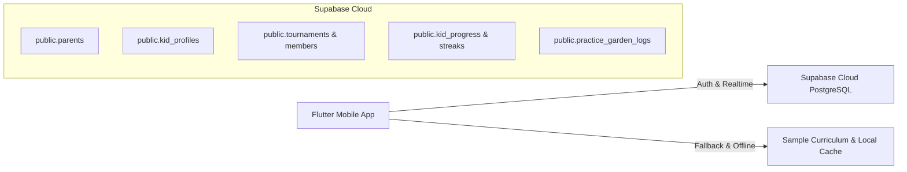

# MathLingo 🦉 - Ứng Dụng Học Toán Tương Tác Cho Trẻ Em (PRM393)

> **Môn học**: PRM393 - Mobile Programming (FPT University)  
> **Nền tảng**: Flutter (Android/iOS) | **Ngôn ngữ**: Dart  
> **Backend & Cloud Database**: Supabase (PostgreSQL, Supabase Auth, Row Level Security)  
> **Quản lý trạng thái**: Provider (`AppStateProvider`)  

---

## 🌟 1. Tổng Quan Dự Án & Giá Trị Cốt Lõi

**MathLingo** là ứng dụng di động giáo dục toán học tương tác dành cho học sinh Tiểu học (Lớp 1 đến Lớp 5), được xây dựng theo triết lý **Gamification** kết hợp **Phương pháp gợi mở Socratic** (không đưa ra đáp án trực tiếp mà hướng dẫn trẻ tự suy luận).

### Điểm nhấn công nghệ & Thiết kế:
* **Kiến trúc Feature-First**: Tách biệt rõ ràng giữa `core/`, `data/` và từng module chức năng trong `features/`, giúp nhóm 4 người làm việc song song không bị xung đột code.
* **Tương tác trực quan 60 FPS (Visual Manipulatives)**: 5 dạng bài tập tương tác kéo thả táo/que tính, xoay kim đồng hồ, điền bảng cửu chương, đo lưới ô vuông diện tích, và phân tích bài toán có lời văn.
* **Cơ chế Hybrid Cloud - Local**: Kết nối Supabase Cloud cho dữ liệu tài khoản, tiến độ, điểm số và bảng xếp hạng; đồng thời có Fallback cục bộ giúp app chạy mượt mà ngay cả khi offline hoặc mất kết nối.
* **An toàn cho trẻ em (COPPA / GDPR-K)**: Không lưu trữ thông tin nhận dạng cá nhân của học sinh; bảo vệ các khu vực cài đặt bằng Cổng phụ huynh (Parent Gate).

---

## 📋 2. Ma Trận Tính Năng Đã Hoàn Thiện (Feature Matrix)

| STT | Phân hệ (Feature) | Thư mục mã nguồn | Chi tiết chức năng & Thành phần UI |
| :---: | :--- | :--- | :--- |
| **1** | **Khởi động & Chào đón** | `lib/features/onboarding/` | • Splash Screen hoạt họa biểu tượng Cú Mathy<br>• Lựa chọn vai trò Phụ huynh / Học sinh<br>• Giới thiệu các tính năng nổi bật |
| **2** | **Xác thực Phụ Huynh** | `lib/features/auth/` | • Đăng ký / Đăng nhập tài khoản với **Supabase Auth**<br>• Tự động nạp tài khoản test nhanh (`phuhuynh@mathlingo.vn`)<br>• Lưu phiên đăng nhập an toàn |
| **3** | **Điều hướng Chính** | `lib/features/main/` | • `MainScreen`: BottomNavigationBar 4 tab cố định<br>• **Floating Action Button Quét AI**: Nút quét toán nổi bật trên giao diện |
| **4** | **Trang Chủ (Home)** | `lib/features/home/` | • Hiển thị Cú Mathy tương tác với trang phục hiện tại<br>• Thanh Header thống kê Trái tim ❤️, Sao năng lượng ⭐, Chuỗi Streak 🔥<br>• Thẻ bài học kế tiếp được đề xuất trong ngày |
| **5** | **Bản Đồ Kho Báu** | `lib/features/treasure_map/` | • Lộ trình bài học dạng bản đồ phiêu lưu theo Khối Lớp 1 - 5<br>• Hiển thị trạng thái bài học (Đã xong, Đang mở, Đang khóa)<br>• Bottom Sheet giới thiệu bài học & phần thưởng (`lesson_intro_sheet.dart`) |
| **6** | **Engine Học Toán Tương Tác** | `lib/features/learning_engine/` | • **5 Dạng tương tác trực quan (Manipulatives)**:<br>  1. `drag_counters_widget`: Kéo thả quả táo vào rổ phép thuật<br>  2. `clock_rotation_widget`: Xoay kim giờ, kim phút thực tế<br>  3. `multiplication_widget`: Bảng cửu chương nhẩm nhanh thần tốc<br>  4. `area_grid_widget`: Thám tử đo lưới ô vuông diện tích & chu vi<br>  5. `word_problem_widget`: Phân tích từ khóa toán có lời văn<br>• **Trợ lý Cú Socratic** (`socratic_owl_sheet.dart`): Gợi ý tư duy 2 bước<br>• **Hộp thoại Hết tim** (`out_of_hearts_dialog.dart`): Điều hướng sang Vườn luyện tập |
| **7** | **Vườn Luyện Tập** | `lib/features/practice_garden/` | • **Tuân thủ quy tắc BR-03**<br>• Giải 5 bài toán ôn tập nhanh để phục hồi đầy đủ tim miễn phí<br>• Popup chúc mừng hồi tim thành công (`heart_recovered_dialog.dart`) |
| **8** | **Đấu Trường (Arena)** | `lib/features/arena/` | • **Tuân thủ quy tắc BR-02**<br>• Bảng xếp hạng tuần giải đấu 30 bạn cùng khối lớp<br>• Tính tuần ISO (`yyyy-Wxx`) tự động tạo giải mới mỗi tuần<br>• Popup thể lệ giải đấu (`league_rules_sheet.dart`) & nộp điểm XP thi đấu |
| **9** | **Tủ Đồ Linh Vật Cú** | `lib/features/mascot_wardrobe/` | • Đổi diện mạo cho Cú Mathy với Mũ (Thám tử, Học giả...) và Kính (Tri thức, Phù thủy...)<br>• Mua sắm trang phục bằng Sao năng lượng (Energy Stars)<br>• Popup xác nhận mua đồ (`item_buy_dialog.dart`) |
| **10** | **Quét Bài Toán AI** | `lib/features/ai_scanner/` | • Khung ngắm máy ảnh quét bài toán thực tế<br>• Hoạt ảnh quét Laser AI trong 1.2s<br>• Thư viện bài toán mẫu kiểm tra nhanh (`sample_math_dialog.dart`)<br>• Bóc tách lời giải theo phương pháp Socratic (`socratic_steps_sheet.dart`) |
| **11** | **Cổng Phụ Huynh** | `lib/features/parent_portal/` | • **Tuân thủ quy tắc BR-01 & BR-04**<br>• Khóa bảo vệ bằng mã PIN 4 số hoặc phép toán nhân (`parent_gate_dialog.dart`)<br>• Biểu đồ thời lượng học tập trong tuần với `fl_chart`<br>• Thanh trượt cài đặt giới hạn thời gian chơi mỗi ngày (15 - 60 phút)<br>• Đổi mã PIN phụ huynh (`change_pin_dialog.dart`) |
| **12** | **Quản Lý Hồ Sơ Bé** | `lib/features/kid_profile/` | • Hỗ trợ tối đa 3 bé trong gia đình theo BR-04<br>• Hộp thoại thêm bé mới (`add_kid_dialog.dart`) và sửa thông tin bé (`edit_kid_dialog.dart`)<br>• Chuyển đổi linh hoạt giữa các bé (`kid_switch_sheet.dart`) |

---

## ⚖️ 3. Các Quy Tắc Nghiệp Vụ Cốt Lõi (Business Rules)

Ứng dụng tuân thủ nghiêm ngặt 4 quy tắc nghiệp vụ môn học:
* **BR-01 (Cổng bảo vệ phụ huynh - Parent Gate)**: Mọi thao tác truy cập cài đặt thời gian học, đổi mã PIN, đổi thông tin tài khoản đều bắt buộc phải nhập đúng mã PIN 4 số hoặc giải đúng câu đố toán học 2 chữ số.
* **BR-02 (Chuỗi ngày học & Đấu trường tuần - Streak & Arena)**: 
  * Chuỗi ngày rèn luyện (`streak`) được chốt vào **21:00** hàng ngày.
  * Đấu trường phân chia 30 bạn học sinh cùng khối lớp thi đấu tính điểm XP theo tuần ISO.
* **BR-03 (Nền kinh tế Trái tim - Heart Economy)**: Trẻ em bị trừ 1 tim khi làm sai bài tập. Khi hết tim (0 tim), **tuyệt đối không yêu cầu nạp tiền**, trẻ chỉ cần vào **Vườn Luyện Tập** hoàn thành 5 bài toán ôn tập để phục hồi toàn bộ tim.
* **BR-04 (Giới hạn tài khoản học sinh)**: Mỗi tài khoản phụ huynh chỉ được tạo tối đa **3 hồ sơ học sinh** (được kiểm soát chặt chẽ cả ở tầng giao diện lẫn tầng Database Trigger `check_max_kids_limit`).

---

## 🗄️ 4. Tình Trạng Tích Hợp API Supabase vs Mock Data

Ứng dụng áp dụng **kiến trúc Hybrid**:



### Chi tiết trạng thái:
* 🟢 **Đã nối Supabase Cloud thật 100%**:
  * `auth.users` & `public.parents`: Đăng ký, đăng nhập phụ huynh, lưu mã PIN bí mật.
  * `public.kid_profiles`: CRUD hồ sơ bé, cập nhật tim, sao, thời gian học, trang phục linh vật `avatar_id`.
  * `public.tournaments` & `tournament_members`: Giải đấu tuần, nộp điểm và đọc bảng xếp hạng 30 bé.
  * `public.kid_progress`: Ghi nhận tiến độ bài học, số sao đạt được, độ chính xác (%).
  * `public.kid_streaks`: Cập nhật chuỗi ngày học liên tục.
  * `public.practice_garden_logs`: Ghi nhật ký phục hồi tim tại Vườn Luyện Tập.
* 🟡 **Đang sử dụng Mock Data / Cục bộ**:
  * `SampleCurriculum` (`topics`, `lessons`, `questions`): Mặc dù đã có sẵn bảng và seed SQL trên Supabase, app đang đọc danh sách bài học và câu hỏi từ file cục bộ để đảm bảo render 5 widget tương tác 60 FPS mượt mà và hỗ trợ học offline khi không có internet.
  * `AI Scanner`: Giao diện giả lập quét 1.2s và nạp bài toán mẫu, chưa gắn model OCR thực tế.

---

## 🚀 5. Hướng Dẫn Cài Đặt & Chạy Dự Án

### Yêu cầu tiên quyết:
* **Flutter SDK**: 3.24+ (kênh stable)
* **Dart SDK**: `^3.13.3`
* Thiết bị Android thật (đã bật USB Debugging) hoặc Android Emulator

### Các bước khởi chạy:
```bash
# 1. Clone repo về máy
git clone https://github.com/giabaone281005/PRM393-FPT-FA26.git
cd PRM393-FPT-FA26

# 2. Chuyển sang nhánh develop
git checkout develop

# 3. Tải thư viện
flutter pub get

# 4. Kiểm tra sức khỏe môi trường
flutter doctor

# 5. Chạy ứng dụng
flutter run
```

---

## 🌿 6. Quy Ước Phân Nhánh Làm Việc Nhóm (Git Workflow)

```text
main (Nhánh ổn định - Dành cho bản nộp bài & demo)
  └── develop (Nhánh tích hợp chung của 4 thành viên)
        ├── feat/auth-kid-profile     (Thành viên 1 - Team Lead)
        ├── feat/learning-engine      (Thành viên 2)
        ├── feat/arena-leaderboard    (Thành viên 3)
        └── feat/parent-portal        (Thành viên 4)
```

### Quy trình đẩy code chuẩn:
1. **Trước khi bắt đầu code**:
   ```bash
   git checkout develop
   git pull origin develop
   git checkout -b feat/ten-tinh-nang
   ```
2. **Trước khi đẩy code lên**:
   ```bash
   # Kéo code mới nhất từ develop về nhánh tính năng và giải quyết conflict trên máy mình
   git checkout develop
   git pull origin develop
   git checkout feat/ten-tinh-nang
   git merge develop
   
   # Chạy test kiểm tra lại
   flutter test
   
   # Push lên GitHub và tạo Pull Request vào develop
   git push origin feat/ten-tinh-nang
   ```

---

## 🧪 7. Kiểm Thử & Chất Lượng Mã Nguồn

* **Phân tích tĩnh (Static Analysis)**:
  ```bash
  flutter analyze
  # Kết quả: No issues found! (0 warnings, 0 errors)
  ```
* **Kiểm thử tự động (Unit & Widget Test)**:
  ```bash
  flutter test
  # Kết quả: All tests passed! (100% Passed)
  ```
  - [main_screen_test.dart](file:///d:/DEMO/PRM391/test/main_screen_test.dart): Kiểm tra thanh điều hướng và chuyển tab.
  - [onboarding_test.dart](file:///d:/DEMO/PRM391/test/onboarding_test.dart): Kiểm tra khởi động màn hình Onboarding.
  - [widget_test.dart](file:///d:/DEMO/PRM391/test/widget_test.dart): Smoke test khởi chạy toàn ứng dụng.
