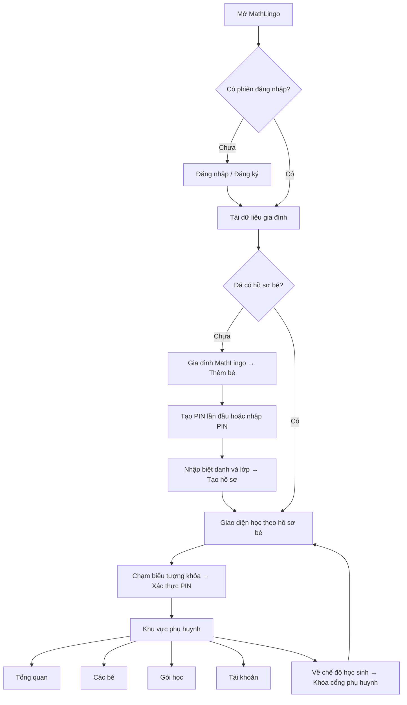
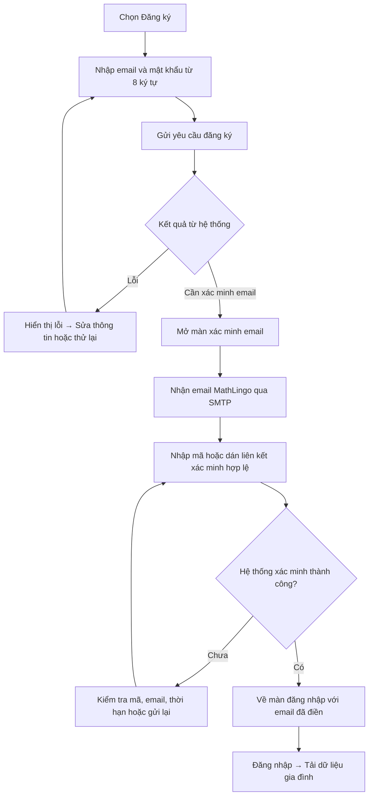
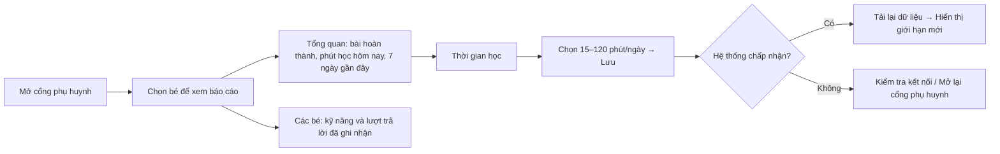
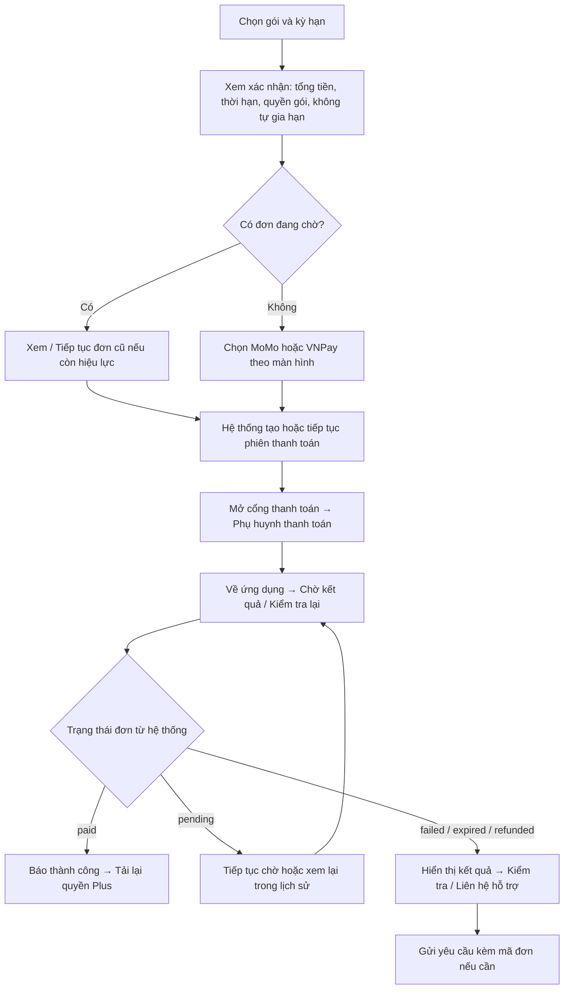

# MathLingo — Luồng tương tác của phụ huynh

Cập nhật: **21/10/2026**. Tài liệu đối chiếu mã nguồn hiện có trong workspace, mô tả thao tác trên ứng dụng bằng tài khoản phụ huynh và các trạng thái cần xử lý.

**Phạm vi xác nhận:** SMTP đăng ký đã cấu hình trên Supabase và người dùng đã nhận email thử. Thanh toán mô phỏng có lịch sử riêng và kênh cập nhật dữ liệu đã được bổ sung; xem [kịch bản demo](D:/DEMO/PRM391/DEMO_SCENARIO.md) và [kết quả kiểm thử](D:/DEMO/PRM391/DEMO_TEST_REPORT_20261021.md). Merchant thật vẫn có phần backend chưa triển khai; xem mục 9.

## 1. Vai trò và điểm vào

Phụ huynh đăng nhập bằng email và mật khẩu, quản lý các hồ sơ bé trong cùng gia đình. Mỗi bé có biệt danh, lớp và tiến độ riêng. Sau đăng nhập, ứng dụng vào giao diện học; phụ huynh mở **Cổng phụ huynh** bằng PIN để quản lý gia đình.

| Không gian | Mục hiển thị | Mục đích |
|---|---|---|
| Giao diện học | Trang chủ, Bài học, Luyện tập, Hồ sơ | Cho bé học theo hồ sơ được chọn |
| Khu vực phụ huynh | Tổng quan, Các bé, Gói học, Tài khoản | Theo dõi học tập và quản lý gia đình |
| Các màn hình phụ | Thông báo, Hỗ trợ gia đình, Gói học tập, Tài khoản phụ huynh | Xem thông tin và thực hiện tác vụ cụ thể |

Nếu tải dữ liệu thất bại, dùng **Thử tải lại**; không suy ra gia đình chưa có bé chỉ từ lỗi kết nối.

## 2. Đăng ký, xác minh email và đăng nhập

- Email đăng ký được gửi bởi Supabase Auth qua SMTP; mã được xác minh với hệ thống.
- Màn xác minh có đếm ngược 60 giây trước khi gửi lại. Giới hạn gửi của hệ thống vẫn có thể áp dụng.
- Tài khoản chưa xác minh được hướng dẫn hoàn tất xác minh trước khi đăng nhập.
- **Quên mật khẩu:** yêu cầu email khôi phục → xác minh mã/liên kết khôi phục → nhập mật khẩu mới và xác nhận → đăng nhập lại.
- Liên kết mở ứng dụng trên iOS chưa được nghiệm thu. Có thể nhập mã trực tiếp trong màn xác minh.

## 3. Mở khóa khu vực phụ huynh

| Trạng thái | Thao tác | Kết quả |
|---|---|---|
| Chưa có PIN | Tạo PIN 4 chữ số; màn hình yêu cầu không dùng `1234` | Lưu PIN trên hệ thống rồi xác thực để tiếp tục |
| Đã có PIN | Nhập PIN → Mở khóa | Vào cổng phụ huynh hoặc tiếp tục tác vụ vừa yêu cầu |
| PIN sai / không kết nối | Đọc thông báo lỗi, kiểm tra kết nối và thử lại | Không mở chức năng quản lý |
| Sai PIN nhiều lần | Màn hình thông báo sai 5 lần sẽ khóa 5 phút | Chờ theo trạng thái hệ thống |
| Phiên mở khóa hết hạn | Mở lại cổng và nhập PIN | Tiếp tục sau khi xác thực lại |
| Chọn Về chế độ học sinh | Thoát cổng | Khóa quyền thao tác phụ huynh trong phiên hiện tại |

Phiên mở khóa có thời hạn; ứng dụng hiện đặt thời hạn cục bộ 14 phút sau xác thực. Các thao tác nhạy cảm còn được hệ thống kiểm tra quyền. Không coi việc đăng nhập email là đã mở khóa bằng PIN.

Mở hoặc khóa PIN ở một phiên chỉ tác động phiên đó. Đổi PIN thu hồi mọi token mở khóa trước đó; ứng dụng xác thực lại với PIN mới sau khi đổi thành công.

## 4. Quản lý hồ sơ bé

Điểm vào: **Khu vực phụ huynh → Các bé**.

| Nhu cầu | Thao tác | Kết quả mong đợi |
|---|---|---|
| Thêm bé | Thêm bé → nhập biệt danh → chọn lớp 1–5 → Tạo Hồ Sơ | Hồ sơ được lưu và tải lại trong gia đình |
| Sửa thông tin | Sửa hồ sơ → sửa biệt danh/lớp → Lưu thay đổi | Hiển thị thông tin mới; đổi lớp giữ tiến độ lớp cũ |
| Tạm ngừng dùng hồ sơ | Sửa hồ sơ → Lưu trữ hồ sơ → xác nhận | Ẩn khỏi danh sách học; giữ thành tích, sao và trang phục |
| Dùng lại hồ sơ | Chọn hồ sơ đã lưu trữ → Khôi phục | Phục hồi theo giới hạn và quyền gói hiện tại |
| Chọn bé dùng Basic | Chọn học với Basic | Hệ thống cập nhật bé được phép học với Basic |
| Chuyển bé đang học | Về chế độ học sinh → mở bộ chọn hồ sơ → chọn bé | Giao diện học chuyển sang hồ sơ tương ứng trong quyền hiện có |

**Quyền gói:** Basic cho một bé học; Plus hỗ trợ tối đa ba hồ sơ hoạt động theo quyền hiện tại. Hết Plus không xóa hồ sơ hoặc thành tích; phụ huynh chọn một bé học với Basic. Chọn bé để xem báo cáo, chuyển hồ sơ trên giao diện học và chọn bé có quyền Basic là ba thao tác khác nhau.

Nếu lưu/khôi phục thất bại, ứng dụng báo kiểm tra kết nối, PIN và giới hạn gói; chỉ coi thay đổi thành công khi hệ thống xác nhận.

## 5. Theo dõi học tập và đặt giới hạn

- **Tổng quan:** xem số bài đã hoàn thành, thời lượng hôm nay so với giới hạn, biểu đồ bảy ngày và bài học gần nhất.
- Trạng thái bài gần nhất phân biệt đã hoàn thành, đang học và đang tạm dừng theo dữ liệu phiên học. “Đang học” phụ thuộc tín hiệu hoạt động gần đây.
- **Các bé:** xem độ chính xác theo kỹ năng và số lượt trả lời. Khi chưa đủ dữ liệu, màn hình hiển thị trạng thái trống.
- Giới hạn học điều chỉnh theo bước 5 phút. Hủy hộp thoại không lưu thay đổi.
- Báo cáo được tải khi mở cổng và làm mới định kỳ 30 giây khi màn hình đang hoạt động, cổng còn mở khóa. Có thời điểm cập nhật và thao tác **Cập nhật dữ liệu**.
- Dữ liệu gia đình và phiên học còn kích hoạt tải lại qua kênh sự kiện giữa các phiên; có tải lại dự phòng khoảng 30 giây khi app hoạt động. Nhịp thời gian học gửi khoảng 20 giây/lần; không coi mọi chỉ số là thay đổi ngay từng giây.
- Khi có lỗi, dùng **Thử lại**; dữ liệu đang hiển thị có thể là lần đồng bộ trước.

## 6. Xem gói, dùng thử và thanh toán

Điểm vào: **Gói học → Xem gói và lịch sử mua**. Màn Gói học tập yêu cầu mở khóa khu vực phụ huynh.

### 6.1. Gợi ý theo tình trạng tài khoản

Thứ tự ưu tiên trong mã nguồn hiện tại:

| Trạng thái tài khoản | Nội dung hướng dẫn |
|---|---|
| Có đơn đang chờ | Kiểm tra hoặc tiếp tục đơn đó trước khi mua thêm |
| Đang dùng thử | Hiển thị số ngày còn lại để trải nghiệm trước khi quyết định |
| Plus đang hiệu lực | Tiếp tục dùng; có thể mua thêm để kéo dài thời hạn |
| Plus không thời hạn | Thông báo không cần mua thêm |
| Basic, còn lượt dùng thử và có gói thử đang mở | Có thể dùng thử trước |
| Basic, không thuộc các trường hợp trên | Basic vẫn miễn phí; cân nhắc Plus khi cần thêm hồ sơ hoặc toàn bộ lộ trình |

Gói, giá và kỳ hạn lấy từ danh mục đang mở bán. Gợi ý dựa trên trạng thái tài khoản, không tự chọn ngẫu nhiên gói tháng/năm cho phụ huynh.

### 6.2. Dùng thử

**Chọn dùng thử → nhập/lưu thông tin ví nếu chưa có → gửi yêu cầu kích hoạt → tải lại quyền gói.** Việc dùng thử phụ thuộc lượt đã sử dụng và danh mục hiện hành. Thông tin ví hiện chỉ được lưu, chưa xác minh quyền sở hữu ví; thao tác này không tự động trừ tiền.

### 6.3. Mua và nhận quyền học

- Việc mở cổng thanh toán hoặc quay lại ứng dụng chưa đủ để xác nhận đã trả tiền. Ứng dụng chỉ báo thành công khi đọc được trạng thái `paid` từ hệ thống.
- Đơn được lưu trên hệ thống để xem lịch sử và đối chiếu; ứng dụng không tự xóa đơn khi thoát màn chờ.
- Màn chờ kiểm tra định kỳ khoảng 3 giây và kiểm tra khi quay lại ứng dụng. Sau thời gian chờ tối đa 15 phút, phụ huynh vẫn có thể kiểm tra lại.
- Nếu đã xác nhận `paid` nhưng tải quyền học thất bại, giữ kết quả thanh toán và tải lại quyền sau; tránh mua lại chỉ vì giao diện chưa cập nhật.
- Nếu đã bị trừ tiền nhưng đơn chưa rõ kết quả, kiểm tra đơn cũ hoặc gửi hỗ trợ kèm mã đơn trước khi thanh toán thêm.
- Lịch sử mua có trạng thái, mã đơn, thời điểm, kiểm tra thanh toán, tiếp tục đơn còn hiệu lực và liên hệ hỗ trợ. Kết quả kiểm tra phụ thuộc backend đã triển khai.

### 6.4. Thanh toán mô phỏng cho demo

**Thanh toán demo · không thu tiền → xem mã đơn và giá trị mô phỏng → Giả lập thanh toán thành công → server lưu trạng thái paid và cấp Plus demo → xem Lịch sử thanh toán mô phỏng.**

Giao dịch lưu ở sổ demo riêng, có mã `DEMO-`, không ghi thành payment MoMo/VNPay hoặc doanh thu merchant. Phụ huynh chỉ đọc giao dịch của mình; admin xem được lịch sử demo. Xác nhận lại cùng giao dịch không cộng thêm kỳ Plus. Nút demo phụ thuộc cấu hình có thời hạn trên server.

## 7. Thông báo và hỗ trợ

| Điểm vào | Luồng tương tác |
|---|---|
| Biểu tượng thông báo trong cổng phụ huynh | Xem thông báo của gia đình theo trang → nhận biết đã đọc/chưa đọc qua biểu tượng → chạm thông báo chưa đọc để đánh dấu đã đọc |
| Tổng quan → Hỗ trợ hoặc Tài khoản → Liên hệ hỗ trợ | Gửi yêu cầu mới → nhập nội dung ít nhất 5 ký tự → Gửi → theo dõi trạng thái và phản hồi |
| Lịch sử mua → hỗ trợ đơn hàng | Mở Hỗ trợ gia đình với mã đơn → gửi mô tả → theo dõi phản hồi |

Yêu cầu hỗ trợ hiển thị **Đang chờ hỗ trợ** hoặc **Đã phản hồi**. Phụ huynh đọc phản hồi do bộ phận quản trị gửi; thao tác phản hồi và hoàn tất yêu cầu thuộc khu vực quản trị.

## 8. Tài khoản, PIN và bàn giao cho bé

| Tác vụ | Luồng |
|---|---|
| Đổi mật khẩu | Tài khoản → Bảo mật tài khoản → nhập mật khẩu hiện tại, mật khẩu mới từ 8 ký tự và xác nhận → lưu → đăng xuất → đăng nhập lại |
| Đổi PIN | Tài khoản → Đổi PIN phụ huynh → nhập PIN hiện tại, PIN mới 4 chữ số và xác nhận → lưu lên hệ thống |
| Đổi tùy chọn | Tài khoản → bật/tắt Âm thanh phản hồi hoặc Giao diện tối |
| Đăng xuất | Bảo mật tài khoản → Đăng xuất khỏi thiết bị → về màn đăng nhập |
| Bàn giao cho bé | Về chế độ học sinh → cổng phụ huynh bị khóa → bé tiếp tục học bằng hồ sơ được chọn |

Trường PIN hiện tại dùng PIN phụ huynh đã tạo. Nhãn gợi ý PIN mặc định cũ đã được bỏ.

## 9. Trạng thái triển khai và nguồn đối chiếu

| Hạng mục | Trạng thái tại thời điểm cập nhật |
|---|---|
| SMTP và email xác minh đăng ký | Đã lưu cấu hình trên Supabase; người dùng xác nhận nhận email thử |
| Nhập mã xác minh, đăng nhập, tạo bé và thao tác trên thiết bị | Có luồng trong mã nguồn; chưa xác nhận hoàn tất toàn bộ E2E trên thiết bị trong lần viết tài liệu này |
| Gợi ý mua theo tài khoản, ưu tiên đơn chờ, giao diện chờ thanh toán | Đã có bản sửa local; cần dùng đúng bản ứng dụng chứa thay đổi |
| Thanh toán mô phỏng, lịch sử demo, cập nhật giữa các phiên và khóa PIN theo phiên | Đã bổ sung mã app và áp dụng migration mới lên Supabase phát triển; xem báo cáo kiểm thử demo |
| Giữ đơn ở backend, lưu lượt checkout MoMo, đối soát MoMo, khóa demo và kiểm tra provider | Migration mới cùng sáu Edge Functions còn chờ triển khai, theo báo cáo sửa lỗi |
| Thu tiền merchant thật và cấp quyền sau giao dịch thật | Chưa nghiệm thu; không suy ra đã sẵn sàng vận hành từ sơ đồ |

Nguồn để cập nhật khi luồng ứng dụng thay đổi:

- [Điểm vào và điều hướng chính](D:/DEMO/PRM391/lib/features/main/main_screen.dart), [đăng nhập/đăng ký](D:/DEMO/PRM391/lib/features/auth/auth_screen.dart), [xác minh email](D:/DEMO/PRM391/lib/features/auth/email_verification_screen.dart).
- [Cổng PIN](D:/DEMO/PRM391/lib/features/parent_portal/popups/parent_gate_dialog.dart), [điều phối phụ huynh](D:/DEMO/PRM391/lib/features/parent_portal/screens/parent_portal_screen.dart), [bốn mục quản lý](D:/DEMO/PRM391/lib/features/parent_portal/screens/parent_dashboard_view.dart).
- [Thêm bé](D:/DEMO/PRM391/lib/features/kid_profile/popups/add_kid_dialog.dart), [sửa/lưu trữ bé](D:/DEMO/PRM391/lib/features/kid_profile/popups/edit_kid_dialog.dart), [state và quyền gia đình](D:/DEMO/PRM391/lib/data/providers/app_state_provider.dart).
- [Gói học và lịch sử mua](D:/DEMO/PRM391/lib/features/subscriptions/learning_packages_screen.dart), [quy tắc gợi ý](D:/DEMO/PRM391/lib/data/models/purchase_guidance.dart), [chờ thanh toán](D:/DEMO/PRM391/lib/features/subscriptions/payment_waiting_screen.dart).
- [Thông báo](D:/DEMO/PRM391/lib/features/parent_portal/screens/notifications_screen.dart), [hỗ trợ](D:/DEMO/PRM391/lib/features/parent_portal/screens/support_screen.dart), [tài khoản](D:/DEMO/PRM391/lib/features/auth/account_screen.dart).
- [Trạng thái SMTP](D:/DEMO/PRM391/supabase/SMTP_SETUP.md), [bản sửa và phần backend còn chờ](D:/DEMO/PRM391/FIX_REPORT_20261021.md).
- Tài liệu nền để đối chiếu kiến trúc: [kế hoạch role/commerce](D:/DEMO/PRM391/ROLE_COMMERCE_DEVELOPMENT_PLAN.md), [tích hợp Supabase](D:/DEMO/PRM391/SUPABASE_INTEGRATION_STATUS.md), [kiểm toán database](D:/DEMO/PRM391/supabase/DB_AUDIT.md). Các mốc lịch sử trong những tài liệu này cần được đọc cùng trạng thái triển khai nêu trên.
