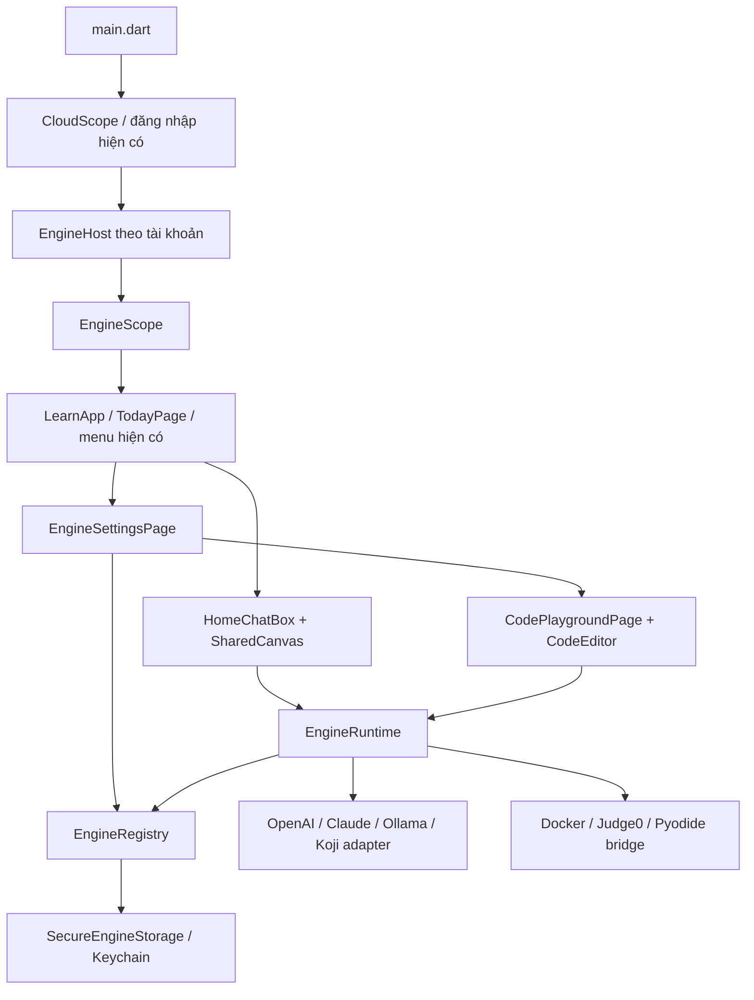

# Mở rộng kiến trúc học tương tác trên codebase hiện tại

Ứng dụng tiếp tục dùng Flutter, `LearnApp`, `LearningStore`, catalog thí nghiệm,
`HomeChatBox`, `AppLayout` và theme REA hiện có. Không thay router, framework,
schema Supabase, font, bảng màu hay bộ tương tác bài học.

## Luồng tích hợp



UI chỉ bắt sự kiện và hiển thị. Truy cập secure storage nằm trong repository;
HTTP nằm trong adapter. Khóa engine không thuộc `LearningStore`, không dùng
SharedPreferences và không được đưa vào payload sao lưu Supabase.

## Cấu trúc được thêm

```text
lib/
  data/
    models/
      engine_config.dart          # Provider, loại engine, cấu hình không chứa khóa
      learning_modules.dart       # Canvas, tutor, coding, roadmap, quiz, mastery
    repositories/
      engine_storage.dart         # Interface storage + implementation bảo mật
      engine_registry.dart        # Đăng ký, cập nhật, chọn, xóa, khôi phục
      engine_runtime.dart         # Adapter factories và điều phối hot-swap
      catalog_roadmaps.dart        # Tham chiếu lại 11 chủ đề hiện có
    engines/
      engine_contracts.dart       # AiEngine, CodeExecutionEngine, bridge
      engine_http.dart            # HTTP giới hạn response, không theo redirect
      http_ai_engine.dart         # OpenAI, Claude, Ollama, Koji
      http_code_engine.dart       # Docker API và Judge0 polling
  features/
    engines/
      engine_scope.dart           # Lifecycle theo tài khoản, nối ChatResponder
      engine_settings_page.dart   # CRUD kết nối và chọn engine đang dùng
    tutor/shared_canvas.dart      # Nét vẽ chuẩn hóa, overlay và bounding box
    coding/
      code_editor.dart            # Python/JavaScript lexical highlighting
      code_playground_page.dart   # Mẫu thực hành, stdin, stdout/stderr/errors
    assessment/mastery_widgets.dart # Quiz và dashboard nhận dữ liệu qua props
```

Các file cầu nối và component học cũ giữ nguyên. `main.dart` chỉ thêm
`EngineHost` bao quanh `LearnApp`; `TodayPage` nhận responder từ `EngineScope`
khi chưa được truyền responder riêng. Test/integration dùng `ChatResponder`
cũ vẫn hoạt động. Menu có thêm **Engine học tập**.

## EngineRegistry

### Gia sư mặc định cho người dùng đã đăng nhập

Bản mobile có cấu hình Supabase dùng `tutor-chat` làm gia sư mặc định khi chưa
chọn engine cá nhân. Không cần người dùng nhập API key. `main.dart` truyền factory
repository cho `EngineHost`; repository gửi JWT hiện tại và kiểm tra đúng tài khoản
trước/sau request. Engine cá nhân đang dùng vẫn được ưu tiên. Đăng xuất/đổi tài khoản
đóng request cũ và không nhận phản hồi trễ vào phiên mới.

Provider key chỉ nằm trong Supabase Edge secrets `GEMINI_API_KEY`; `GEMINI_MODEL`
chọn model server (mặc định `gemini-3.5-flash-lite`). Không đưa provider key vào
`config/app.mobile.json`, dart defines hoặc APK. Hàm xác thực với Auth và kiểm tra
`get_my_access()` có trạng thái active trước khi gọi Gemini. Không lưu lịch sử chat
ở server, không ghi XP, không cần migration. Model, endpoint và system instruction
do server quyết định; client chỉ gửi messages/canvas.

Triển khai riêng `tutor-chat` bằng CLI với `--no-verify-jwt --use-api`; handler tự
xác thực JWT qua Auth, tương tự `learning-api`. Cấu hình secrets qua Dashboard hoặc
`supabase secrets set --env-file` với file ngoài Git. Không deploy các stub retired.
Giới hạn payload 300 KB, 60 messages/50.000 ký tự, 2.048 output tokens và timeout
Gemini 35 giây. Giới hạn burst 10 request/phút/tài khoản chỉ có hiệu lực trong từng
isolate; đây không phải quota phân tán. Quota/budget chung cần cấu hình trên Google
Cloud cho project dùng khóa. Test mock: `test/default_tutor_test.dart` và
`supabase/tests/tutor_handler_test.ts`.

- `initialize()`: đọc snapshot bảo mật version 1. Nếu hỏng hoặc thiết bị khóa,
  báo lỗi và khóa mutation; không tự ghi đè dữ liệu cũ.
- `register(config, credential: ...)`: thêm engine, từ chối ID trùng.
- `update(config, credential: ..., clearCredential: ...)`: cập nhật metadata,
  xoay hoặc xóa khóa. Bỏ trống credential khi sửa sẽ giữ khóa cũ.
- `activate(kind, id)`: chọn AI/code độc lập; kiểm tra đúng loại.
- `remove(id)`: xóa cấu hình, khóa và lựa chọn đang trỏ tới engine đó.
- `resolve(kind)`: snapshot immutable dành cho runtime, không log/serialize.
- `engines`, `active(kind)`, `hasCredential(id)`: metadata dành cho UI, không lộ khóa.

Mọi mutation xếp hàng, ghi một snapshot vào secure storage rồi mới cập nhật
state và thông báo listener. Ghi thất bại không đổi engine đang chạy và không
làm hỏng hàng đợi. Cấu hình, credential và lựa chọn dùng cùng một storage record
để tránh trạng thái không đồng nhất giữa hai kho. Khả năng ghi nguyên tử vật lý
phụ thuộc nền tảng secure storage; không có database transaction xuyên OS.

`EngineHost` dùng namespace theo Auth user ID. Khi đổi tài khoản, runtime cũ
đóng client đang hoạt động và không trả kết quả muộn vào phiên mới. Bản offline
phát triển dùng namespace `device`; cấu hình đó không tự chuyển sang tài khoản cloud.

```dart
final registry = EngineRegistry(SecureEngineStorage(accountId));
await registry.initialize();
await registry.register(EngineConfig(
  id: 'koji-school',
  name: 'Koji của trường',
  provider: EngineProvider.koji,
  endpoint: Uri.parse('https://your-gateway.example/tutor'),
  model: 'your-model-id',
), credential: tokenFromUserInput);
await registry.activate(EngineKind.tutor, 'koji-school');

final runtime = EngineRuntime(registry);
final reply = await runtime.respond(TutorRequest(messages: [
  const TutorMessage(TutorRole.user, 'Gợi ý giúp mình bước đầu.'),
]));
// Lần respond tiếp theo tự lấy engine vừa chọn, không cần restart.
```

Không nhúng provider key dùng chung vào app. Bản phân phối nên dùng gateway
với token cá nhân/thời hạn ngắn và giữ provider secret phía server. Registry
cũng hỗ trợ khóa do chính người dùng nhập; secure storage không khiến thiết bị
bị root/jailbreak trở thành nơi giữ bí mật tuyệt đối.

Khi đổi endpoint/provider có credential, phải nhập lại hoặc chủ động xóa khóa;
khóa cũ không được tự chuyển đến host mới. Chỉ chấp nhận HTTPS, không cho
userinfo/query/fragment trong endpoint. Ollama được chấp nhận HTTP ở loopback
hoặc `10.0.2.2`; chính sách cleartext/ATS của Android/iOS vẫn áp dụng. Bản mặc định
không mở cleartext toàn app: dùng HTTPS gateway khi chạy trên điện thoại.

Android tắt OS Auto Backup (`allowBackup=false`) để tránh sao chép ciphertext
sang thiết bị không có encryption key tương ứng; sao lưu tiến độ Supabase hiện
có vẫn hoạt động. iOS thêm entitlement Keychain và dùng `unlocked_this_device`.
Không có workflow import/export credential ra file thường.

## Giao thức adapter

Endpoint là URL **đầy đủ**, không tự nối suffix. Model do người dùng chọn theo
quyền truy cập thực tế; không gán một model mặc định có thể không tồn tại.

| Provider | Endpoint và hợp đồng |
|---|---|
| OpenAI | Responses-compatible `/v1/responses`: `model`, `instructions`, `input`, `store:false`; đọc `text` từ content có `type:output_text` |
| Claude | `/v1/messages`, bearer token, `anthropic-version:2023-06-01`, `messages`, `system`, `max_tokens`; đọc text content |
| Ollama | `/api/chat`, `stream:false`, `model`, `messages`; đọc `message.content` |
| Koji | Gateway tùy chỉnh nhận `model`, `messages`, `instructions`, `canvas?`; trả `{ "text": "..." }` |
| Docker | Gateway nhận `source`, `language`, `stdin`, `limits`; trả `stdout`, `stderr`, `exitCode`, `error` |
| Judge0 | Endpoint `/submissions`; base64, token polling, `X-Auth-Token` nếu cần; đọc status/compile/runtime errors |
| Pyodide | `embedded:pyodide`, gọi bridge được host gắn bằng `runtime.attachPyodide(runner)` |

Judge0 language ID phải lấy từ `/languages` của server đang dùng. Không giả định
ID chung giữa mọi deployment. Hosted gateways dùng scheme khác (vd RapidAPI)
cần adapter riêng qua `registerCodeAdapter`.

Timeout áp dụng toàn bộ request ở `EngineRuntime`. HTTP response tối đa 1 MiB,
không tự theo redirect, lỗi UI không chứa raw response body hoặc credential.
Lệnh đổi engine không tự hủy request cùng tài khoản đang chạy: request đó giữ
config/credential cũ; request mới lấy config mới. Đổi tài khoản/dispose đóng client.

Client chỉ yêu cầu giới hạn CPU/RAM/network; **server sandbox phải thực sự thi
hành các giới hạn**, cô lập filesystem/process, xác thực và rate-limit. Không có
Docker daemon, compiler, server deployment hay code evaluation trong app Dart.
Pyodide cần WebView/worker và policy sandbox riêng; hiện không giả lập kết quả
hay tự chạy `eval` trên thiết bị. Một timeout không đảm bảo remote job bị hủy.

## Module học tập và phần còn lại

| Module | Đã có trong lần tích hợp này | Cần tích hợp tiếp |
|---|---|---|
| Koji | Engine text, chat cũ, canvas có nét vẽ/overlay/bounding box; gửi canvas khi người học mở bảng | Đồng bộ canvas nhiều người, nhận annotation tự động từ model, voice STT/TTS adapter và permission |
| Coding | Editor Python/JS có highlight cơ bản, mẫu ma trận ảnh và kiểm tra URL mô phỏng, API client/hiển thị kết quả | Lưu draft theo profile, debugger, autocomplete, backend sandbox được triển khai |
| Đánh giá | `QuizQuestion`, `AssessmentRepository`, `MasteryMetric`, quiz/dashboard widget | Kho câu hỏi và adapter lưu kết quả, nối vào màn progress thật |
| Cá nhân hóa | `MasteryPathwayController.next()` tôn trọng prerequisite, đề nghị luyện 5/10 phút; không tự coi hoàn thành là mastery | Đưa metric đánh giá thực vào controller, nối recommendation hiện có khi có đủ dữ liệu |
| Lộ trình | Bốn domain và adapter tái dùng toàn bộ catalog hiện tại, kiểm tra prerequisite và chu trình | Nội dung khóa AI chuyên biệt và metadata prerequisite được biên soạn |
| Báo cáo | `ProgressReport`, `ProgressNotificationService` interface | Native notification adapter, xin quyền theo thao tác người dùng, lịch gửi |

Các widget đánh giá là component tái sử dụng, chưa gắn vào điều kiện hoàn thành
bài học cũ. Chỉ đánh giá cá nhân, không ghi `xp_ledger`, không cấp thưởng server.
Mẫu Web Security là xử lý chuỗi URL giả định trong sandbox, không gọi mục tiêu ngoài.
Canvas/chat và bản nháp playground hiện ở bộ nhớ màn hình, không tự thêm vào
payload Supabase hoặc chuyển thành lịch sử học đã xác thực.

## Kiểm tra

`test/engine_registry_test.dart` kiểm tra persistence, cách ly namespace, mutation
đồng thời, lỗi ghi, credential rotation, hot-swap/in-flight, protocol AI, Judge0,
redirect và roadmap. `test/engine_widgets_test.dart` kiểm tra CRUD trên màn nhỏ,
không hiển thị khóa cũ, chat/canvas tích hợp, chạy mã theo thao tác và quiz/dashboard.
Các adapter test dùng mock transport, không tiêu tiền API và không chạy code trên
dịch vụ thật. iOS cần build/ký và kiểm tra Keychain trên macOS/thiết bị thật.

Kết quả 26/10/2026: analyze sạch, toàn bộ 125 test qua; 50 kiểm tra interaction,
2.491 kiểm tra depth và 17.552 kiểm tra geometry qua; APK debug có cấu hình cloud
build thành công và mở trên emulator Pixel 9 Android 15. Menu đăng xuất kết thúc
phiên cloud để đóng runtime theo tài khoản. Đã xem ảnh `build/engine-settings-preview.png` với font thật,
viewport 320px và text scale 1.4. Chưa kiểm tra provider key thật hoặc sandbox thật.

Tài liệu giao thức đã đối chiếu:
[OpenAI text generation](https://developers.openai.com/api/docs/guides/text),
[Claude Messages](https://platform.claude.com/docs/en/api/messages/create),
[Claude authentication](https://platform.claude.com/docs/en/manage-claude/authentication),
[Ollama chat](https://docs.ollama.com/api/chat),
[Judge0](https://ce.judge0.com/),
[flutter_secure_storage](https://pub.dev/packages/flutter_secure_storage).
