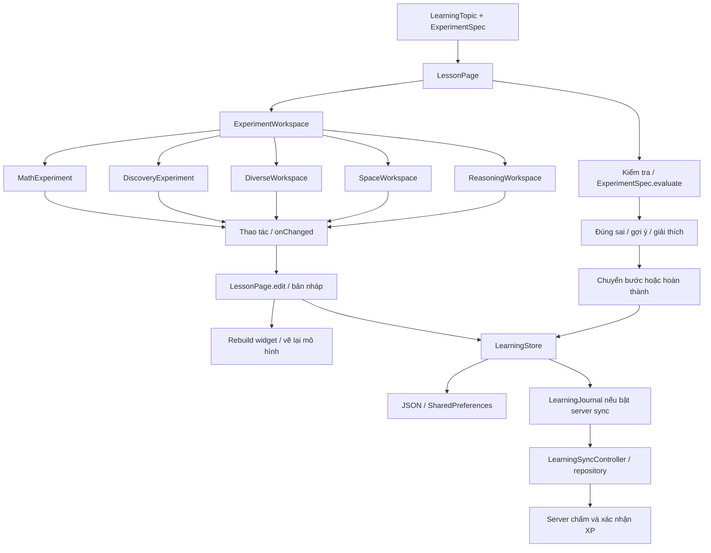

# Matlingo — Tech stack và engine bài học tương tác

Ngày đối chiếu mã nguồn: **28/10/2026**. Phiên bản ứng dụng khai báo: **1.3.2+6**.

## 1. Tổng quan

Engine bài học tương tác của Matlingo được triển khai bằng **Flutter và Dart**, kết hợp widget nhận thao tác, Canvas vẽ mô hình, bộ chấm theo trạng thái và lưu tiến độ trên thiết bị.

Đơn vị nội dung là `ExperimentSpec`. Các hoạt động được ghép thành `LearningTopic`. `LessonPage` điều phối từng bước; `ExperimentWorkspace` chọn widget phù hợp theo `mechanism`. Người học thao tác với mô hình, bấm **Kiểm tra**, nhận phản hồi rồi chuyển sang hoạt động tiếp theo khi đáp ứng điều kiện.

Catalog hiện tại có **13 chủ đề, 71 hoạt động và 31 cơ chế tương tác** theo catalog và test của working tree. Một cơ chế có thể được dùng lại cho nhiều hoạt động với tham số hoặc ràng buộc khác nhau.

## 2. Tech stack

| Tầng | Công nghệ / thành phần | Vai trò thực tế |
|---|---|---|
| Framework ứng dụng | Flutter; CI ghim Flutter `3.47.4` | Giao diện mobile, điều hướng, layout, input và rendering |
| Ngôn ngữ | Dart; pubspec yêu cầu `^3.13.3` | Mô hình nội dung, tính toán, evaluator và điều phối phiên học |
| UI | Material widgets, StatefulWidget, StatelessWidget | Màn học, nút kiểm tra, gợi ý, thanh điều khiển và phản hồi |
| Đồ họa 2D | `CustomPainter`, `CustomPaint`, `Canvas`, `Path`, `Paint` | Vẽ cân, bánh răng, hình học, mạch điện và mô hình dữ liệu |
| Input | `GestureDetector`, `Draggable`, `DragTarget`, Slider, Button | Chạm, kéo, thả, vuốt, xoay và điều chỉnh tham số |
| Chuyển động | `TweenAnimationBuilder`, `AnimationController`, `AppMotion` | Nội suy trạng thái hiển thị, mô phỏng và chuyển cảnh; hỗ trợ giảm chuyển động |
| Tính toán | `dart:math` và các hàm Dart thuần | Góc, lượng giác, hình học, ràng buộc, xác suất và phép chiếu |
| Mô hình 3D | `Point3`, `SolidScene`, `ProjectedFace` tự viết | Xoay đỉnh, chiếu lên mặt phẳng, sắp mặt theo độ sâu và tô bóng |
| State phiên học | State của `LessonPage`, callback `onChanged`, `LearningStore` / ChangeNotifier | Bản nháp, bước hiện tại, lần kiểm tra, hoàn thành và cập nhật UI |
| Dữ liệu cục bộ | `shared_preferences: ^2.5.6`, JSON snapshot version 3 | Hồ sơ, bản nháp, lịch sử, thời gian học và trạng thái đồng bộ |
| Cloud tùy cấu hình | `supabase_flutter: 2.18.3`, repository và controller đồng bộ | Auth, sao lưu cá nhân, gửi phiên/bài làm để server xác nhận |
| HTTP | `http: 1.6.0` | Giao tiếp dịch vụ qua data layer; không nằm trong painter hoặc widget thí nghiệm |
| Test | `flutter_test`, `integration_test`, Dart checks, Node.js parity checks | Kiểm tra evaluator, UI, lưu/khôi phục và luồng Android |

Các phiên bản package trong bảng là khai báo của dự án, không phải thông tin về phiên bản mới nhất trên thị trường. Engine bài học lõi hoạt động offline; tính năng cloud cần cấu hình và xác thực phù hợp.

## 3. Cấu trúc engine

Đây là sơ đồ kiến trúc và luồng dữ liệu, không phải Use Case Diagram. `LearningStore` là đối tượng state dùng chung; UI lắng nghe thay đổi bằng cơ chế Flutter như `ListenableBuilder`.

### 3.1. Nội dung: ExperimentSpec

| Thành phần | Ý nghĩa |
|---|---|
| `id`, `title`, `stage` | Định danh, tiêu đề và giai đoạn học |
| `prompt`, `hint`, `explanation` | Đề bài, gợi ý và giải thích |
| `mechanism` | Khóa chọn loại workspace tương tác |
| `initial` / `initialData()` | Trạng thái khởi đầu; tạo bản sao sâu qua JSON để tránh dùng chung dữ liệu mutable |
| `config` | Tham số của bài, tách khỏi trạng thái người học; ví dụ khối lượng mục tiêu hoặc các phương án |
| `validator` | Hàm Dart nhận trạng thái, trả đúng/sai |
| `evaluator` | Hàm tùy chọn trả kết quả chấm chi tiết; được ưu tiên nếu có |
| `skillIds` | Liên kết hoạt động với kỹ năng |
| `contentVersion`, `mechanismVersion` | Phiên bản nội dung và cơ chế, mặc định là 1 trong model |

`ExperimentData` là `Map<String, dynamic>`. Nội dung hiện được khai báo bằng mã Dart trong catalog; đây chưa phải trình soạn bài tổng quát nhận mọi loại hoạt động từ JSON từ xa.

### 3.2. Điều phối: LessonPage

`LessonPage` giữ `draft`, bước hiện tại, hồ sơ sở hữu phiên, trạng thái đang hoàn tất, đồng hồ và trạng thái gợi ý. Dữ liệu một hoạt động được dựng từ trạng thái ban đầu cộng bản nháp đã lưu.

Luồng chính:

1. Đọc bản nháp version 3 hoặc khởi tạo phiên học mới.
2. Lấy `ExperimentSpec` của bước hiện tại từ chủ đề.
3. Truyền `spec`, `data`, `locked`, `onChanged` cho workspace.
4. Khi người học sửa mô hình, `edit()` cập nhật state, đánh dấu đã tương tác và bỏ dấu đã kiểm tra của hoạt động đó.
5. Khi bấm Kiểm tra, tăng số lần thử và đánh dấu đã kiểm tra. Getter `correct` yêu cầu đồng thời: **đã tương tác, đã kiểm tra và state vượt qua bộ chấm**.
6. `next()` chỉ cho chuyển bước khi `correct` là true. Bước cuối gọi `LearningStore.finish()` rồi mở màn hoàn thành.

Điều này giúp dữ liệu `checked` cũ không tự trở thành bằng chứng trả lời đúng. Nếu hồ sơ đang mở khác hồ sơ sở hữu phiên, thao tác hoàn thành bị ngăn.

### 3.3. Chọn workspace

`ExperimentWorkspace` hiện chọn widget bằng chuỗi `mechanism`, theo thứ tự: `reasonedChoice` → nhóm Math → Discovery → Diverse → Space. Cơ chế chưa được hỗ trợ hiển thị thông báo thí nghiệm đang được chuẩn bị.

Đây là dispatch bằng điều kiện và các hàm `supports...`; chưa có cơ chế nạp plugin động cho loại bài học.

## 4. Các nhóm cơ chế tương tác

| Workspace | Số cơ chế | Các mechanism hiện có |
|---|---:|---|
| `MathExperiment` | 12 | `balanceBlocks`, `removeBothSides`, `gearRatios`, `fractionPaint`, `fractionFold`, `distributeObjects`, `launchAngle`, `motionTimeline`, `leverTorque`, `sortBars`, `histogramBins`, `redistributeMean` |
| `DiscoveryExperiment` | 12 | `polygonVertices`, `symmetryMirror`, `tangramRotate`, `robotRoute`, `loopBuilder`, `sortingNetwork`, `wireCircuit`, `switchLogic`, `colorMixer`, `probabilityBag`, `sampleSpace`, `probabilitySpinner` |
| `DiverseWorkspace` | 3 | `fractionNumberLine`, `logicalCounterexample`, `outlierExplorer` |
| `SpaceWorkspace` | 3 | `solidExplorer`, `globeExplorer`, `strataExplorer` |
| `ReasoningWorkspace` | 1 | `reasonedChoice` |

Nhóm Reasoning yêu cầu chọn cả kết quả và lý do. Phần mã Python trong bài Reasoning được hiển thị để đọc; việc chọn đáp án ở đây không chạy Python.

## 5. Đồ họa và mô phỏng

### 5.1. Mô hình 2D

Workspace kết hợp control Flutter với hình vẽ tùy chỉnh. State như số khối, góc phóng hoặc số vòng bánh răng được chuyển thành vị trí, màu, nét vẽ và chuyển động.

Phần preview khi kéo hoặc góc nhìn có thể nằm trong state cục bộ của widget. Dữ liệu bài làm chỉ thay đổi khi workspace phát `onChanged`. Cách commit cụ thể phụ thuộc từng control; không phải mọi cử chỉ đều chỉ ghi khi thả tay.

Các mô phỏng sử dụng công thức và ràng buộc phục vụ bài học. Dependency trực tiếp hiện tại không khai báo Flame, Unity hoặc một physics engine tổng quát.

### 5.2. Mô hình 3D

Phần 3D là một bộ mô hình hóa nhỏ bằng Dart, kết quả được vẽ lên Canvas Flutter:

1. `Point3` biểu diễn tọa độ x/y/z và xoay theo yaw/pitch.
2. `SolidScene.project()` chuẩn hóa kích thước, xoay các đỉnh và thực hiện phép chiếu phối cảnh cho khối hộp.
3. Tạo các `ProjectedFace`, sắp xếp theo độ sâu từ xa đến gần và dùng hệ số shade để tạo cảm giác khối.
4. `_SpacePainter` vẽ các mặt đã chiếu bằng Canvas.
5. Địa cầu dùng tọa độ cầu và phép suy ngược phép chiếu trực giao để chọn điểm trên bán cầu nhìn thấy; các lớp địa chất dùng mô hình nhiều lớp cùng thứ tự vật liệu.

Góc camera yaw/pitch thuộc state hiển thị của `SpaceWorkspace`. Điều kiện chấm khối dựa trên kích thước hoặc ràng buộc dữ liệu, không dựa vào việc xoay camera. Không nên mô tả bộ này là engine 3D tổng quát với scene editor, vật lý hoặc vật liệu PBR.

### 5.3. Animation và khả năng tiếp cận

`AppMotion` đọc thiết lập giảm chuyển động và accessibility từ `MediaQuery`. Những animation sử dụng helper này có thể rút thời lượng về 0. Control có nhãn, tooltip hoặc Semantics tùy workspace; mức bao phủ cần được kiểm tra theo từng màn hình.

Các bài học hiện được render bằng Flutter widget/Canvas. Không có WebView trong đường chọn workspace đang dùng. FPS trên điện thoại vật lý chưa được xác nhận bằng các kết quả kiểm thử hiện có.

## 6. Bộ chấm và phản hồi

`ExperimentSpec.evaluate(data)` gọi evaluator chi tiết nếu có; nếu không thì bọc kết quả validator. Nếu hàm chấm ném lỗi, model trả kết quả sai với `feedbackKey = invalid-state`.

`EvaluationResult` có:

- `isCorrect`: kết quả đúng/sai.
- `satisfiedConstraints`: các điều kiện đã đạt.
- `misconceptionCodes`: mã hiểu sai nếu evaluator cung cấp; không phải bài nào cũng sinh mã này.
- `feedbackKey`: khóa phản hồi; evaluator mặc định chỉ dùng validator vẫn có giá trị mặc định `try-again`, nên phải ưu tiên `isCorrect` khi xác định thành công.

Ví dụ thực tế ở Logic:

| Hoạt động | Trạng thái bài làm | Điều kiện đúng |
|---|---|---|
| Chiếc cân bí mật | `blocks` | 4 khối |
| Bóc từng lớp | `pairs` | Bỏ 3 cặp |
| Truyền chuyển động | `turns` | Bánh nhỏ quay 2 vòng |
| Hiệu chuẩn hộp bí mật | `blocks`, mục tiêu trong `config` | 6 khối; trạng thái ban đầu có 1 khối |
| Phản ví dụ | `a`, `b` | A sáng và B tắt |

Gợi ý theo ngữ cảnh nằm trong các module guidance; `LessonPage` lưu mức gợi ý từ 1 đến 3. Đây là logic nội dung/ràng buộc cục bộ, không yêu cầu gọi AI cho mỗi lần kiểm tra.

## 7. Lưu tiến độ, thời gian và hoàn thành

### 7.1. Bản nháp và lưu trên thiết bị

Bản nháp gồm bước hiện tại, trạng thái từng hoạt động, tập đã tương tác/đã kiểm tra, gợi ý, số lần thử, thời gian và mốc bắt đầu. `LearningStore` lưu JSON snapshot version 3 trong SharedPreferences bằng hàng đợi ghi tuần tự.

`LessonPage` lưu khi mở bài, khi chỉnh sửa/kiểm tra/chuyển bước và qua timer 15 giây khi đồng hồ đang chạy. Khi màn hình bị che hoặc ứng dụng rời trạng thái resumed, đồng hồ dừng và lên lịch lưu. Việc dispose cũng lên lịch lưu; lỗi ghi vẫn có thể xảy ra, nên callback lưu không đồng nghĩa chắc chắn đã ghi thành công.

Thời gian dùng `Stopwatch`, cộng vào `elapsedMs` và `activeMsByDay`. Đồng hồ chỉ chạy khi route hiện tại, ứng dụng active, chưa hoàn tất và đúng hồ sơ sở hữu.

### 7.2. Hoàn thành và XP

`LearningStore.finish()` kiểm tra hồ sơ sở hữu và chấm lại dữ liệu hoạt động trước khi ghi nhận hoàn thành. XP cá nhân tính theo số chủ đề hoàn thành, 30 XP/chủ đề; ôn tập ghi lịch sử nhưng không cộng trùng XP.

Khi bật server sync, journal được lưu cùng snapshot và controller gửi phiên, bản nháp, bài làm và yêu cầu hoàn thành qua repository. Server tự chấm và cấp XP đã xác nhận theo nội dung tương thích. XP cá nhân và XP đã xác nhận là hai chỉ số riêng.

Catalog mobile có 71 hoạt động; baseline server được tài liệu hiện tại ghi nhận là 53 hoạt động. Nội dung chưa published hoặc chưa tương thích được giữ chờ, không được suy ra là đã có XP server xác nhận. Sao lưu cá nhân phục vụ khôi phục hồ sơ, không thay thế quá trình server chấm bài.

## 8. Phân biệt với Engine Registry của AI/code

| Thành phần | Engine bài học tương tác | Engine Registry AI/code |
|---|---|---|
| Đầu vào | State của mô hình, thao tác và lựa chọn | Câu hỏi/ngữ cảnh hoặc chương trình Python/JavaScript |
| Xử lý | Công thức, validator/evaluator, widget và Canvas | Adapter gọi endpoint AI hoặc code execution đã cấu hình |
| Mạng | Không cần cho hoạt động và chấm cục bộ | Cần dịch vụ/bridge thích hợp theo provider |
| Lưu trạng thái | Draft và snapshot của hồ sơ | Cấu hình/kết nối và credential theo tài khoản |
| Vai trò | Dạy và kiểm tra bằng mô hình tương tác | Trợ lý chat, bảng vẽ làm ngữ cảnh và code playground |

Chi tiết phần kết nối xem [ENGINE_ARCHITECTURE.md](<D:/Brilliant Clone/brilliant_mobile/repo-history/docs/ENGINE_ARCHITECTURE.md>). Không nên gọi toàn bộ engine bài học là AI engine: các bài tương tác hiện tại có thể chạy và chấm cục bộ bằng Dart.

## 9. Bản đồ mã nguồn

| Nguồn | Trách nhiệm |
|---|---|
| [learning_catalog.dart](<D:/Brilliant Clone/brilliant_mobile/repo-history/lib/learning_catalog.dart>) | Ghép catalog và khai báo chủ đề |
| [experiment_model.dart](<D:/Brilliant Clone/brilliant_mobile/repo-history/lib/experiments/experiment_model.dart>) | Contract nội dung, state và kết quả chấm |
| [journey_app.dart](<D:/Brilliant Clone/brilliant_mobile/repo-history/lib/journey_app.dart>) | LessonPage, dispatch workspace và CompletionPage |
| [math_experiments.dart](<D:/Brilliant Clone/brilliant_mobile/repo-history/lib/experiments/math_experiments.dart>) | Workspace toán/mô phỏng và painter |
| [discovery_experiments.dart](<D:/Brilliant Clone/brilliant_mobile/repo-history/lib/experiments/discovery_experiments.dart>) | Hình học, lập trình hành động, mạch và xác suất |
| [diverse_workspace.dart](<D:/Brilliant Clone/brilliant_mobile/repo-history/lib/experiments/diverse_workspace.dart>) | Trục phân số, phản ví dụ và ngoại lệ dữ liệu |
| [space_workspace.dart](<D:/Brilliant Clone/brilliant_mobile/repo-history/lib/experiments/space_workspace.dart>) | UI khối, địa cầu, lớp địa chất và painter |
| [solid_model.dart](<D:/Brilliant Clone/brilliant_mobile/repo-history/lib/experiments/solid_model.dart>) | Toán 3D, phép chiếu và các ràng buộc |
| [reasoning_workspace.dart](<D:/Brilliant Clone/brilliant_mobile/repo-history/lib/experiments/reasoning_workspace.dart>) | Chọn đáp án kèm lý do |
| [deep_catalog.dart](<D:/Brilliant Clone/brilliant_mobile/repo-history/lib/experiments/deep_catalog.dart>) | Nội dung reasonedChoice và evaluator |
| [fraction_evaluation.dart](<D:/Brilliant Clone/brilliant_mobile/repo-history/lib/experiments/fraction_evaluation.dart>) | Ví dụ evaluator chi tiết có kiểm tra dữ liệu |
| [learning_store.dart](<D:/Brilliant Clone/brilliant_mobile/repo-history/lib/learning_store.dart>) | Lưu state, hồ sơ, hoàn thành và lịch sử |
| [learning_sync_controller.dart](<D:/Brilliant Clone/brilliant_mobile/repo-history/lib/data/providers/learning_sync_controller.dart>) | Điều phối gửi journal khi bật cloud |
| [app_motion.dart](<D:/Brilliant Clone/brilliant_mobile/repo-history/lib/app_motion.dart>) | Helper chuyển động và giảm chuyển động |
| [lesson_theme.dart](<D:/Brilliant Clone/brilliant_mobile/repo-history/lib/lesson_theme.dart>) | Theme theo chủ đề/bước học |
| [pubspec.yaml](<D:/Brilliant Clone/brilliant_mobile/repo-history/pubspec.yaml>) | SDK constraint và dependency |

`InteractiveWorkspace` trong [interactive_workspace.dart](<D:/Brilliant Clone/brilliant_mobile/repo-history/lib/interactive_workspace.dart>) là một component khác dùng model `Challenge`. Dispatcher của `LessonPage` hiện tại dùng `ExperimentWorkspace` và các workspace ở bảng trên; không lấy tên component cũ để mô tả nhầm đường chạy chính.

## 10. Cách mở rộng bài học

**Dùng lại cơ chế hiện có:** khai báo `ExperimentSpec` mới trong catalog phù hợp, đặt ID riêng, dữ liệu ban đầu, config và bộ chấm; ghép vào catalog của chủ đề. Kiểm tra state khởi đầu, state sai/đúng, dữ liệu không hợp lệ và lưu/khôi phục.

**Thêm cơ chế mới:** bổ sung widget xử lý input/render, khai báo cơ chế được hỗ trợ và nối vào dispatcher; giữ contract `spec/data/locked/onChanged`. Viết evaluator tương ứng và test có ý nghĩa cho thao tác/ràng buộc. Để nhận XP server xác nhận, phải bổ sung evaluator và phát hành nội dung backend tương thích; chỉ thêm UI mobile chưa đủ.

Không để painter gọi mạng hoặc ghi storage. Trạng thái hiển thị như camera và animation cần tách khỏi bằng chứng hoàn thành bài. Không tin cờ UI hoặc bản backup để cấp XP server xác nhận.

## 11. Bằng chứng kiểm thử và giới hạn

Kết quả từ lượt kiểm thử trước trong cùng phiên, không chạy lại vì lần này chỉ bổ sung tài liệu:

- 197 Flutter unit/widget test đạt; gồm hoàn thành 13 chủ đề bằng solution fixture, kiểm tra UI và trạng thái lưu.
- 1 Android integration test đạt với 12 checkpoint cho toàn bộ Logic, dùng thao tác UI, kiểm tra lưu/đọc lại và không cấp XP cá nhân trùng.
- 729 ca parity client/server đạt cho 53 hoạt động baseline.
- Các chương trình kiểm tra đạt 50 ca tương tác/domain, 2.491 ca chiều sâu bài và 17.552 ca không gian/3D/khôi phục.
- Flutter analyze và build APK debug đạt tại lượt trước.

Xem [cây test và báo cáo E2E](<D:/Brilliant Clone/brilliant_mobile/repo-history/docs/E2E_TEST_TREE_AND_REPORT.md>) để biết lệnh chạy lại, log và phạm vi bằng chứng. Các kết quả này không xác nhận FPS máy thật, mọi bài bằng gesture native, provider AI/code thật hoặc cloud E2E thật của lượt đó.
