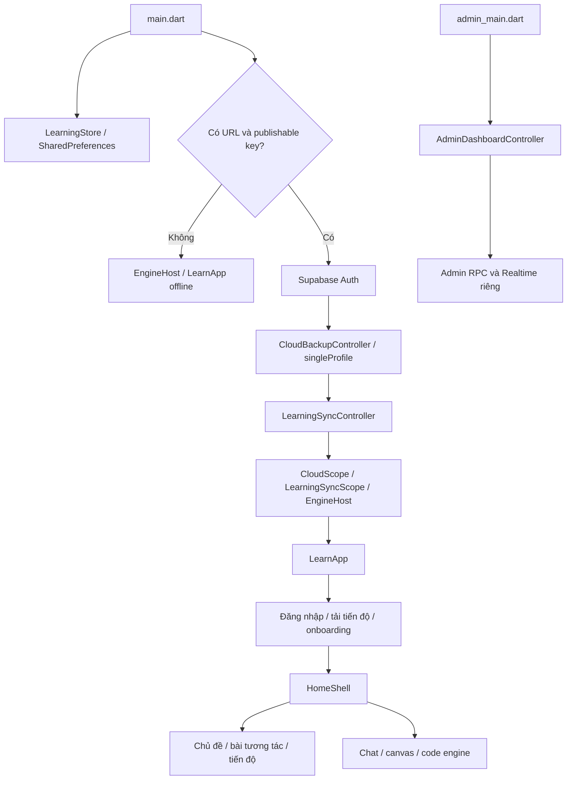

# Phân tích tổng thể dự án Matlingo

Ngày khảo sát: **02/11/2026**. Phiên bản khai báo: **1.3.2+6**. Commit nền: `36bf699` — Merge pull request #12, cộng các thay đổi có sẵn trong workspace.

## 1. Phạm vi và cách đọc báo cáo

Báo cáo phân tích repository tại `D:\Brilliant Clone\brilliant_mobile\repo-history`: điểm khởi chạy, giao diện, catalog học tập, lưu trữ, đồng bộ, Auth, Admin, AI/code engine, SQL, kiểm thử và CI. Đây là phân tích mã nguồn và kiểm tra local; không phải xác nhận lại cấu hình hoặc dữ liệu production.

Các đường dẫn bên dưới dùng gốc tuyệt đối của workspace. Những kết quả trích từ tài liệu cũ được ghi rõ là bằng chứng trước đó, khác với lệnh thực sự chạy trong lượt khảo sát này. Không đọc hoặc đưa giá trị credential local vào báo cáo; không chạy migration, SQL ghi dữ liệu, triển khai hay thao tác tài khoản thật.

Workspace ban đầu đã có thay đổi ở `VALIDATION.md`, `lib/app_motion.dart`, `lib/journey_app.dart`, cùng các file/bộ tài liệu chưa theo dõi, gồm integration test toàn luồng, motion test, báo cáo E2E, thư mục demo, output và bộ UI/UX tham khảo. Các thay đổi này được giữ nguyên; báo cáo mô tả cả trạng thái workspace, không chỉ commit nền.

## 2. Kết luận chính

Matlingo là ứng dụng học bằng tương tác, giao diện tiếng Việt, có nền tảng Flutter và backend Supabase. Phần học cốt lõi chạy được bằng dữ liệu đóng gói trên thiết bị; cấu hình cloud bổ sung đăng nhập, lưu tiến độ tài khoản, xác nhận bài làm/XP và trợ lý mặc định. Có entry point riêng cho dashboard Admin.

Điểm mạnh là mô hình bài học dùng validator xác định, lưu nháp bền vững, tách điểm học trên máy khỏi XP có thẩm quyền server, cách ly tài khoản và có nhiều lớp kiểm thử. Hạn chế lớn nhất là catalog mobile đi trước bản nội dung đã xuất bản ở backend, tài liệu chưa đồng nhất, và lịch sử migration cần đối chiếu thủ công trước khi tái tạo môi trường.

**Không nên hiểu dự án hiện tại là ứng dụng parent/kid/commerce cũ.** Tài liệu vai trò hiện hành và điểm khởi chạy cho thấy hai vai trò ứng dụng là `user` và `admin`; giao diện thanh toán, gói Plus, VNPay/MoMo không nằm trong frontend đang hoạt động. File migration cũ được giữ lại không chứng minh chức năng đó còn vận hành.

## 3. Quy mô và công nghệ

Thống kê file ở thời điểm khảo sát, bao gồm file chưa được Git theo dõi trong các thư mục tương ứng:

| Khu vực | Số file | Vai trò |
|---|---:|---|
| `D:\Brilliant Clone\brilliant_mobile\repo-history\lib` | 82 | Dart ứng dụng, domain, UI, controller, repository và adapter |
| `D:\Brilliant Clone\brilliant_mobile\repo-history\test` | 41 | 38 file `*_test.dart` và fixture/helper |
| `D:\Brilliant Clone\brilliant_mobile\repo-history\integration_test` | 3 | Journey, phone readiness, full-stack journey |
| `D:\Brilliant Clone\brilliant_mobile\repo-history\supabase\migrations` | 27 | Migration lịch sử và migration bổ sung |
| `D:\Brilliant Clone\brilliant_mobile\repo-history\tools` | 12 | Kiểm tra catalog, xuất/chuyển evaluator, preview và HTTP |
| `D:\Brilliant Clone\brilliant_mobile\repo-history\docs` | 146 | Markdown, ảnh, evidence và tài liệu demo |

| Thành phần | Khai báo/nhận xét |
|---|---|
| Flutter | CI cố định `3.47.4` |
| Dart | `pubspec.yaml` yêu cầu `^3.13.3` |
| Package | `brilliant_mobile`, không xuất bản lên pub.dev |
| Supabase SDK | `supabase_flutter: 2.18.3` |
| Local preferences | `shared_preferences: ^2.5.6` |
| Secure storage | `flutter_secure_storage: 11.2.0` |
| HTTP / hash | `http: 1.6.0`, `crypto: 3.0.7` |
| Thông tin package | `package_info_plus: 10.2.2` |
| Âm thanh/ngôn ngữ | `flutter_tts: 4.2.5`, `speech_to_text: 7.5.0` |
| Backend | PostgreSQL, Auth, RPC, Storage, Realtime, Deno Edge Functions |
| State và navigation | `ChangeNotifier`, `ListenableBuilder`, scope widget và Navigator; không có dependency Riverpod/BLoC/go_router trong pubspec |

Nguồn: `D:\Brilliant Clone\brilliant_mobile\repo-history\pubspec.yaml` và `D:\Brilliant Clone\brilliant_mobile\repo-history\.github\workflows\verify.yml`. Các phiên bản trên mô tả repository, không khẳng định là phiên bản mới nhất của nhà cung cấp.

## 4. Cấu trúc và luồng khởi chạy

Điểm vào mobile: `D:\Brilliant Clone\brilliant_mobile\repo-history\lib\main.dart`.

- Khởi tạo Flutter binding và `LearningStore` trước khi dựng app.
- Khi thiếu URL hoặc publishable key, mở nhánh offline, không khởi tạo Supabase.
- Khi đủ cấu hình, khởi tạo Supabase rồi nối controller backup và controller xác nhận học tập.
- Nhánh mobile cloud dùng `SupabaseAccountProgressRepository` và `singleProfile: true`: một tiến độ chính theo tài khoản. Không nên mô tả mặc định hiện tại như trình quản lý nhiều hồ sơ cloud độc lập.
- `EngineHost` nhận factory trợ lý Supabase mặc định theo owner.

Điểm vào quản trị: `D:\Brilliant Clone\brilliant_mobile\repo-history\lib\admin_main.dart`. Thiếu cấu hình thì hiển thị thông báo; có cấu hình thì tạo Auth repository, Admin repository và controller riêng.

Trong `D:\Brilliant Clone\brilliant_mobile\repo-history\lib\journey_app.dart`, `LearnApp` kiểm tra đăng nhập, tải tiến độ, quyền dùng hồ sơ và onboarding trước khi dựng `HomeShell`. `MaterialApp` có key theo user để đổi tài khoản không giữ nguyên route cũ. Lifecycle lưu/flush tiến độ khi app rời foreground và refresh khi quay lại.

## 5. Các chức năng hiện có

| Nhóm | Triển khai quan sát được | Giới hạn cần hiểu |
|---|---|---|
| Bắt đầu học | Entry, onboarding, quan tâm, mục tiêu thời gian | Nhánh offline và cloud có điều kiện vào khác nhau |
| Khám phá | Danh mục chủ đề, tìm kiếm/lọc, discovery paths, roadmap | Tuổi là gợi ý điểm bắt đầu, không phải kiểm định năng lực |
| Học tương tác | Thao tác mô hình, kiểm tra, gợi ý, thử lại, hoàn thành | Validator cục bộ không tự cấp XP có xác nhận |
| Tiến độ | Bài hoàn thành, nháp, lịch sử, thời gian ngày, điểm học | Lịch sử local giới hạn 100 bản ghi trong store |
| Tài khoản | Email/password, OTP xác nhận, gửi lại, đăng xuất | Recovery có cờ cấu hình riêng, mặc định tắt |
| Cloud | Snapshot tài khoản, retry, revision conflict, journal học | Không phải cơ chế đồng bộ mọi dữ liệu theo thời gian thực |
| Trợ lý | FAQ app, Gemini qua server, engine cá nhân, canvas | Chất lượng mọi câu trả lời AI chưa được chứng minh bởi test đường truyền |
| Code playground | Python/JavaScript editor, stdin, stdout/stderr | Phải có engine/gateway hoặc bridge được host gắn vào |
| Ngôn ngữ | TTS, nhận dạng cụm nói, nhập chữ thay thế | So khớp câu; không chấm chất lượng phát âm |
| Appearance | Màu nền/nhấn, cỡ chữ, font heading, giảm chuyển động | Cần QA accessibility thực tế trên thiết bị |
| Admin | Overview, tài khoản, khóa/mở, chủ đề, tìm kiếm/phân trang | Chưa có bằng chứng UI CMS đầy đủ cho sửa/xuất bản mọi activity/evaluator |

## 6. Catalog và engine bài học

Catalog hiện tại có **20 chủ đề, 139 hoạt động, 40 cơ chế tương tác**, được mô tả và kiểm tra trong bộ expanded curriculum. Nguồn catalog chính: `D:\Brilliant Clone\brilliant_mobile\repo-history\lib\learning_catalog.dart`. Catalog ghép các nhóm math, discovery, extension, diverse, solid, deep và curriculum.

| Chủ đề | ID | Hoạt động | Tuổi gợi ý từ |
|---|---|---:|---:|
| Logic & quy luật | logic | 8 | 8 |
| Những phần bằng nhau | math | 8 | 6 |
| Chuyển động | science | 7 | 8 |
| Dữ liệu | data | 8 | 10 |
| Hình học | geometry | 8 | 8 |
| Lập trình | coding | 13 | 10 |
| Mạch điện | circuits | 7 | 10 |
| Xác suất | probability | 7 | 10 |
| Đại số | algebra | 6 | 12 |
| Thuật toán hiệu quả | optimization | 5 | 14 |
| Địa lý | geography | 4 | 10 |
| Triết học & xã hội | marxism | 8 | 16 |
| Hội họa | painting | 8 | 8 |
| Tiếng Anh | english | 6 | 6 |
| Tiếng Việt | vietnamese | 6 | 6 |
| Sinh học | biology | 6 | 8 |
| Hóa học | chemistry | 6 | 12 |
| Thiên văn | astronomy | 6 | 8 |
| Tiền & lựa chọn | finance | 6 | 10 |
| Công dân số | digital | 6 | 10 |

Số hoạt động đối chiếu catalog và bảng duyệt hoạt động trong `D:\Brilliant Clone\brilliant_mobile\repo-history\docs\HEADED_E2E_REPORT_2026-11-02.md`; tuổi lấy từ getter `suggestedAge` trong catalog.

Mỗi `ExperimentSpec` gồm ID, nội dung hướng dẫn, cơ chế, state ban đầu, config bất biến, validator/evaluator, stage, skill ID và phiên bản nội dung/cơ chế. `initialData()` sao chép JSON để state người học không sửa trực tiếp mẫu; lỗi evaluator được chuyển thành kết quả không đúng với feedback an toàn.

`D:\Brilliant Clone\brilliant_mobile\repo-history\lib\experiments\experiment_model.dart` định nghĩa hợp đồng chung. Các workspace toán, khám phá, reasoning, diverse, space và curriculum render từng loại tương tác. `ExperimentWorkspace` trong file journey điều phối nhánh renderer.

Chín cơ chế tái sử dụng của curriculum mới: ghép cặp, sắp xếp chuỗi, phân loại, điền chỗ trống, bảng bằng chứng, thí nghiệm nhân quả, phân bổ ngân sách, nghe chọn đáp án và luyện câu nói. Các cơ chế này không cần AI hoặc thực thi code tùy ý để chấm đáp án.

**Khoảng cách với server:** bản baseline được tài liệu hiện hành ghi nhận có 11 chủ đề / 53 activity version / 30 evaluator hoạt động. Catalog mobile có thêm **86 hoạt động** so với baseline. Metadata 20 chủ đề không đồng nghĩa cả 139 hoạt động đã được xuất bản và có evaluator server. Phiên không tương thích được giữ để đồng bộ sau, không tự nhận XP verified.

## 7. State, lưu cục bộ và độ bền dữ liệu

`D:\Brilliant Clone\brilliant_mobile\repo-history\lib\learning_store.dart` là nguồn state học cục bộ, dùng snapshot JSON tại key `nary:journey:v3` trong SharedPreferences. Store quản lý hồ sơ, nháp, bài hoàn thành, lịch sử, hoạt động ngày và journal server.

Điểm học local được tính từ số chủ đề đã hoàn thành nhân 30. `verifiedPoints` lấy từ dữ liệu xác nhận đã cache riêng; sửa snapshot cá nhân không được xem như tạo XP server. Lịch sử local được cắt còn 100 bản ghi.

Snapshot write được xếp hàng; các thao tác quan trọng có xử lý lỗi ghi/khôi phục state. Thiết kế lưu tiến độ và journal trong cùng snapshot tránh tình trạng đã đánh dấu hoàn thành trên máy nhưng mất riêng yêu cầu đồng bộ. SharedPreferences vẫn là lưu trữ key-value, không nên mô tả thành database transaction xuyên thiết bị hoặc xuyên server.

`D:\Brilliant Clone\brilliant_mobile\repo-history\lib\data\models\learning_journal.dart` giữ UUID của session/attempt, số phiên bản draft và trạng thái gửi. Khi restore thành nhánh thiết bị mới, các ID mutable chưa verified được tạo lại để hai nhánh không tái sử dụng cùng draft/attempt ID.

`D:\Brilliant Clone\brilliant_mobile\repo-history\lib\data\models\account_progress.dart` chuẩn hóa hash snapshot, bỏ profile ID và serverSync khỏi hash so sánh tiến độ; merge completion/history/draft/activity và giữ journal. Quy tắc merge không phải CRDT tổng quát: draft local có ưu tiên khi trùng key, daily metric lấy giá trị lớn hơn, và lịch sử được khử trùng theo khóa course/thời điểm.

Hệ quả: đã có merge có chủ đích cho snapshot tài khoản; nhận định cũ “chỉ restore hồ sơ riêng, chưa hợp nhất gì” không còn mô tả đầy đủ nhánh hiện tại. Tuy nhiên mobile chưa có luồng tiêu thụ incremental change feed đầy đủ để tự hợp nhất mọi thay đổi canonical giữa thiết bị.

## 8. Auth, backup và đồng bộ kết quả

Repository Auth cô lập SDK khỏi widget; controller xử lý đăng ký, đăng nhập, OTP, cooldown, lỗi và thay đổi tài khoản. Recovery dùng repository riêng, chỉ được tạo khi `PASSWORD_RECOVERY_ENABLED` bật; email template và cấu hình hosted là điều kiện vận hành bên ngoài mã.

`CloudBackupController` tự lưu snapshot theo account, debounce/retry và gắn owner với profile local. Khi đổi tài khoản, controller đóng profile cũ và dùng generation để loại kết quả bất đồng bộ cũ. Nhánh hiện hành gọi `load_account_progress` / `save_account_progress`; repository backup kiểu nhiều profile cũ vẫn tồn tại để tương thích.

Migration `D:\Brilliant Clone\brilliant_mobile\repo-history\supabase\migrations\20261106000000_single_account_progress.sql` bổ sung private root theo account, khóa advisory transaction và kiểm tra expected owner; hàm public là wrapper invoker, phần đặc quyền nằm private.

`LearningSyncController` thực hiện luồng thứ hai: profile canonical → session gắn release → draft/attempt → completion → cache verified XP. Controller debounce 2 giây, retry định kỳ 30 giây, không gửi đồng thời nhiều lượt sync của chính nó, giữ ID/payload để retry và bỏ phản hồi của tài khoản cũ.

Khi metadata profile xung đột revision, người dùng có lựa chọn dữ liệu thiết bị/cloud. Khi phiên bản nội dung chưa được hỗ trợ, yêu cầu được hoãn thay vì bỏ journal hoặc cộng XP client. Session đã pin bản release tương thích cũ có xử lý riêng để nội dung mobile mới không bị gửi vào bản server cũ.

Nguồn: `D:\Brilliant Clone\brilliant_mobile\repo-history\lib\data\providers\cloud_backup_controller.dart`, `D:\Brilliant Clone\brilliant_mobile\repo-history\lib\data\providers\learning_sync_controller.dart` và các repository tương ứng.

## 9. Backend và mô hình dữ liệu

Schema nền trong `D:\Brilliant Clone\brilliant_mobile\repo-history\supabase\schema_reset.sql` khai báo 22 bảng trên `public` và `private`; migration sau đó thêm snapshot mobile và root tiến độ tài khoản. Đây là số đọc từ source, không phải kiểm kê trực tiếp database đang chạy.

| Nhóm | Bảng trong schema nền | Mục đích |
|---|---|---|
| Account | `public.accounts`, `private.account_access`, `public.learner_profiles` | Định danh app, role/status, hồ sơ |
| Nội dung | `topics`, `activities`, `activity_versions`, `content_releases`, `release_activities` | Danh mục và release có phiên bản |
| Evaluator | `private.evaluator_versions` | Đăng ký phiên bản bộ chấm |
| Assets | `assets`, `activity_assets` | Metadata và liên kết tài nguyên |
| Học tập | `learning_sessions`, `lesson_drafts`, `activity_attempts`, `topic_completions` | Trạng thái học canonical và kết quả |
| Thưởng/telemetry | `xp_ledger`, `activity_events` | XP có nguồn và sự kiện học |
| Sync | `private.sync_heads`, `private.sync_operations`, `private.sync_changes` | Revision, idempotency và change feed |
| Quản trị/lịch sử | `private.legacy_imports`, `private.admin_audit_logs` | Nguồn import và audit |
| Bổ sung sau reset | `public.mobile_profile_backups`, `private.account_learning_roots` | Snapshot và tiến độ chính của account |

Các bảng public không ghi schema trong bảng trên thuộc `public`; bảng private được ghi rõ. Cấu trúc quan hệ chính là account sở hữu profile, profile có session, session có draft/attempt, completion tham chiếu session và XP có khóa thưởng duy nhất. Nội dung được version hóa và session gắn release để tránh đổi tiêu chí chấm giữa chừng.

Các nguồn SQL thể hiện RLS, role/status check, khóa hàng và unique constraint. Completion server kiểm tra hoạt động bắt buộc rồi ghi completion/XP trong giao dịch; reward key ngăn phát thưởng lần đầu lặp lại. Thời gian hoạt động chỉ là telemetry, không được dùng làm quyền cấp XP.

**Cảnh báo vận hành có bằng chứng:** `schema_reset.sql` là script phá hủy schema và tài liệu backend ghi rõ không chạy lại. Tên migration legacy và lịch sử remote không tương đương một chuỗi replay hoàn chỉnh. Không dùng `db reset`/`db push` như hướng dẫn tái tạo tự động khi chưa đối chiếu name/content với lịch sử đã áp dụng.

## 10. Edge API và tài nguyên

`D:\Brilliant Clone\brilliant_mobile\repo-history\supabase\functions\learning-api\handler.ts` xác thực token qua Auth, kiểm tra account active, giới hạn payload và ánh xạ lỗi thành thông báo ổn định. Không chỉ decode JWT để tin dữ liệu client.

| Nhóm route | Mục đích |
|---|---|
| `GET catalog` | Catalog/release tương thích app version |
| `POST mutate` | Mutation profile/session/draft/completion qua RPC |
| `POST attempts` | Chấm state bằng evaluator server rồi ghi kết quả |
| `GET sync` | Change feed có cursor/phân trang |
| `GET progress` | Tiến độ canonical của profile |
| `GET/POST admin` | API quản trị đọc/mutation |
| `POST assets`, `GET assets/...` | Upload ảnh và URL ký |
| `POST admin/assets` | Gắn tài nguyên nội dung |

State bài làm có giới hạn chiều sâu, độ dài, số trường/phần tử và kích thước; evaluator có implementation hash. Service key chỉ dùng phía server ở các đoạn cần quyền ghi đặc biệt, owner lấy từ user đã xác thực.

Pipeline ảnh cho phép PNG/JPEG/WebP, kiểm tra magic bytes, tối đa 2 MiB, hash SHA-256 và metadata quyền truy cập. Storage bucket học tập/avatar được tài liệu cấu hình là private; URL đọc hết hạn sau 300 giây. Không có bằng chứng đây là pipeline upload file tùy ý, video hoặc mô hình GLB.

`D:\Brilliant Clone\brilliant_mobile\repo-history\supabase\functions\_shared\http.ts` dùng chung CORS, JSON, giới hạn body và lỗi. `D:\Brilliant Clone\brilliant_mobile\repo-history\supabase\functions\_retired\index.ts` chỉ trả 410 cho endpoint cũ; không chứa chức năng thanh toán đang hoạt động.

## 11. AI, canvas, chạy code và ngôn ngữ

Trợ lý mặc định: mobile → `SupabaseTutorRepository` → `tutor-chat` → Gemini. Handler kiểm tra user thật, từ chối anonymous, kiểm tra trạng thái active rồi mới dùng provider. FAQ ứng dụng có thể trả trực tiếp từ app knowledge; câu hỏi học tập dùng provider khi cần.

Giới hạn quan sát được: 60 message, tổng 50.000 ký tự, canvas tối đa 256 KiB, output tối đa 2.048 token, timeout provider 35 giây. Burst map giới hạn 10 request/phút/account trong từng isolate; **không phải quota phân tán** giữa mọi instance. Không có logic chat cấp XP.

Engine cá nhân dùng `EngineRegistry` + `EngineRuntime`, adapter HTTP và secure storage theo namespace tài khoản. Registry lưu credential ngoài snapshot học tập. Adapter hiện có các nhánh Gemini, OpenAI-compatible, Anthropic, Ollama và Koji; code engine có gateway Docker/Judge0 và hợp đồng bridge Pyodide. Sự tồn tại adapter không đồng nghĩa gateway/sandbox thực đã được triển khai.

Canvas lưu nét và tọa độ chuẩn hóa làm ngữ cảnh. Code editor/playground là công cụ thực hành; giới hạn CPU/RAM/network phải được server thực thi, client gửi thông số không tạo được sandbox an toàn. Pyodide cần runner do host gắn, không thể suy ra đã nhúng runtime đầy đủ chỉ từ interface.

Ngôn ngữ dùng `DeviceLanguageAudio`: chỉ mở nhận dạng sau thao tác người dùng, dừng khi rời bài/background/khóa câu trả lời, có transcript và nhập chữ thay thế. Snapshot giữ text phản hồi, không phải file audio thô. Nhận dạng của hệ điều hành có thể cần mạng; không nên gọi toàn bộ tính năng audio là offline tuyệt đối.

Nguồn chính: `D:\Brilliant Clone\brilliant_mobile\repo-history\lib\data\engines`, `D:\Brilliant Clone\brilliant_mobile\repo-history\lib\data\repositories\engine_runtime.dart`, `D:\Brilliant Clone\brilliant_mobile\repo-history\supabase\functions\tutor-chat\handler.ts`.

## 12. Admin và phân quyền

Dashboard triển khai tại `D:\Brilliant Clone\brilliant_mobile\repo-history\lib\features\admin\admin_app.dart`. Controller đọc quyền trước khi tải overview/danh sách, có tìm kiếm, phân trang và mutation ID để retry ổn định. UI hỗ trợ danh sách accounts và topics; thao tác gồm khóa/mở account, tạo/sửa/lưu trữ metadata chủ đề.

`SupabaseAdminRepository` gọi RPC trực tiếp, kiểm tra owner trước/sau request, không dựa riêng vào việc ẩn button. Realtime dùng private channel `matlingo:admin`, chỉ phát tín hiệu thay đổi; dữ liệu được đọc lại qua RPC có phân quyền. Controller có debounce refresh và polling 30 giây dự phòng.

Không nên mô tả Admin hiện tại như hệ thống biên soạn/publish toàn bộ lesson engine: backend có hợp đồng rộng hơn UI. Tạo topic draft không tự tạo activity, validator hay bản release hỗ trợ mobile.

## 13. UI/UX, nền tảng và build

Theme thực tế nằm tại `D:\Brilliant Clone\brilliant_mobile\repo-history\lib\app_theme.dart`, `D:\Brilliant Clone\brilliant_mobile\repo-history\lib\app_preferences.dart` và `D:\Brilliant Clone\brilliant_mobile\repo-history\lib\lesson_theme.dart`; layout/motion có file riêng. Đường dẫn theme cũ `lib/core/theme/` được nhắc trong quy tắc dự án không tồn tại trong workspace hiện tại.

App dùng font CofoBrilliant/CofoRobert và NotoSans/NotoSerif theo khai báo asset. Tùy chỉnh kích thước chữ kết hợp với text scale của hệ điều hành; giảm chuyển động kết hợp preference và media accessibility. Các workspace có phản hồi theo state và hỗ trợ kiểm tra/làm lại, thay vì chỉ chọn đáp án tĩnh.

File `D:\Brilliant Clone\brilliant_mobile\repo-history\lib\journey_app.dart` khoảng 74 KB và gom app shell, home/explore/topic/lesson/completion/profile; đây là điểm tập trung trách nhiệm cần chú ý khi mở rộng. Không có lỗi phân tách tầng “widget gọi Supabase trực tiếp” qua tìm kiếm `Supabase.instance`: chỉ hai entry point dùng mẫu này.

Android có Internet, microphone, TTS/speech service queries; `allowBackup=false`. Package/application ID vẫn là `com.learningstudio.brilliant_mobile`. Gradle dùng Java/Kotlin target 17. Release bị chặn nếu thiếu keystore, trừ override rõ ràng cho test signing; APK test ký debug không tương đương bản sẵn sàng đưa lên store.

Repository có scaffold iOS/web/desktop. Điều này không chứng minh mọi platform đã chạy tốt; tài liệu hiện tại lấy Android làm nền tảng đã kiểm tra, iOS cần macOS/Xcode và thiết bị phù hợp. Admin web có bước build riêng trong CI.

## 14. Bảo mật và giới hạn của khảo sát

Các biện pháp thấy trong source: RLS, kiểm tra owner/role/status phía server, public invoker wrapper/private authority, operation ID, kiểm tra revision, nội dung published bất biến, private storage và credential engine tách khỏi tiến độ. `.gitignore` loại config mobile/e2e, env, keystore, signing properties và local tool state.

Không phát hiện luồng client được phép tự ghi số dư XP trong các luồng học đã đọc. Đây là kết luận phạm vi source được khảo sát, không phải chứng nhận pentest hoặc kiểm kê mọi policy trên database deployed. Chưa thực hiện quét secret toàn Git history hay audit dependency theo advisory hiện hành.

Tài liệu backend ghi leaked-password protection từng còn tắt; cần đọc lại cấu hình hosted để xác định hiện trạng, không coi thông tin lịch sử là xác nhận mới. Credential AI cá nhân trong secure storage vẫn cần mô hình đe dọa cho thiết bị bị can thiệp. Dữ liệu học trong SharedPreferences không phải kho credential được mã hóa.

## 15. Kiểm thử và CI

CI trong `D:\Brilliant Clone\brilliant_mobile\repo-history\.github\workflows\verify.yml` gồm hai job:

1. Flutter: cài dependency, analyze, toàn bộ Flutter tests, evaluator parity, ba checker độc lập, debug APK và Admin web build.
2. Edge: Deno `2.9.6`, check/lint/test learning-api, tutor-chat và app knowledge.

CI không truy cập database thật và không chạy `schema_reset.sql`. Vì vậy CI xanh không xác nhận RLS deployed, email delivery, chất lượng microphone, quota provider hay cấu hình Storage thực tế.

Các test Flutter phủ Auth/recovery, snapshot, account isolation, canonical sync, Admin, engine adapter, từng nhóm bài, timer, layout/text lớn, chat và accessibility/motion. SQL smoke riêng kiểm tra backup, account progress, canonical API, Admin và curriculum metadata/state. Integration có ba file cho user journey, phone readiness và full-stack.

Bằng chứng có sẵn trước lượt khảo sát: `D:\Brilliant Clone\brilliant_mobile\repo-history\docs\HEADED_E2E_REPORT_2026-11-02.md` báo 34 checkpoint trên emulator, 139 hoạt động, trong đó 92 dùng controls và 47 dùng answer fixture công khai qua callback; 235 Flutter test và 21 backend handler test. Đây là báo cáo trước đó, không phải lượt E2E được chạy lại để viết file này. Restore được kiểm tra trên cùng emulator với namespace trống, không chứng minh đồng bộ đa thiết bị vật lý.

### Kết quả chạy trong lượt phân tích này

| Kiểm tra | Kết quả |
|---|---|
| `flutter analyze --no-pub` | PASS, không có issue; lệnh báo 87,6 giây |
| Toàn bộ `flutter test --no-pub` | Đang tổng hợp kết quả ở bước hoàn tất báo cáo |
| Ba checker standalone | Đang tổng hợp kết quả ở bước hoàn tất báo cáo |
| `node supabase/tests/evaluator_parity.mjs` | FAIL tại assertion SHA-256 của evaluator source so với version manifest |
| Deno check/lint/test | Chưa chạy: không tìm thấy `deno` trên PATH trong lượt khảo sát |
| Build APK/Admin web, integration/UI | Không chạy lại; thay đổi chỉ là tài liệu, không sửa ứng dụng |
| SQL/RLS/idempotency live | Không chạy; không thay đổi backend hoặc dữ liệu |
| `git diff --check` | Sẽ kiểm tra sau khi hoàn thiện file |

Parity script thực hiện so sánh case trước khi kiểm hash; lỗi quan sát nằm ở dòng kiểm hash. Tài liệu hiện có mô tả khác biệt CRLF/LF trên Windows và `core.autocrlf=true` đang bật. Cần kiểm riêng byte chuẩn hóa trước khi quy nguyên nhân chắc chắn; không đổi evaluator hoặc manifest chỉ để làm test xanh.

## 16. Các vấn đề và việc nên ưu tiên

Độ ưu tiên bên dưới là đánh giá tác động phát triển/vận hành từ source, không phải xếp hạng lỗ hổng đã khai thác.

| Ưu tiên | Phát hiện có bằng chứng | Tác động | Hướng xử lý đề xuất |
|---|---|---|---|
| Cao | Migration cũ/reset và remote history chưa tạo thành chuỗi replay chuẩn | Có thể triển khai sai hoặc mất dữ liệu nếu chạy lệnh reset/push theo thói quen | Đối chiếu lịch sử theo tên/nội dung, tạo baseline tái lập trên môi trường cô lập; tuyệt đối không reset production |
| Cao | 139 hoạt động local so với baseline server 53 | Người dùng có thể học/lưu snapshot nhưng chưa nhận XP verified cho nội dung mới | Lập ma trận activity → content/evaluator/release, bổ sung bộ chấm và kiểm parity trước khi publish |
| Vừa | `tools/export_catalog.dart` chặn `topics.length != 11` trong khi catalog hiện có 20 | Công cụ không xuất được toàn bộ catalog hiện tại; chưa chạy công cụ vì nó ghi đè catalog JSON | Làm rõ đây là exporter baseline lịch sử hoặc nâng cấp pipeline có version; không xuất/publish đại trà |
| Vừa | `SupabaseLearningRepository.catalog()` gửi `app_version=1.3.1`, pubspec là 1.3.2+6 | Negotiation có thể lệch khi server phân release theo version | Dùng nguồn version có chủ đích và test tương thích release; đánh giá giữ 1.3.1 có phải quyết định tương thích |
| Vừa | README/integration status vẫn ghi 13 chủ đề/71 hoạt động; backend README còn ghi Admin UI pending | Người mới hiểu sai tính năng và phạm vi đã kiểm tra | Đồng bộ tài liệu cốt lõi và ghi ngày/phạm vi bằng chứng |
| Vừa | AGENTS còn đường dẫn state/theme và quy tắc commerce của kiến trúc cũ | Agent có thể áp convention không còn đúng code | Cập nhật quy tắc theo kiến trúc hiện tại, giữ nguyên các yêu cầu bảo vệ dữ liệu |
| Vừa | Parity trên worktree Windows fail ở implementation hash | Kiểm tra local không đạt dù logic case chạy trước đó không lỗi | Chuẩn hóa line ending có chủ đích và kiểm LF artifact; không bỏ kiểm hash |
| Vừa | Rate limit tutor chỉ ở memory từng isolate | Không kiểm soát quota tổng theo account giữa nhiều instance | Nếu cần giới hạn chi phí, bổ sung bộ đếm/quota server dùng chung và theo dõi provider |
| Vừa | Snapshot JSON + deep copy và journal giữ session/attempt | Chi phí ghi/bộ nhớ có thể tăng khi dùng lâu; chưa benchmark | Đo kích thước/latency thực, xác định retention/compaction an toàn cho journal đã ack |
| Thấp | `journey_app.dart` gom nhiều màn hình và orchestration | Khó đọc/review, test setup dễ chồng chéo khi mở rộng | Tách từng màn hình theo các thay đổi tính năng sau, tránh refactor diện rộng không cần thiết |
| Thấp | Namespace/package/version thương hiệu còn nhiều tên cũ | Khó thống nhất build/release và tài liệu | Chốt định danh sản phẩm trước phát hành; đổi package ID cần kế hoạch tương thích |

Không tự sửa các vấn đề trên trong lượt này vì yêu cầu là phân tích và lưu báo cáo.

## 17. Lộ trình phát triển gợi ý

**Giai đoạn 1 — Tái lập và tài liệu:** thống nhất tài liệu 20/139, xác định baseline database không phá dữ liệu, xử lý line ending/hash, mô tả exporter nào là lịch sử và exporter nào dùng hiện tại. Kết quả mong đợi: người mới dựng môi trường test theo một đường dẫn rõ ràng.

**Giai đoạn 2 — Phát hành nội dung:** tạo ma trận phủ server cho 139 hoạt động, đăng ký evaluator/version, kiểm parity và negative cases, tạo release tương thích app rồi kiểm học hoàn chỉnh/XP/idempotency. Kết quả mong đợi: catalog được publish đến đâu có bằng chứng đến đó.

**Giai đoạn 3 — Vận hành:** kiểm nhiều thiết bị thật, email recovery/confirmation, âm thanh và quyền micro; xác minh signing release, quota AI, quan sát lỗi sync và chính sách retention. Nếu mở rộng Admin thành CMS, cần UI authoring/review/publish phù hợp bất biến release, không chỉ CRUD topic.

**Giai đoạn 4 — Bảo trì theo số đo:** đo snapshot lớn, pending journal và danh sách Admin; chỉ tách màn hình hoặc đổi storage khi có nhu cầu và kiểm thử bảo vệ luồng cũ. Mọi thay đổi schema tiếp tục forward-only, giữ tương thích và kiểm RLS.

## 18. Bản đồ nguồn để tiếp tục làm việc

| Mục đích | Đường dẫn tuyệt đối |
|---|---|
| Quy tắc agent | `D:\Brilliant Clone\brilliant_mobile\repo-history\AGENTS.md` |
| Hướng dẫn chạy | `D:\Brilliant Clone\brilliant_mobile\repo-history\README.md` |
| Setup nhóm | `D:\Brilliant Clone\brilliant_mobile\repo-history\docs\SETUP_VA_TEST_CHO_TEAM.md` |
| Catalog hiện tại | `D:\Brilliant Clone\brilliant_mobile\repo-history\lib\learning_catalog.dart` |
| Catalog mở rộng/giới hạn audio | `D:\Brilliant Clone\brilliant_mobile\repo-history\docs\EXPANDED_CURRICULUM.md` |
| Kiến trúc engine | `D:\Brilliant Clone\brilliant_mobile\repo-history\docs\ENGINE_ARCHITECTURE.md` |
| Hợp đồng backend | `D:\Brilliant Clone\brilliant_mobile\repo-history\docs\LEARNING_SERVER_API.md` |
| Schema và vai trò hiện hành | `D:\Brilliant Clone\brilliant_mobile\repo-history\docs\SUPABASE_SCHEMA_MIGRATION.md` |
| Nguồn SQL/lưu ý migration | `D:\Brilliant Clone\brilliant_mobile\repo-history\supabase\README.md` |
| Kiểm thử hiện có | `D:\Brilliant Clone\brilliant_mobile\repo-history\VALIDATION.md` |
| Báo cáo E2E trước đó | `D:\Brilliant Clone\brilliant_mobile\repo-history\docs\HEADED_E2E_REPORT_2026-11-02.md` |

Báo cáo này là ảnh chụp trạng thái workspace ngày khảo sát. Việc xác nhận deployment, toàn bộ thiết bị và mọi cấu hình bảo mật hosted cần lượt kiểm tra riêng có bằng chứng tương ứng.
