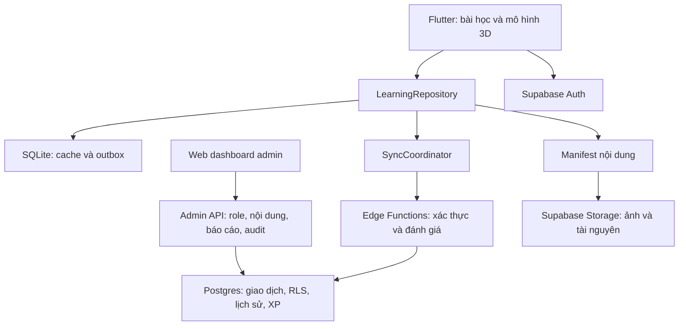

# Kế hoạch backend Supabase cho Matlingo

Ngày: 25/10/2026. Trạng thái: thiết kế để triển khai; chưa chọn project, tạo database, cài dependency hoặc deploy.

**Cập nhật phạm vi:** chỉ có hai role ứng dụng: `admin` sử dụng web dashboard và `user` sử dụng mobile. Chi tiết chuẩn về 22 bảng, từng trường, ràng buộc và các mốc migration nằm trong [SUPABASE_SCHEMA_MIGRATION.md](SUPABASE_SCHEMA_MIGRATION.md); tài liệu đó thay thế các mô tả sơ bộ nếu có khác biệt.

## 1. Mục tiêu và hiện trạng

Frontend Flutter hiện có 11 chủ đề, 53 hoạt động tương tác, gồm mô hình 3D. `learning_store.dart` đang lưu hồ sơ, bản nháp, lịch sử và XP trong SharedPreferences (`nary:journey:v3`). Một hồ sơ thiết bị không phải tài khoản đã xác thực. Lịch sử cục bộ giữ tối đa 100 bản ghi; XP hiện tính 30 cho mỗi chủ đề hoàn thành. Chat mới có điểm nối `ChatResponder`, chưa có backend.

Mục tiêu backend: đăng nhập, đồng bộ nhiều thiết bị, khôi phục bài, lưu kết quả lâu dài, phân quyền từng người dùng và phân phối nội dung/tài nguyên. Giữ học offline và giao diện REA hiện có. Engine 3D vẫn chạy ở frontend; backend lưu cấu hình và trạng thái học, không render từng frame.

**MVP:** Auth hai role + web dashboard admin + hồ sơ user mobile + nội dung có phiên bản + đồng bộ + đánh giá kết quả/XP + Storage. AI chat, thanh toán, lớp học và mạng xã hội nằm ngoài MVP.

## 2. Kiến trúc đề xuất

- Dùng `supabase_flutter`; xác minh phiên bản tương thích Dart/Flutter trước khi cài và commit lockfile.
- Chọn SQLite cho dữ liệu học/outbox thay vì tiếp tục ghi một snapshot JSON lớn. Chọn thư viện Dart cụ thể sau thử migration và đo kích thước dữ liệu; SharedPreferences tiếp tục dùng cho cài đặt nhẹ.
- Tự xây giao thức đồng bộ có retry/idempotency. Không coi SDK Supabase hoặc Realtime là cơ chế offline sync hoàn chỉnh.
- Read API có RLS; mọi thay đổi dữ liệu học đi qua API nghiệp vụ để cùng ghi nhật ký đồng bộ trong một giao dịch.
- Tách môi trường local/staging/production; chỉ tạo hạ tầng trả phí khi đã chọn project và ngân sách.

## 3. Tài khoản và hồ sơ

Mỗi Auth account có đúng một role `admin` hoặc `user`, lưu trong bảng private và kiểm tra phía server. Đăng ký thông thường luôn là user; admin được cấp bằng quy trình vận hành, không có tùy chọn tự đăng ký admin. Publishable key có thể dùng trên cả hai client; secret không nằm trong mobile hoặc web JavaScript. Hồ sơ học tập không tạo thêm role.

Đề xuất mặc định: cho học khách trên thiết bị; đăng nhập email OTP để sao lưu/đồng bộ. Google đăng nhập là đợt sau. Cấu hình email template gửi mã, SMTP, giới hạn gửi/thử mã và luồng khôi phục trước khi phát hành.

Một `auth.users` có nhiều `learner_profiles`, tương ứng luồng đổi hồ sơ hiện có. Mỗi hồ sơ thuộc đúng một tài khoản; các hồ sơ trong cùng tài khoản là cách tổ chức dữ liệu, không phải ranh giới bảo mật độc lập. Chưa mặc định có tài khoản phụ huynh/giáo viên.

Khi đăng nhập lần đầu, người dùng chọn hồ sơ cục bộ muốn liên kết. Không tự tải tất cả hồ sơ của máy dùng chung lên tài khoản mới. Đăng xuất chỉ ngừng đồng bộ, tách cache theo tài khoản; không xóa bài offline chưa gửi. Khi đổi tài khoản, outbox cũ không được gửi bằng danh tính mới.

## 4. Mô hình dữ liệu

UUID cho bản ghi nghiệp vụ; ID nội dung hiện có giữ nguyên, ví dụ `geometry-solid-volume`. Dùng `timestamptz` UTC cho thời điểm. Dữ liệu thống kê lưu múi giờ tại thời điểm học để không đổi ngày lịch sử khi người dùng đi du lịch.

| Bảng/nhóm | Trường và trách nhiệm chính |
|---|---|
| `learner_profiles` | `id`, `owner_user_id`, tên, sở thích, nhịp học, onboarded, revision, deleted_at |
| `content_releases` | Phiên bản phát hành bất biến, trạng thái draft/published, min_app_version, manifest_hash |
| `topics`, `activity_versions` | ID ổn định; khóa activity/version; mechanism, config, initial_state, evaluator_version, skill_ids |
| `release_activities` | Release → topic → activity/version và thứ tự; chụp đúng danh sách cần hoàn thành |
| `learning_sessions` | Hồ sơ, topic, release, thời điểm, trạng thái local/pending/verified; một lượt học/ôn |
| `lesson_drafts` | Hồ sơ, topic, session, bước hiện tại, trạng thái JSONB, base_revision/revision; nhiều nhánh khi xung đột |
| `activity_attempts` | operation_id, session, activity/version, trạng thái nộp, kết quả server, mức gợi ý, thời điểm nhận |
| `topic_completions` | Hồ sơ, topic, release đã hoàn thành; tách khỏi sổ thưởng |
| `xp_ledger` | Hồ sơ, reward_key, delta, nguồn và thời điểm; chỉ backend ghi |
| `activity_events` | Event UUID, session, thời gian hoạt động tăng thêm, ngày/múi giờ; không lưu pointer event |
| `sync_operations`, `sync_changes` | Receipt chống gửi trùng; thay đổi và tombstone theo revision của tài khoản |
| `legacy_imports` | Mapping hồ sơ nguồn, mã import, checksum, trạng thái; giữ dấu vết dữ liệu v3 |

Các bảng con có `profile_id` và `owner_user_id`; dùng FK kép tham chiếu cặp `(id, owner_user_id)` của hồ sơ để chặn ghép dữ liệu giữa hai tài khoản. Các FK khác phải bảo đảm attempt/session/draft thuộc cùng hồ sơ.

Ràng buộc quan trọng:

- Unique `(owner_user_id, operation_id)`; trùng ID nhưng payload khác phải báo lỗi, không coi là retry hợp lệ.
- Unique `(profile_id, reward_key)`, với `reward_key = topic:<topic_id>:first_completion`; thêm bài mới vào chủ đề không thưởng lại 30 XP.
- Unique `(profile_id, topic_id, release_id)` cho completion đã xác minh; session ôn có ID riêng.
- Check kích thước JSON, số bước, thời gian không âm và phiên bản được hỗ trợ. Payload hoạt động dự kiến tối đa 64 KiB, batch tối đa 50 operation; điều chỉnh sau đo thực tế.
- Index cho `owner_user_id`, `(owner_user_id, revision)`, `(profile_id, received_at, id)` và các FK. Truy vấn lịch sử dùng keyset pagination.

Hiện runner coi một topic là một hành trình. MVP giữ cách này; chưa giả định đã có cây chương/bài hoàn chỉnh. Giai đoạn sau thêm chapters/lessons/skills theo `curriculum.dart`, không đổi ID hoạt động đã phát hành.

## 5. API nghiệp vụ và đánh giá

| API dự kiến | Chức năng |
|---|---|
| `bootstrap` | Hồ sơ, release tương thích, tiến độ tóm tắt và cursor |
| `sync-push` | Nhận batch operation, kiểm tra chủ sở hữu, revision và trả receipt từng mục |
| `sync-pull` | Trả thay đổi/tombstone sau cursor, có phân trang |
| `submit-attempt` | Đánh giá trạng thái dựa trên activity/config/version phía server |
| `complete-topic` | Xác nhận toàn bộ hoạt động của release rồi ghi completion/XP nguyên tử |
| `import-local` | Import hồ sơ v3 có mapping và chống lặp |
| `export-data`, `delete-account` | Xuất dữ liệu hoặc bắt đầu quy trình xóa có theo dõi |

Đây là tên hợp đồng dự kiến, không phải endpoint đã deploy. Response chuẩn gồm `operation_id`, `status`, `server_revision`, `error_code`, dữ liệu xác nhận; lỗi xung đột trả cả revision hiện tại và bản nháp server.

Không nhận `correct`, `xp`, `owner_user_id` do app gửi như bằng chứng. Edge Function xác thực JWT, lấy danh tính từ token, kiểm tra quyền hồ sơ và giới hạn request. Evaluator tra phiên bản nội dung bất biến; không chạy code do client tải lên.

Validator hiện là hàm Dart, không thể đưa thẳng lên Postgres. Xây registry evaluator TypeScript trong Edge Functions, chuyển lần lượt theo cơ chế và dùng cùng bộ fixture với Dart. Chỉ bật xác minh cloud cho cơ chế có kiểm thử tương đương; cơ chế chưa hỗ trợ chỉ giữ tiến độ cục bộ, không giả vờ đã xác minh.

Luồng completion: kiểm tra attempt đã xác minh của đúng profile/release → khóa bản ghi tổng hợp của hồ sơ → ghi completion → insert reward nếu chưa có → ghi lịch sử và sync_changes → commit một giao dịch Postgres. Mọi kiểm tra cuối phải được bảo đảm trong giao dịch, không chỉ bằng các request rời từ Edge Function. Khi mạng timeout sau commit, retry trả lại receipt cũ và không thưởng thêm.

Chấm đúng trạng thái không chứng minh người học tự suy luận hay không dùng hỗ trợ. Checkpoint độc lập và năng lực kỹ năng là chức năng riêng ở giai đoạn sau.

## 6. Đồng bộ offline và xung đột

1. Mỗi thao tác có `operation_id` UUID tạo một lần. Ghi thay đổi local và outbox trong cùng giao dịch SQLite; UI phản hồi ngay.
2. Gửi batch khi online, sau thao tác có debounce và lúc mở lại app. Không phụ thuộc việc hệ điều hành cho chạy nền.
3. Server deduplicate, kiểm tra ownership/version, commit và trả receipt. Client chỉ xóa outbox khi đã lưu receipt.
4. Retry lỗi tạm thời với exponential backoff và jitter. Lỗi auth chờ đăng nhập lại; lỗi dữ liệu vào hàng đợi cần xử lý, không retry vô hạn.
5. `sync-pull` dùng nhật ký thay đổi và cursor do server cấp, không dựa vào đồng hồ điện thoại. Thiết kế revision theo tài khoản, cấp dưới row lock trong giao dịch để không bỏ sót commit đến muộn; mọi write đều phải ghi change log.
6. Thời gian học là event tăng thêm có ID, không cộng lại snapshot tổng mỗi lần retry. Không tuyên bố đo được sự tập trung chính xác khi nhiều thiết bị hoạt động đồng thời.

Quy tắc merge:

- Completion và XP là dữ liệu đơn điệu, hợp nhất bằng khóa unique; không ghi đè bằng snapshot từ máy cũ.
- Attempt giữ độc lập từng lượt. Bản nháp dùng compare-and-swap theo revision; hai thiết bị sửa cùng bài sẽ giữ hai nhánh và cho chọn tiếp tục, không ghép tùy tiện các trường của mô hình.
- Profile/settings dùng revision theo bản ghi; trường bị sửa đồng thời trả conflict. MVP có thể yêu cầu người dùng chọn bản mới, không dùng thời gian thiết bị để quyết định thắng.
- Xóa dùng tombstone. Cursor quá cũ phải bootstrap lại; outbox còn chờ vẫn được giữ và kiểm tra lại trước khi áp dụng.

UI chỉ cần các trạng thái ngắn: “Đã lưu trên máy”, “Đang đồng bộ”, “Đã đồng bộ”, “Cần xử lý”. Khi offline, hoàn thành bài được ghi cục bộ; phần xác minh cloud/XP có trạng thái chờ rõ ràng.

## 7. RLS, quyền ghi và quản trị

Áp dụng RLS cho mọi bảng exposed, cấp GRANT tối thiểu và policy theo chủ sở hữu. `TO authenticated` tự nó không đủ để cô lập tài khoản; UPDATE cần SELECT và `USING`/`WITH CHECK` phù hợp. Tham chiếu: [Supabase RLS](https://supabase.com/docs/guides/database/postgres/row-level-security).

| Loại dữ liệu | App người dùng | Backend/biên tập |
|---|---|---|
| Hồ sơ, draft, session | Đọc của mình; gửi thay đổi qua API | Kiểm tra quyền, ghi revision và change log |
| Attempt/result/XP | Đọc của mình; gửi trạng thái để chấm | Chấm, ghi kết quả và XP trong giao dịch |
| Nội dung published | Đọc bản tương thích; không sửa | Phát hành version bất biến |
| Nội dung draft/validator | Không truy cập | Chỉ quản trị được cấp quyền |
| Import và sync receipts | Chỉ đọc phạm vi tài khoản | Ghi mapping và receipt chống trùng |

App chứa project URL và publishable key; secret/service-role key chỉ ở backend. Không lấy quyền admin từ `user_metadata`. Ưu tiên SECURITY INVOKER cho RPC thông thường; tác vụ ghi sổ thưởng đặc quyền đặt trong schema private, thu hồi EXECUTE mặc định, chỉ cấp cho vai trò backend. Khi dùng quyền bypass RLS phải kiểm tra chủ sở hữu tường minh và không nhận owner từ request.

Quản trị MVP có web dashboard cho role admin: tài khoản user, chủ đề, activity/version, tài nguyên, phát hành, báo cáo và audit. Mọi mutation đi qua API kiểm tra role/status; không cho sửa trực tiếp XP hoặc đáp án. Mỗi thay đổi schema phải qua migration, kiểm tra RLS bằng JWT thật của hai tài khoản user và một admin, chạy security/performance advisors trước phát hành. [Bảo vệ Edge Functions](https://supabase.com/docs/guides/functions/auth).

## 8. Nội dung và tài nguyên 3D

- Giữ catalog bundled để mở app/học cơ bản khi không có mạng; server phát hành manifest có version/hash/min_app_version. Không sửa hoạt động của release đã publish.
- Với bài đang làm, giữ đúng config, content_version, mechanism_version và evaluator_version. App chưa hỗ trợ cơ chế mới phải dùng release tương thích.
- Storage `learning-assets`: ảnh, texture, tài nguyên đã xuất bản có tên theo hash để cache. Upload chỉ cho quản trị; frontend tải khi cần và kiểm tra hash trước dùng. Không đặt dữ liệu người dùng trong bucket public.
- Avatar hoặc ảnh người học nếu triển khai: bucket private, đường dẫn theo tài khoản, giới hạn MIME/dung lượng, policy riêng và URL có hạn khi chia sẻ. [Storage access control](https://supabase.com/docs/guides/storage/security/access-control).
- Hiện engine chỉ dựng khối/cầu đơn giản. Việc lưu `.glb` trong Storage không làm frontend tự có khả năng đọc glTF; renderer/loader và tối ưu mesh/texture là task riêng. Dữ liệu bản đồ phải có nguồn và giấy phép trước khi nhập.

## 9. Migration frontend và dữ liệu cũ

Tách `LearningStore` thành facade gọi `LearningRepository`, `LocalLearningRepository`, `RemoteLearningRepository`, `SyncCoordinator`, `ContentRepository`, `AuthRepository`. Không gọi Supabase trực tiếp từ painter hoặc workspace.

Migration v3: sao lưu snapshot gốc → validate → tạo ID nguồn bền vững và SQLite local trong giao dịch → đối chiếu số hồ sơ/draft/XP → chỉ đánh dấu migration thành công sau commit. Giữ snapshot để phục hồi khi lỗi.

Import cloud chỉ chạy cho hồ sơ được chọn. Mapping unique theo tài khoản và source_profile_key; checksum/idempotency ngăn import lặp. ID cũ dạng chuỗi được map sang UUID, không ép cast. Dữ liệu lịch sử thiếu do giới hạn 100 dòng không được bịa lại.

Giữ XP đã có dưới nguồn `legacy_import`, tách khỏi kết quả đã xác minh. Không cộng cả legacy 30 XP lẫn first_completion 30 XP cho cùng chủ đề: dùng chung reward_key hoặc chuyển trạng thái nguồn trên cùng entry, không tạo thêm entry thưởng. Không nâng dữ liệu cũ thành bằng chứng “tự giải được”.

## 10. Lộ trình triển khai và nghiệm thu

| Mốc | Công việc | Điều kiện hoàn thành |
|---|---|---|
| A — Nền tảng | Chọn project/region, local/staging, Auth, schema, RLS, seed nội dung | Hai tài khoản không thể đọc/ghi chéo, migration dựng lại DB sạch |
| B — Local repository | SQLite, outbox, migration v3, UI trạng thái lưu | Đóng app/mất mạng vẫn giữ draft và operation chưa gửi |
| C — Pilot cloud | Một bài hình học 3D và evaluator tương ứng, push/pull, receipt, completion/XP | Hai thiết bị tiếp tục được bài; retry đồng thời không trùng XP; conflict không mất draft |
| D — Toàn bộ danh mục | Chuyển evaluator theo 30 cơ chế, import có chọn, hồ sơ/lịch sử/thống kê | Fixture Dart/server tương đương cho 53 hoạt động; legacy không mất hoặc nhân đôi XP |
| E — Nội dung/Storage | Release manifest, cache tài nguyên, publish/rollback | App cũ mở đúng bài cũ; thiếu mạng/tài nguyên vẫn có thông báo và fallback |
| F — Phát hành | Auth trên Android/iOS, kiểm thử tải, backup/restore, export/delete, giám sát | Restore được dữ liệu thử nghiệm và hoàn thành checklist thiết bị |

Ưu tiên A → B → C trước khi nhân rộng. Chưa đưa ra lịch cố định vì cần thử migration, năng lực môi trường và công sức chuyển evaluator; sau pilot mới ước lượng toàn đợt.

Kiểm thử bắt buộc: JWT hết hạn, đổi tài khoản khi có outbox, gửi trùng/race, timeout sau commit, hai máy sửa cùng bài, lệch đồng hồ, cursor quá hạn, xóa rồi máy cũ online, cấu hình bài bị sửa trên client, JSON quá lớn, sai phiên bản, nâng app giữa phiên và lỗi ghi local/cloud.

Theo dõi: tỷ lệ sync thành công, độ trễ batch, backlog, lỗi RLS/evaluator, dung lượng DB/Storage và egress. Không log token, email hoặc toàn bộ trạng thái học mặc định. Phân trang lịch sử và không gửi pointer/camera event lên server. Lập dự toán theo số người học, phiên/ngày, operation/phiên và lượng tải tài nguyên; chưa chốt giá/gói khi chưa có tải thực tế.

Xóa tài khoản là workflow có thể retry: khóa các mutation mới, xử lý outbox bị từ chối, xóa dữ liệu và đối tượng Storage, thu hồi phiên rồi xóa Auth user; theo dõi hoàn tất vì DB và Storage không chung một giao dịch. Xác định thời hạn retention và kiểm thử phục hồi backup theo gói hạ tầng đã chọn.

## 11. Chat AI và kỹ năng — sau MVP

Nối `ChatResponder` qua Edge Function: xác thực, kiểm tra profile/session, lấy context tối thiểu, giới hạn lượt/chi phí, lưu hội thoại theo lựa chọn sản phẩm. API key mô hình ở backend; offline dùng gợi ý hiện có. Không cho mô hình tự chạy SQL hoặc ghi XP.

Sau đó thêm `skills`, `activity_skills`, `skill_evidence`, `review_schedule` để ôn cách quãng. Tiến độ hoàn thành và năng lực kỹ năng là hai lớp riêng; không dùng số phút hoặc XP làm bằng chứng hiểu bài.

## 12. Tài liệu đã đối chiếu và quyết định còn mở

Đã đọc tài liệu chính thức về [Flutter integration](https://supabase.com/docs/guides/getting-started/quickstarts/flutter), [RLS](https://supabase.com/docs/guides/database/postgres/row-level-security), [Edge Functions](https://supabase.com/docs/guides/functions/auth), [Storage](https://supabase.com/docs/guides/storage/serving/downloads) và [migrations](https://supabase.com/docs/guides/deployment/database-migrations). URL changelog Markdown bị công cụ từ chối content-type nên đã xem [changelog HTML](https://supabase.com/changelog). Mục TLS tháng 10/2026 ảnh hưởng thiết bị cũ: kiểm tra kết nối HTTPS trên thiết bị Android tối thiểu trước phát hành. Phiên bản SDK/CLI và breaking changes cần được kiểm tra lại lúc triển khai.

Giả định mặc định để lập kế hoạch: guest offline + email OTP; một tài khoản user có nhiều hồ sơ; nội dung học cơ bản không trả phí; XP 30/chủ đề được giữ. Đã chốt hai role và web dashboard admin trong MVP. Các lựa chọn còn mở: project Supabase đích/region/ngân sách, phương thức đăng nhập, một hay nhiều hồ sơ mỗi user, và thời điểm triển khai chat.

**Bước bắt đầu:** xác định project đích, tạo môi trường local/staging và migration Auth/RLS; sau đó làm trọn pilot đồng bộ một bài hình học 3D trước khi chuyển toàn bộ frontend sang backend.
