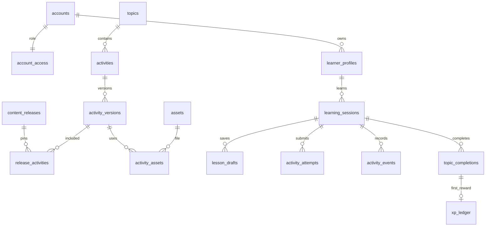

# Supabase: hai role, thiết kế bảng và kế hoạch migration

Ngày 25/10/2026. Đây là đặc tả triển khai, chưa phải SQL đã chạy. Tài liệu này quyết định chi tiết schema/quyền; khi khác bản kế hoạch tổng quan, dùng tài liệu này làm chuẩn.

## 1. Phạm vi và hai role duy nhất

| Role ứng dụng | Client chính | Quyền |
|---|---|---|
| `admin` | Web dashboard | Quản lý tài khoản user, chủ đề, hoạt động, bản phát hành, ảnh/texture/mô hình; xem báo cáo và audit |
| `user` | Flutter mobile | Quản lý hồ sơ của mình, học, lưu/tiếp tục bài, xem kết quả và đồng bộ |

Mỗi tài khoản có đúng một role. Không tạo teacher, parent, editor, moderator hoặc super_admin. Guest offline là trạng thái chưa đăng nhập, không phải role database. Role `authenticated`, `anon`, `service_role` của Supabase là vai trò hạ tầng, không bổ sung role ứng dụng.

Giữ mô hình nhiều `learner_profiles` trong một tài khoản để tương thích frontend hiện tại. Đây là các vùng tiến độ của cùng một user, không có tài khoản/quyền riêng. Admin không tự có quyền học hoặc sở hữu hồ sơ user. Nếu sau này chọn một hồ sơ mỗi user, thêm UNIQUE(owner_user_id) sau khi xử lý hồ sơ cũ; không âm thầm gộp dữ liệu trong migration đầu.

## 2. Quản lý quyền và dashboard

- Nguồn sự thật của role/status là `private.account_access`. Đăng ký thông thường luôn tạo role `user`; dữ liệu đăng ký không được chọn role.
- Admin đầu tiên được bootstrap bằng thao tác vận hành có kiểm soát sau khi tạo Auth user. Không đưa mật khẩu hay ID admin cố định vào seed/public repository.
- MVP không có API tự nâng quyền hoặc màn đổi user thành admin. Thêm admin khác bằng quy trình vận hành được ghi audit; vẫn chỉ có hai role.
- Dashboard dùng publishable key và JWT admin, không chứa secret/service-role key trong JavaScript. API `/admin/*` kiểm tra JWT và role/status hiện hành từ DB cho mỗi thao tác.
- RLS dùng helper kiểm tra account đang active. Helper đọc role có thể là SECURITY DEFINER tối thiểu: chỉ trả boolean, cố định search_path, schema private, thu hồi EXECUTE của PUBLIC/anon và cấp đúng authenticated. Không lộ bảng phân quyền hoặc cho phép helper ghi dữ liệu.
- Nếu thêm JWT custom claim để điều hướng UI, đó chỉ là cache; quyền ghi vẫn dựa trên DB để việc hạ quyền/khóa tài khoản có hiệu lực với token còn hạn. Không dùng user_metadata để phân quyền.
- Chặn user gọi admin API dù đổi URL hoặc gọi REST trực tiếp. Chặn admin dùng mobile mutation của user trừ tác vụ hỗ trợ được định nghĩa riêng. HTTP Origin hoặc loại thiết bị không phải bằng chứng quyền.

Màn dashboard MVP: Tổng quan; Tài khoản user; Chủ đề; Hoạt động và preview; Thư viện tài nguyên; Bản phát hành; Báo cáo học tập; Audit log. Admin xem báo cáo/tiến độ để hỗ trợ nhưng không sửa đáp án, lịch sử attempt hoặc XP trực tiếp.

## 3. Quy ước schema

- `public`: dữ liệu được cung cấp có kiểm soát qua Data API; bật RLS, GRANT tối thiểu.
- `private`: phân quyền, evaluator registry, sync receipts/change log, import payload và audit; không expose qua Data API.
- `auth.users` và `storage.objects`: dùng schema có sẵn của Supabase, không tự tạo lại.
- `uuid`: UUID, mặc định `gen_random_uuid()` cho bản ghi mới, ngoại trừ ID gắn Auth. `ts`: `timestamptz`. Mọi cột **NOT NULL trừ khi ghi `NULL`**.
- Mỗi mục bên dưới liệt kê đầy đủ cột dự kiến. `created_at default now()` và `updated_at default now()` được cập nhật bằng server, không lấy thời gian client để giải quyết conflict.
- ID nội dung là `text` ổn định, giữ tên frontend như `geometry-solid-volume`. Revision là `bigint`, serialize dạng chuỗi trong JSON để không mất độ chính xác ở web.
- Dữ liệu payload JSON phải là object/array đúng schema, có giới hạn kích thước. Config không chứa hàm Dart/JavaScript hoặc mã tùy ý do admin nhập.

## 4. Nhóm tài khoản — 3 bảng

### 4.1 `private.account_access`

| Trường | Kiểu, mặc định và ràng buộc |
|---|---|
| user_id | uuid PK, FK auth.users(id), ON DELETE CASCADE |
| role | text default 'user', CHECK IN ('admin','user') |
| status | text default 'active', CHECK IN ('active','suspended','deleting') |
| created_at | ts default now() |
| updated_at | ts default now() |

Chỉ backend/vận hành ghi. Khóa tài khoản phải chặn cả RLS đọc dữ liệu riêng và mutation qua API. Không dùng `role_permissions` hoặc bảng gán nhiều role vì bài toán chỉ có hai role cố định.

### 4.2 `public.accounts`

| Trường | Kiểu, mặc định và ràng buộc |
|---|---|
| id | uuid PK, FK auth.users(id), ON DELETE CASCADE |
| display_name | text, độ dài 1–80 |
| locale | text default 'vi' |
| timezone | text default 'Asia/Bangkok', validate tên timezone |
| avatar_asset_id | uuid NULL, FK assets(id), ON DELETE SET NULL |
| created_at | ts default now() |
| updated_at | ts default now() |
| deleted_at | ts NULL |

Email, mật khẩu và provider do Supabase Auth quản lý; không lưu password/password_hash ở bảng ứng dụng. Admin lấy email qua backend Auth Admin API khi thực sự cần, không nhân bản toàn bộ email sang bảng public.

### 4.3 `public.learner_profiles`

| Trường | Kiểu, mặc định và ràng buộc |
|---|---|
| id | uuid PK |
| owner_user_id | uuid FK accounts(id), ON DELETE CASCADE |
| name | text, độ dài 1–60 |
| daily_minutes | smallint default 10, CHECK BETWEEN 1 AND 120 |
| onboarded_at | ts NULL; chuyển từ cờ onboarded cũ, không bịa thời điểm quá khứ |
| interest_topic_ids | text[] default '{}', backend kiểm tra ID tồn tại và không trùng |
| revision | bigint default 1, > 0 |
| created_at | ts default now() |
| updated_at | ts default now() |
| deleted_at | ts NULL |

UNIQUE(id, owner_user_id) để các bảng học dùng FK kép. Không lưu XP tổng có thể bị user sửa trong hồ sơ; tổng lấy từ xp_ledger. `mode=device` cũ chỉ là metadata migration, không thành role.

## 5. Nội dung và tài nguyên — 8 bảng

### 5.1 `public.topics`

| Trường | Kiểu, mặc định và ràng buộc |
|---|---|
| id | text PK, giữ ID hiện có |
| title | text, 1–160 ký tự |
| subtitle | text default '' |
| subject | text, 1–80 ký tự |
| action_label | text default '' |
| icon_key | text; key trong registry icon frontend, không lưu mã Icons |
| sort_order | integer >= 0 |
| status | text default 'draft', IN ('draft','active','archived') |
| created_by | uuid NULL, FK accounts(id), ON DELETE SET NULL |
| created_at | ts default now() |
| updated_at | ts default now() |

Title/icon của topic là metadata hiển thị hiện hành; nội dung/chấm điểm của release nằm ở các version bất biến. Không xóa topic đang được tham chiếu; chỉ archive.

### 5.2 `public.activities`

| Trường | Kiểu, mặc định và ràng buộc |
|---|---|
| id | text PK, ví dụ geography-globe-grid |
| topic_id | text FK topics(id), ON DELETE RESTRICT |
| status | text default 'draft', IN ('draft','active','archived') |
| created_by | uuid NULL, FK accounts(id), ON DELETE SET NULL |
| created_at | ts default now() |
| updated_at | ts default now() |

UNIQUE(id, topic_id). Một activity có một topic; sau khi đã publish không đổi topic của activity đó. Thay đổi cấu trúc lớn phải tạo ID mới.

### 5.3 `private.evaluator_versions`

| Trường | Kiểu, mặc định và ràng buộc |
|---|---|
| mechanism | text, một phần PK |
| version | integer > 0, một phần PK |
| handler_key | text, key registry backend đã deploy |
| implementation_hash | text, SHA-256 mã triển khai |
| input_schema | jsonb object, schema trạng thái/config được hỗ trợ |
| status | text default 'testing', IN ('testing','active','retired') |
| created_at | ts default now() |

PK(mechanism, version). Chỉ deploy pipeline ghi; dashboard chỉ chọn evaluator hợp lệ qua API. Không cho admin tải mã evaluator để chạy tùy ý. Giữ evaluator cũ cho phiên học đã pin version; retirement chỉ chặn phiên mới.

### 5.4 `public.activity_versions`

| Trường | Kiểu, mặc định và ràng buộc |
|---|---|
| activity_id | text FK activities(id), một phần PK |
| content_version | integer > 0, một phần PK |
| title | text, 1–160 ký tự |
| stage | text; nhãn như Khám phá, Vận dụng 3D |
| prompt | text |
| hint_levels | jsonb array 1–3 chuỗi, không để rỗng |
| explanation | text |
| mechanism | text |
| mechanism_version | integer > 0; phiên bản renderer/config frontend |
| evaluator_version | integer > 0 |
| config | jsonb object default '{}' |
| initial_state | jsonb object |
| skill_ids | text[] default '{}'; metadata, chưa có tính mastery |
| status | text default 'draft', IN ('draft','published','archived') |
| created_by | uuid NULL, FK accounts(id), ON DELETE SET NULL |
| created_at | ts default now() |
| published_at | ts NULL |

PK(activity_id, content_version); FK(mechanism, evaluator_version) → evaluator_versions. Bản published bất biến: sửa nội dung phải tạo content_version mới. Mobile chỉ đọc version thuộc release được phép. Config/explanation trong nội dung tải xuống không phải bí mật chống gian lận; server vẫn tự kiểm tra trạng thái.

### 5.5 `public.content_releases`

| Trường | Kiểu, mặc định và ràng buộc |
|---|---|
| id | uuid PK |
| version_label | text UNIQUE, ví dụ catalog-2026-10-01 |
| status | text default 'draft', IN ('draft','published','retired') |
| min_app_version | text, validate semantic version |
| manifest_hash | text NULL khi draft; bắt buộc SHA-256 khi published |
| created_by | uuid NULL, FK accounts(id), ON DELETE SET NULL |
| created_at | ts default now() |
| published_at | ts NULL |

Publish nguyên tử sau khi kiểm tra evaluator, asset, cấu hình và tương thích renderer. Release retired không mở session mới nhưng vẫn phục vụ phiên đang học/khôi phục. Rollback chọn lại release tương thích, không sửa nội dung release đã publish.

### 5.6 `public.release_activities`

| Trường | Kiểu, mặc định và ràng buộc |
|---|---|
| release_id | uuid FK content_releases(id), một phần PK |
| activity_id | text, một phần PK |
| content_version | integer > 0 |
| topic_id | text FK topics(id) |
| position | integer >= 0, thứ tự trong topic |
| required | boolean default true |

PK(release_id, activity_id); UNIQUE(release_id, topic_id, position); UNIQUE(release_id, activity_id, content_version). FK(activity_id, content_version) → activity_versions và FK(activity_id, topic_id) → activities. Manifest đã publish không được đổi thứ tự hoặc required.

### 5.7 `public.assets`

| Trường | Kiểu, mặc định và ràng buộc |
|---|---|
| id | uuid PK |
| owner_user_id | uuid NULL, FK accounts(id); NULL cho tài nguyên nội dung chung |
| bucket_id | text; allowlist learning-assets, user-avatars |
| object_path | text |
| kind | text IN ('image','texture','model','avatar') |
| mime_type | text, allowlist theo kind |
| byte_size | bigint >= 0, kiểm tra quota theo kind |
| sha256 | text; hash file đã kiểm tra |
| source_url | text NULL |
| license | text NULL; bắt buộc cho tài nguyên bên ngoài dùng trong nội dung |
| attribution | text NULL |
| status | text default 'uploading', IN ('uploading','ready','archived') |
| created_by | uuid NULL, FK accounts(id), ON DELETE SET NULL |
| created_at | ts default now() |
| updated_at | ts default now() |

UNIQUE(bucket_id, object_path). Learning assets do admin upload; avatar chỉ thuộc chủ tài khoản. Asset chỉ được đánh dấu ready sau khi backend xác nhận object/dung lượng/MIME/hash. Object path có hash, không ghi đè file đang publish. `.glb` chỉ là loại tài nguyên dự kiến, frontend hiện chưa có glTF loader.

### 5.8 `public.activity_assets`

| Trường | Kiểu, mặc định và ràng buộc |
|---|---|
| activity_id | text, một phần PK |
| content_version | integer, một phần PK |
| slot | text, một phần PK; ví dụ globe-texture, cover |
| asset_id | uuid FK assets(id), ON DELETE RESTRICT |
| required | boolean default false |

PK(activity_id, content_version, slot); FK(activity_id, content_version) → activity_versions. Chỉ gắn learning asset đã ready. File private/user avatar không được xuất hiện trong manifest nội dung công khai.

## 6. Phiên học và kết quả — 6 bảng

### 6.1 `public.learning_sessions`

| Trường | Kiểu, mặc định và ràng buộc |
|---|---|
| id | uuid PK, client tạo một lần để hoạt động offline |
| profile_id | uuid |
| owner_user_id | uuid |
| topic_id | text FK topics(id) |
| release_id | uuid NULL chỉ khi source = legacy_import |
| source | text default 'mobile', IN ('mobile','legacy_import') |
| status | text default 'in_progress', IN ('in_progress','pending','verified','legacy_imported','abandoned') |
| device_id | uuid NULL; ID cài đặt, không phải định danh phần cứng |
| started_at | ts; thời điểm học client, kiểm tra hợp lý |
| received_at | ts default now(), thời điểm server nhận |
| completed_at | ts NULL |
| hints_used | integer default 0, >= 0 |
| attempts_count | integer default 0, >= 0 |
| active_ms | bigint default 0, >= 0 |
| revision | bigint default 1 |
| created_at | ts default now() |
| updated_at | ts default now() |

FK(profile_id, owner_user_id) → learner_profiles; FK release_id → content_releases. UNIQUE(id, profile_id, owner_user_id), UNIQUE(id, release_id). Backend xác nhận topic có trong release. Các tổng session do server tính từ event/attempt, không tin giá trị tổng app tự gửi. Legacy có thể giữ tổng cũ nhưng gắn nhãn imported.

### 6.2 `public.lesson_drafts`

| Trường | Kiểu, mặc định và ràng buộc |
|---|---|
| id | uuid PK, ID một nhánh bản nháp |
| session_id | uuid |
| profile_id | uuid |
| owner_user_id | uuid |
| current_activity_id | text NULL; NULL cho bản legacy không map được |
| state_schema_version | integer default 1, > 0 |
| snapshot | jsonb object; states, touched, checked, hint levels, step |
| base_revision | bigint >= 0, revision server mà nhánh bắt đầu sửa |
| revision | bigint default 1 |
| conflict_of_draft_id | uuid NULL, FK lesson_drafts(id) |
| created_at | ts default now() |
| updated_at | ts default now() |
| deleted_at | ts NULL, tombstone |

FK(session_id, profile_id, owner_user_id) → learning_sessions. Một session có thể giữ nhiều nhánh conflict; không UNIQUE(profile_id, topic_id) làm mất nhánh. Backend kiểm tra current_activity thuộc release/topic của session. Snapshot không phải nguồn xác nhận đáp án đúng.

### 6.3 `public.activity_attempts`

| Trường | Kiểu, mặc định và ràng buộc |
|---|---|
| id | uuid PK |
| operation_id | uuid; chống gửi trùng |
| session_id | uuid |
| profile_id | uuid |
| owner_user_id | uuid |
| release_id | uuid |
| activity_id | text |
| content_version | integer > 0 |
| submitted_state | jsonb object, tối đa 64 KiB dự kiến |
| hint_level | smallint default 0, CHECK BETWEEN 0 AND 3 |
| evaluation_status | text, IN ('verified','unsupported','rejected') |
| is_correct | boolean NULL; NULL khi không được đánh giá |
| misconception_codes | text[] default '{}' |
| satisfied_constraints | text[] default '{}' |
| feedback_key | text NULL |
| evaluator_version | integer NULL khi unsupported |
| attempted_at | ts NULL, thời gian client cung cấp |
| received_at | ts default now() |

UNIQUE(owner_user_id, operation_id). FK session/profile/owner; FK(session_id, release_id) → learning_sessions; FK(release_id, activity_id, content_version) → release_activities. Backend kiểm tra topic của activity khớp session. Chỉ evaluator backend ghi kết quả. CHECK status verified thì is_correct và evaluator_version không NULL. Attempt bất biến, sửa sai tạo attempt mới.

### 6.4 `public.topic_completions`

| Trường | Kiểu, mặc định và ràng buộc |
|---|---|
| id | uuid PK |
| profile_id | uuid |
| owner_user_id | uuid |
| topic_id | text FK topics(id) |
| release_id | uuid NULL chỉ khi source = legacy_import |
| session_id | uuid |
| source | text IN ('verified','legacy_import') |
| completed_at | ts; giữ ngày cũ nếu có |
| verified_at | ts NULL, bắt buộc khi source = verified |
| created_at | ts default now() |

FK session/profile/owner; FK release nếu khác NULL. Unique partial (profile_id, topic_id, release_id) WHERE source = 'verified'; unique partial (profile_id, topic_id) WHERE source = 'legacy_import'. Ghi legacy không có nghĩa bài đã được server chấm. Hoàn thành release mới không tự thưởng lại XP.

### 6.5 `public.xp_ledger`

| Trường | Kiểu, mặc định và ràng buộc |
|---|---|
| id | uuid PK |
| profile_id | uuid |
| owner_user_id | uuid |
| reward_key | text; topic:<topic_id>:first_completion |
| topic_id | text FK topics(id) |
| completion_id | uuid FK topic_completions(id) |
| source | text IN ('first_completion','legacy_import') |
| delta | integer default 30, CHECK delta = 30 trong MVP |
| created_at | ts default now() |

UNIQUE(profile_id, reward_key). FK profile/owner và completion phải cùng profile/topic/owner. Backend ghi append-only trong giao dịch completion. Tổng XP = SUM(delta); không cho user/admin sửa ledger trực tiếp. Import legacy và completion verified dùng cùng reward_key để không thưởng hai lần; không cần update entry cũ khi người dùng xác minh lại.

### 6.6 `public.activity_events`

| Trường | Kiểu, mặc định và ràng buộc |
|---|---|
| id | uuid PK; event ID tạo bền vững ở client |
| operation_id | uuid |
| session_id | uuid |
| profile_id | uuid |
| owner_user_id | uuid |
| event_type | text IN ('active_time','hint_opened') |
| activity_id | text NULL, FK activities(id) |
| active_ms_delta | bigint default 0, >= 0 |
| hint_level | smallint default 0, BETWEEN 0 AND 3 |
| occurred_at | ts |
| local_date | date, ngày học theo timezone lưu kèm |
| timezone | text NULL chỉ khi dữ liệu legacy không xác định được |
| utc_offset_minutes | smallint NULL, BETWEEN -840 AND 840 |
| received_at | ts default now() |

UNIQUE(owner_user_id, operation_id); FK session/profile/owner. Mỗi event thời gian chỉ thuộc một ngày local, client tách event qua nửa đêm; backend kiểm tra bounds và chống trùng. Không nhận pointer/camera events. Không suy diễn UTC offset cũ nếu snapshot không lưu.

## 7. Đồng bộ, migration và audit — 5 bảng

### 7.1 `private.sync_heads`

| Trường | Kiểu, mặc định và ràng buộc |
|---|---|
| owner_user_id | uuid PK, FK accounts(id), ON DELETE CASCADE |
| revision | bigint default 0, >= 0 |
| min_available_revision | bigint default 0, >= 0 và <= revision |
| updated_at | ts default now() |

Mỗi mutation khóa hàng tương ứng bằng FOR UPDATE, cấp revision và ghi change log trong cùng transaction. Không dùng timestamp thiết bị hoặc sequence toàn cục độc lập commit để làm cursor.

### 7.2 `private.sync_operations`

| Trường | Kiểu, mặc định và ràng buộc |
|---|---|
| owner_user_id | uuid, một phần PK, FK accounts(id) |
| operation_id | uuid, một phần PK |
| profile_id | uuid NULL, FK kép profile/owner khi có |
| device_id | uuid NULL |
| operation_type | text, allowlist nghiệp vụ |
| payload_hash | text SHA-256 canonical payload |
| status | text IN ('applied','conflict','rejected') |
| response | jsonb object, receipt kết quả |
| server_revision | bigint NULL khi không phát sinh thay đổi |
| created_at | ts default now() |

PK(owner_user_id, operation_id). Không giữ transaction `processing` treo ngoài commit; request đang xử lý dùng khóa và transaction. Retry cùng ID/hash trả receipt cũ; cùng ID khác hash trả lỗi. Giữ receipt tối thiểu bằng thời hạn retry/outbox đã công bố; khóa nghiệp vụ unique vẫn bảo vệ thưởng sau khi receipt hết retention.

### 7.3 `private.sync_changes`

| Trường | Kiểu, mặc định và ràng buộc |
|---|---|
| owner_user_id | uuid, một phần PK, FK accounts(id) |
| revision | bigint > 0, một phần PK |
| change_index | integer >= 0, một phần PK |
| entity_type | text, allowlist bảng đồng bộ |
| entity_id | text, ID record kể cả UUID được stringify |
| action | text IN ('upsert','delete') |
| payload | jsonb NULL khi delete; chỉ chứa dữ liệu được phép trả owner |
| created_at | ts default now() |

PK(owner_user_id, revision, change_index). Nhiều entity có thể đổi trong một revision. Cursor gồm revision + change_index và high-water revision; phân trang không bỏ sót phần còn lại của transaction. Cursor cũ hơn min_available_revision phải bootstrap lại. Xóa đồng bộ bằng tombstone trước khi dọn bản ghi vật lý.

### 7.4 `private.legacy_imports`

| Trường | Kiểu, mặc định và ràng buộc |
|---|---|
| id | uuid PK |
| owner_user_id | uuid FK accounts(id) |
| source_profile_key | text; key bền vững tạo trước lần import đầu |
| target_profile_id | uuid NULL khi chưa map; FK kép profile/owner |
| source_schema_version | integer, MVP chỉ nhận 3 hoặc adapter rõ ràng |
| snapshot_hash | text SHA-256 |
| payload | jsonb NULL sau khi hết retention, chỉ chứa hồ sơ được chọn |
| status | text IN ('pending','completed','failed') |
| result | jsonb object default '{}', gồm mapping và tổng đã import |
| error_code | text NULL |
| created_at | ts default now() |
| completed_at | ts NULL |
| payload_expires_at | ts NULL, chính sách retention xác định trước production |

UNIQUE(owner_user_id, source_profile_key). Snapshot đổi sau một import đã completed không tự nhập lại như dữ liệu mới: trả conflict và chuyển sang sync thông thường. Nguồn v3 thiếu ID lịch sử nên MVP import một lần/hồ sơ để tránh nhân bản session sau mỗi snapshot. Import lớn chia chunk có operation ID xác định và chỉ completed sau đối chiếu.

### 7.5 `private.admin_audit_logs`

| Trường | Kiểu, mặc định và ràng buộc |
|---|---|
| id | uuid PK |
| actor_user_id | uuid NULL, FK accounts(id), ON DELETE SET NULL |
| actor_kind | text IN ('admin','system'); đây là nguồn sự kiện, không phải role mới |
| action | text, ví dụ content.publish, account.suspend |
| target_type | text |
| target_id | text |
| request_id | uuid |
| summary | jsonb object; thay đổi tối thiểu đã loại token/email/payload học |
| created_at | ts default now() |

Append-only, backend ghi. Admin đọc qua API có phân trang; không xóa audit từ dashboard. Tác vụ bootstrap admin do hệ thống thực hiện ghi actor_kind=system. Retention và xóa định danh phải được quy định trước production.

**Tổng MVP: 22 bảng ứng dụng**, gồm 15 bảng public và 7 bảng private; không tính bảng do Supabase Auth/Storage quản lý. Chapters/lessons/mastery/chat chưa nằm trong migration MVP.

## 8. Quan hệ, index và ranh giới ghi

Sơ đồ rút gọn không thay thế FK/ràng buộc trong từng mục. Mọi bảng có owner/profile phải dùng FK kép hoặc kiểm tra giao dịch tương đương, không chỉ kiểm tra `owner_user_id = auth.uid()` trên một hàng độc lập. Không cho đổi owner, profile, session hoặc release của bản ghi đã tạo.

Index bổ sung ngoài PK/UNIQUE:

- learner_profiles(owner_user_id) WHERE deleted_at IS NULL.
- activities(topic_id), activity_versions(mechanism, evaluator_version).
- release_activities(topic_id, release_id), activity_assets(asset_id), accounts(avatar_asset_id).
- learning_sessions(profile_id, received_at DESC, id), learning_sessions(topic_id, release_id).
- lesson_drafts(session_id), lesson_drafts(profile_id, updated_at DESC), lesson_drafts(conflict_of_draft_id).
- activity_attempts(session_id, activity_id, received_at DESC), activity_attempts(profile_id, received_at DESC, id).
- topic_completions(session_id), xp_ledger(completion_id), xp_ledger(profile_id, created_at).
- activity_events(profile_id, local_date), activity_events(session_id), assets(owner_user_id).
- admin_audit_logs(created_at DESC, id), admin_audit_logs(target_type, target_id, created_at DESC).

Rà toàn bộ FK và EXPLAIN các query thật trước production; không tạo GIN cho mọi JSONB khi chưa có truy vấn cần dùng.

| Nhóm | User mobile | Admin dashboard | Đường ghi |
|---|---|---|---|
| Nội dung published | Đọc release tương thích | Đọc, preview | Admin content API tạo version/publish |
| Nội dung draft | Không đọc | CRUD draft | Admin content API + audit |
| Asset nội dung | Đọc file published | Upload, archive | Storage policy + finalize API |
| Account/profile | Đọc/sửa phần được phép của mình | Tra cứu, khóa/mở user | API whitelist field; role không sửa từ client |
| Draft/session | Đọc của mình; gửi thay đổi | Xem hỗ trợ qua API audit | User sync API |
| Attempt/completion/XP | Đọc của mình | Đọc báo cáo | Evaluator + giao dịch backend, không sửa tay |
| Private sync/import | Chỉ receipt/payload API của mình | Xem trạng thái lỗi đã lọc | Backend |
| Phân quyền/audit | Không truy cập trực tiếp | API kiểm tra quyền | Backend/vận hành |

Tất cả public tables bật RLS; cấp SELECT đúng vai trò/chủ sở hữu, không cấp UPDATE toàn bảng rồi chỉ ẩn field role. Các mutation nghiệp vụ được thực hiện qua backend, cùng ghi sync_changes/audit. Views báo cáo dùng security_invoker hoặc đặt private và chỉ gọi qua API. User bị suspended không đọc dữ liệu riêng dù access token còn hạn. Không thể xóa nội dung public/đã tải offline khỏi thiết bị chỉ bằng khóa tài khoản.

## 9. Thứ tự migration database

Các mục M01–M09 là **nhãn kế hoạch**, không phải tên SQL file giả định. Khi triển khai, kiểm tra CLI `--help` và tạo từng file bằng `supabase migration new <name>`; không chỉnh migration đã áp dụng trên shared environment.

| Mốc | Nội dung migration | Nghiệm thu |
|---|---|---|
| M01 identity_and_access | Schema private, account_access, accounts chưa có avatar FK, trigger tạo user role mặc định | Đăng ký không thể tự chọn admin; bootstrap admin có audit khi audit đã sẵn sàng |
| M02 profiles_and_assets | learner_profiles, assets; sau đó thêm FK accounts.avatar_asset_id để giải vòng tham chiếu | FK owner hợp lệ, asset private không đọc chéo |
| M03 content_catalog | topics, activities, evaluator_versions, activity_versions, content_releases, release_activities, activity_assets | Seed đủ 11 topic/53 activity; config gắn đúng evaluator/frontend version |
| M04 learning_records | learning_sessions, lesson_drafts, activity_attempts, topic_completions, xp_ledger, activity_events | Chặn quan hệ chéo profile/release; không thưởng trùng |
| M05 sync_import_audit | sync_heads, sync_operations, sync_changes, legacy_imports, admin_audit_logs | Retry/idempotency, cursor/tombstone và audit hoạt động |
| M06 policies_and_indexes | Helper role/status, GRANT, RLS, index, quyền Storage, ràng buộc bất biến version/owner | Ma trận user A/user B/admin/khách đạt |
| M07 transactional_apis | Private transaction functions, role-gated APIs, evaluator/parity fixture, publish/import workflows | Completion + XP + receipt + change log commit/rollback cùng nhau |
| M08 baseline_release | Import catalog bundled, đăng ký evaluator, kiểm tra asset, publish release baseline | Chỉ publish cơ chế đã có evaluator và fixture đạt; version unsupported vẫn local |
| M09 rollout_hardening | Export/delete workflows, retention, báo cáo dashboard, kiểm tra hiệu năng | Restore staging, telemetry không lộ dữ liệu, checklist phát hành đạt |

Mỗi bảng được tạo với RLS bật và quyền client bị thu hồi ngay từ migration đầu chứa bảng đó; M06 thêm policy/GRANT cần thiết, không để khoảng trống truy cập trước M06. Chưa cho app kết nối môi trường shared cho đến khi M06/M07 và kiểm thử quyền đạt. Admin đầu tiên chỉ bootstrap sau khi audit sẵn sàng.

Seed không ghi dữ liệu thật, mật khẩu, secret hoặc bootstrap admin tự động. `auth.users` được tạo qua Auth; không tự insert password/hash bằng SQL. Metadata tài nguyên tạo trước trạng thái ready; upload object hoàn tất rồi mới publish.

## 10. Migration dữ liệu frontend v3

### Bước 1 — Snapshot và kiểm tra

Đọc `nary:journey:v3`; giữ bản sao nguyên gốc và checksum trên thiết bị trước khi sửa. Kiểm tra profiles, learning và activeId; JSON hỏng không được ghi đè bằng snapshot trống. Tạo source_profile_key bền vững cho từng hồ sơ và lưu trước lần gửi đầu.

### Bước 2 — Local database và chọn chủ sở hữu

Tạo SQLite/cache/outbox trong một transaction. Người dùng đăng nhập role user và chọn hồ sơ muốn import; mapping local string ID → remote UUID ghi bền vững. Không coi ID cũ hoặc tên hồ sơ là Auth user ID. Không import các hồ sơ khác trên máy dùng chung nếu chưa được chọn.

### Bước 3 — Mapping trường

| Nguồn frontend | Đích | Quy tắc |
|---|---|---|
| profile.id | legacy_imports.source_profile_key/mapping | Giữ nguồn; không ép sang UUID |
| profile.name | learner_profiles.name | Trim, giới hạn độ dài |
| profile.interests | interest_topic_ids | Loại ID không tồn tại, báo phần bị bỏ |
| profile.dailyMinutes | daily_minutes | Validate miền hỗ trợ, không âm thầm sửa dữ liệu bất thường |
| profile.onboarded | onboarded_at | true → thời điểm migration, ghi rõ là thời điểm ghi nhận; false → NULL |
| profile.mode | result/source metadata | Không map thành role |
| drafts[topic].states,step,touched,checked,hints | lesson_drafts.snapshot | Giữ dữ liệu gốc; map step sang activity ID của baseline; checked phải chấm lại |
| drafts[topic].attempts/seconds/elapsedMs | legacy session summary | Giữ thống kê imported, không biến thành attempt đã xác minh |
| completed[topic] | legacy topic_completions + xp_ledger | Một reward_key/chủ đề, source legacy_import |
| history[] | learning_sessions source legacy_import | Giữ các bản ghi còn có; không dựng thêm lịch sử đã bị cắt |
| dailyActivity | legacy_imports.result + dữ liệu import local | Không cộng thêm vào activity_events nếu trùng tổng session; chưa rõ nguồn thì giữ summary riêng, không nhập thống kê kép |
| activeMsByDay | legacy summary | Giữ ngày cũ; không suy timezone hoặc offset không được lưu |
| lastCourse/activeId | lựa chọn local sau import | Chỉ trỏ tới hồ sơ/chủ đề đã map; không là quyền sở hữu |

Dữ liệu daily summary legacy nằm trong result dưới khóa có schema `legacy_daily_summary`; báo cáo đọc qua API import-summary, tách nhãn khỏi event mới. Không cần bảng daily aggregate trong MVP; khi khối lượng đủ lớn mới thêm bảng tổng hợp có quy tắc không trùng.

### Bước 4 — Import chống trùng và bảo toàn XP

Gửi import_id + source_profile_key + snapshot_hash. Import thành công một lần cho mỗi owner/source; gửi lại cùng snapshot trả receipt cũ. Khi history và completed cùng chứa một lượt, legacy_imports.result lưu mapping đã xử lý; tạo một completion/reward cho mỗi chủ đề, không dựa số dòng history để tính XP.

Nếu completed thiếu trường lịch sử, tạo legacy session tối thiểu gắn completion với timestamp nguồn nếu có; nếu thiếu thì dùng thời điểm import và đánh dấu trong import result, không trình bày như ngày học gốc. Đối chiếu XP theo quy tắc hiện tại: 30 × số chủ đề đã hoàn thành. Topic cũ không còn catalog phải được giữ dưới catalog archived hoặc được đánh dấu chờ đối chiếu; không bỏ mất XP âm thầm.

Lưu progress legacy được map vào release baseline chỉ sau khi config/ID tương thích được kiểm tra. Nếu không map được, giữ snapshot ở local/import payload và mở lại từ hoạt động đầu phù hợp; không gán nhầm trạng thái vào phiên bản bài mới.

### Bước 5 — Đối chiếu và cutover

So sánh số hồ sơ được chọn, chủ đề hoàn thành, XP, draft và lịch sử còn giữ. Sau receipt completed mới chuyển sang đồng bộ tăng dần và đánh dấu migration local hoàn tất. Giữ snapshot v3 cho đến khi xác nhận khôi phục thành công; thời hạn dọn backup là lựa chọn sản phẩm.

Nếu lỗi ở bất kỳ bước nào, giữ app ở local mode và outbox, không báo đã đồng bộ. Đổi Auth user không được dùng lại mapping/outbox của tài khoản trước. Không tự chạy lại import với snapshot khác; các thay đổi tiếp theo đi qua sync để tránh nhân đôi lịch sử.

## 11. Cutover, rollback và kiểm thử

Thứ tự rollout: local DB sạch → staging seed → hai tài khoản user và một admin thử nghiệm → một bài hình học 3D end-to-end → import snapshot v3 → toàn bộ evaluator → dashboard + toàn bộ mobile → production theo nhóm nhỏ.

- Test permission: user A không thấy B; user không đọc draft content/private roles; admin không sửa raw XP/attempt; payload đổi role/owner/session bị từ chối; admin bị hạ quyền mất quyền ghi dù JWT cũ còn hạn.
- Test integrity: thiếu required activity, dùng release khác, sai config, đổi content version, duplicate reward, hai request completion đồng thời và timeout sau commit.
- Test sync: retry ID khác hash, phân trang giữa transaction có nhiều changes, crash trước/sau receipt, hai nhánh draft, xóa profile rồi máy cũ online, cursor hết retention.
- Test import: snapshot rỗng/hỏng, ID topic legacy, nhiều hồ sơ cùng tên, timestamp/timezone thiếu, history 100 dòng, XP không khớp và import lặp sau thay đổi snapshot.
- Test frontend: đăng nhập/đăng xuất, mất mạng, restore sau reinstall/đổi thiết bị, giữ bản nháp 3D; Android release cần Internet permission và TLS trên thiết bị tối thiểu.
- Test vận hành: replay migrations từ đầu, advisors RLS/performance, restore DB và object Storage, audit publish/suspend, export/delete-account không để token cũ ghi lại dữ liệu.

Rollback ưu tiên feature flag ngừng cloud writes và quay lại release nội dung tương thích; vẫn giữ SQLite/outbox, receipt và dữ liệu cloud đã commit. Không reset/drop production để quay lui. Sửa schema bằng migration bù theo hướng expand → backfill → validate → contract. File trong Supabase Storage không nằm trong cùng transaction/backup DB nên quy trình restore phải kiểm tra riêng.

## 12. Nguồn và bước tiếp theo

Thiết kế role dựa trên [Supabase RBAC](https://supabase.com/docs/guides/api/custom-claims-and-role-based-access-control-rbac); quyền hàng và view đối chiếu [RLS](https://supabase.com/docs/guides/database/postgres/row-level-security); quy trình file migration theo [Database migrations](https://supabase.com/docs/guides/deployment/database-migrations); tài nguyên theo [Storage access control](https://supabase.com/docs/guides/storage/security/access-control). Role, tên bảng và luồng nghiệp vụ cụ thể trong tài liệu là thiết kế đề xuất cho dự án này.

Bước triển khai đầu tiên: kiểm tra project Supabase đích hiện có trước khi thay đổi; tạo M01/M02 trên local/staging, kèm kiểm thử signup luôn là user và không thể nâng quyền từ mobile. Chưa có SQL migration được tạo hoặc áp dụng trong lượt lập kế hoạch này.
