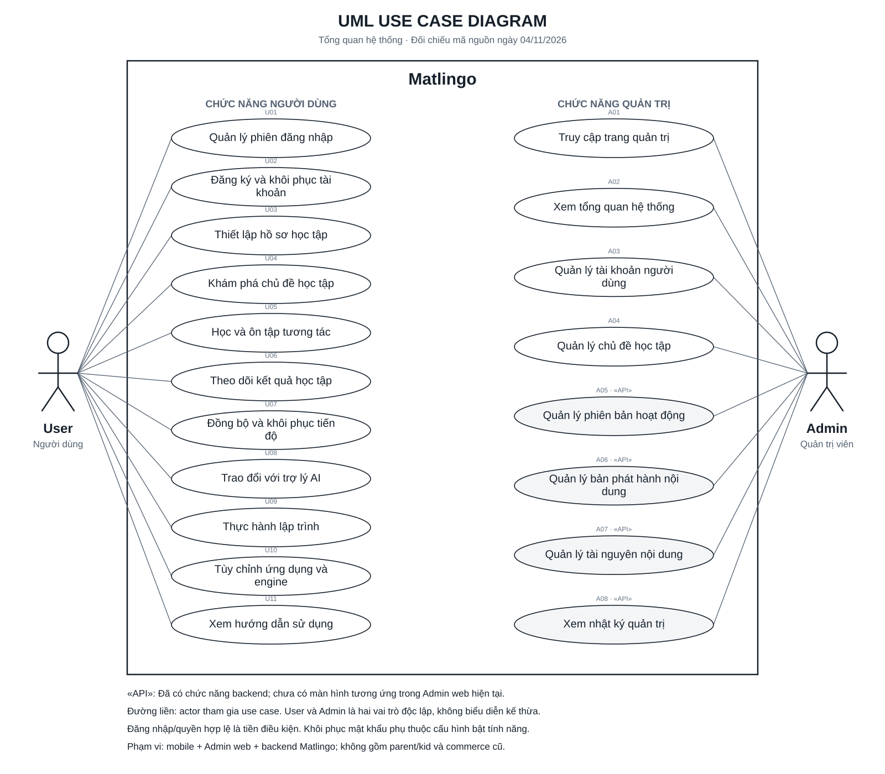

# UML Use Case tổng quan — Matlingo

Đối chiếu ngày 04/11/2026. Phạm vi hiện hành: mobile, Admin web và backend. Sơ đồ mô tả chức năng, không chứng nhận kết quả E2E.

## Tệp bàn giao

- SVG: xem/in/phóng to rõ nét.
- Draw.io: mở bằng diagrams.net để chỉnh sửa từng phần tử; use case là phần tử con của boundary.
- PlantUML: nguồn UML khai báo; bố cục tự động khi render có thể khác SVG.
- `generate-usecase.mjs`: model chung; chạy bằng Node.js để tái tạo các tệp.

## Quy tắc và phạm vi

Hai actor User và Admin nằm ngoài system boundary Matlingo. Bên trong có 19 use case tổng quát: 11 User, 8 Admin. Tên thể hiện mục tiêu nghiệp vụ, không biến từng màn hình/nút/endpoint thành một use case.

Association là đường liền không mũi tên. Không biểu diễn kế thừa giữa hai role. Đăng nhập, quyền hợp lệ, kết nối và cấu hình engine là tiền điều kiện tương ứng. Không dùng include/extend để diễn đạt tuần tự màn hình. Ở mức tổng quan này không cần include/extend: gợi ý, làm lại, bảng vẽ và các bước xác thực được ánh xạ trong bảng bên dưới.

«API» là stereotype quy ước: backend đã có nhưng Admin web chưa có màn hình tương ứng; không được diễn giải thành CMS giao diện đã hoàn thiện. Supabase/Gemini/email/code provider không phải role người dùng; sơ đồ này cố ý chỉ biểu diễn hai actor nghiệp vụ theo phạm vi dự án.

## Bao phủ chức năng

| ID | Actor | Use case | Hành vi được gom | Nguồn trong repository |
|---|---|---|---|---|
| U01 | User | Quản lý phiên đăng nhập | Đăng nhập, đăng xuất, đóng phiên và các màn hình của tài khoản trước. | `lib/features/account/cloud_account_page.dart`; `lib/data/repositories/auth_repository.dart` |
| U02 | User | Đăng ký và khôi phục tài khoản | Đăng ký email/mật khẩu, xác nhận OTP, gửi lại mã; quên mật khẩu, xác minh mã và đặt mật khẩu mới khi bật recovery. | `lib/features/account/`; `lib/main.dart` |
| U03 | User | Thiết lập hồ sơ học tập | Đặt tên, chọn sở thích, mục tiêu thời lượng; quản lý thông tin hồ sơ. Cloud hiện có một tiến độ chính theo account; chọn/đổi nhiều hồ sơ là chế độ offline/legacy. | `lib/entry_flow.dart`; `lib/learning_store.dart`; `lib/main.dart` |
| U04 | User | Khám phá chủ đề học tập | Danh sách, tìm kiếm, lọc, thông tin chủ đề, lộ trình và đề xuất; tôn trọng catalog/visibility từ server. | `lib/journey_app.dart`; `lib/discovery_paths.dart`; `lib/topic_roadmap.dart` |
| U05 | User | Học và ôn tập tương tác | Bắt đầu/tiếp tục; thao tác mô hình, kiểm tra đáp án, phản hồi, gợi ý, làm lại, hoàn thành và ôn tập. Bao phủ toàn bộ lĩnh vực và cơ chế tương tác. | `lib/journey_app.dart`; `lib/interactive_workspace.dart`; `lib/experiments/`; `lib/features/assessment/` |
| U06 | User | Theo dõi kết quả học tập | Tiến độ, lịch sử, thời gian học, hoạt động theo ngày, thành tựu, điểm local và XP server xác nhận. | `lib/journey_app.dart`; `lib/learning_store.dart`; `lib/learning_guidance.dart` |
| U07 | User | Đồng bộ và khôi phục tiến độ | Lưu nháp/phiên/bài làm; server xác nhận kết quả; sao lưu và tải tiến độ theo account, retry offline và xử lý xung đột. Không cam kết tự merge mọi thay đổi đa thiết bị. | `lib/data/providers/cloud_backup_controller.dart`; `lib/data/providers/learning_sync_controller.dart`; `lib/data/repositories/backup_repository.dart` |
| U08 | User | Trao đổi với trợ lý AI | Hỏi đáp học tập và sử dụng app, bảng vẽ/ngữ cảnh; Gemini mặc định hoặc engine AI cá nhân. | `lib/home_chat_box.dart`; `lib/features/tutor/`; `supabase/functions/tutor-chat/` |
| U09 | User | Thực hành lập trình | Soạn/chạy Python và JavaScript, nhập input, xem output/lỗi qua engine code đã cấu hình. | `lib/features/coding/`; `lib/data/repositories/engine_runtime.dart`; `lib/data/engines/` |
| U10 | User | Tùy chỉnh ứng dụng và engine | Giao diện, chữ lớn, giảm chuyển động; thêm/sửa/xóa/chọn kết nối AI hoặc code. | `lib/settings_menu.dart`; `lib/app_preferences.dart`; `lib/features/engines/`; `lib/data/repositories/engine_registry.dart` |
| U11 | User | Xem hướng dẫn sử dụng | Trợ giúp, giới thiệu và thông tin phiên bản. | `lib/settings_menu.dart`; `lib/data/repositories/app_info_repository.dart` |
| A01 | Admin | Truy cập trang quản trị | Đăng nhập/đăng xuất Admin, kiểm tra role và trạng thái account; từ chối hoặc thu hồi truy cập. | `lib/admin_main.dart`; `lib/features/admin/`; `lib/data/providers/admin_dashboard_controller.dart` |
| A02 | Admin | Xem tổng quan hệ thống | Thống kê tổng quan, làm mới và cập nhật khi có Realtime. | `lib/features/admin/admin_app.dart`; `lib/data/providers/admin_dashboard_controller.dart` |
| A03 | Admin | Quản lý tài khoản người dùng | Xem, tìm kiếm, phân trang; khóa/mở tài khoản. Không bao gồm xóa user, đọc mật khẩu hoặc cấp quyền tùy ý. | `lib/features/admin/admin_app.dart`; `lib/data/repositories/admin_repository.dart` |
| A04 | Admin | Quản lý chủ đề học tập | Tạo/sửa metadata, thứ tự và trạng thái draft/active/archived. Topic rỗng không tự tạo bài học. | `lib/features/admin/admin_app.dart`; `supabase/migrations/20261107000000_admin_catalog_topics.sql` |
| A05 | Admin | Quản lý phiên bản hoạt động «API» | Tạo/cập nhật nội dung draft; không sửa trực tiếp phiên bản đã published. | `supabase/migrations/20261030000000_learning_server_api.sql` |
| A06 | Admin | Quản lý bản phát hành nội dung «API» | Tạo release/manifest, publish sau kiểm tra tương thích, retire release; bảo vệ nội dung đã xuất bản. | `supabase/migrations/20261030000000_learning_server_api.sql` |
| A07 | Admin | Quản lý tài nguyên nội dung «API» | Tải ảnh, đăng ký metadata, gắn ảnh hợp lệ vào hoạt động draft; truy cập private assets theo quyền. | `supabase/functions/learning-api/handler.ts`; `supabase/migrations/20261031000000_learning_content_delivery.sql` |
| A08 | Admin | Xem nhật ký quản trị «API» | Đọc audit thao tác quản trị, không sửa/xóa nhật ký. | `supabase/migrations/20261030000000_learning_server_api.sql` |

## Cập nhật so với tài liệu ngày 28/10/2026

Tài liệu `docs/USE_CASE_DIAGRAM_REQUIREMENTS.md` giữ đúng phạm vi hai actor nhưng một số trạng thái triển khai đã cũ:

- Admin web đã có entrypoint, tổng quan, quản lý account và metadata topic. Chỉ A05–A08 mới đánh dấu API.
- Cloud hiện dùng `singleProfile: true` với `SupabaseAccountProgressRepository`: một tiến độ chính theo account, không trình bày chọn nhiều hồ sơ như yêu cầu chính của cloud.
- Catalog hiện hành có 20 chủ đề/139 hoạt động, được gom trong khám phá/học tập.
- Gemini mặc định đi qua tutor-chat; engine AI cá nhân/code có điều kiện cấu hình riêng.
- Recovery phụ thuộc PASSWORD_RECOVERY_ENABLED và dịch vụ email tương ứng.

Ánh xạ ID của tài liệu cũ → sơ đồ mới: U01–U03,U05 → U02; U04,U06 → U01; U07,U08 → U03 (U08 chỉ offline/legacy); U09 → U04; U10–U14 → U05; U15 → U06; U16–U19 → U07; U20,U21 → U08; U22 → U09; U23,U24 → U10; U25 → U11. Admin cũ: A01 → A01; A02 → A02; A03,A04 → A03; A05 → A04; A06 → A05; A07–A09 → A06; A10 → A07; A11 → A08.

Không đưa parent/kid, Parent Gate, VNPay/MoMo, subscription, Plus/Premium, Stars/Gems hoặc wardrobe vào phạm vi hiện hành. Không thêm Teacher, Guest, xóa tài khoản, xem mật khẩu, cấp XP thủ công hay phân quyền tùy ý. File/migration lịch sử không chứng minh module còn hoạt động.

Lưu nháp, retry, xác nhận XP và chống thưởng trùng là hành vi/quy tắc hỗ trợ U05–U07. Realtime làm mới dashboard hỗ trợ A02–A04. Hệ thống không được vẽ như actor của chính nó.

Nguồn tổng thể: ROLE_COMMERCE_DEVELOPMENT_PLAN.md; SUPABASE_INTEGRATION_STATUS.md; final docs/PROJECT_ARCHITECTURE_VI.md; docs/USE_CASE_DIAGRAM_REQUIREMENTS.md; đối chiếu entrypoint, màn hình, controller/repository, Edge handler, migration và test hiện hành. Đường dẫn nguồn trong bảng tương đối với D:\Brilliant Clone\brilliant_mobile\repo-history.

Không sửa mã ứng dụng, cấu hình, migration hoặc tài liệu lịch sử.
