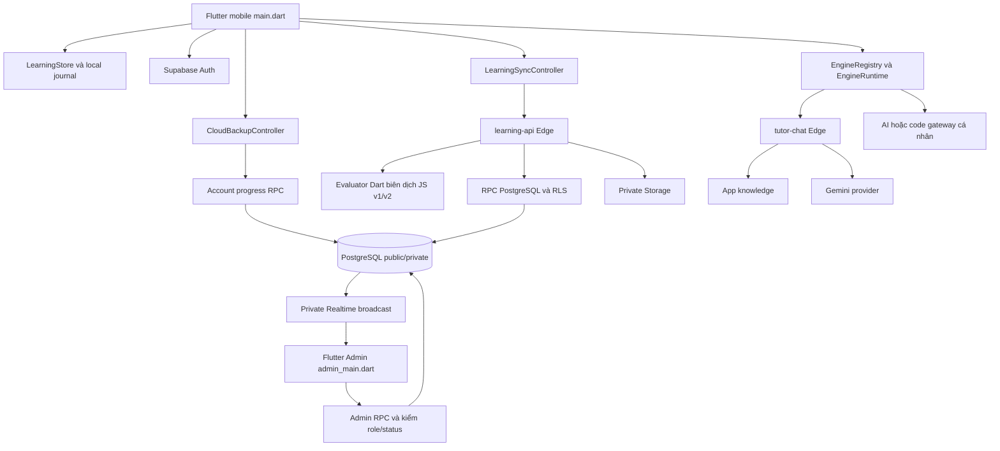
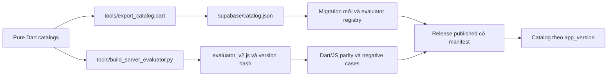
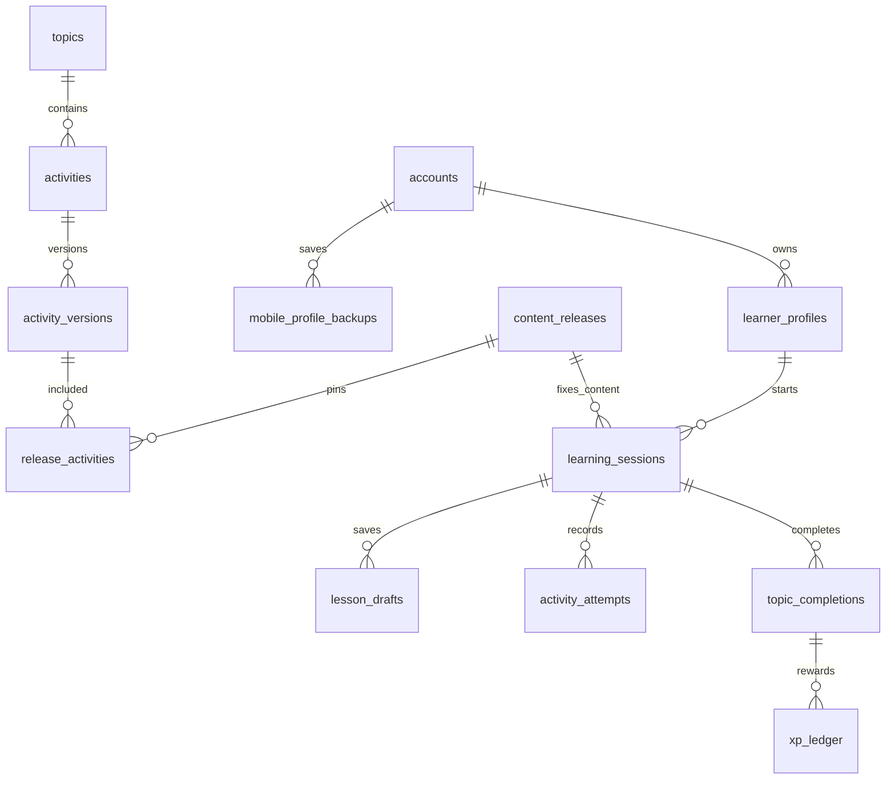

# Matlingo — Toàn bộ kiến trúc frontend, backend, Supabase và engine

Ngày đối chiếu: 03/11/2026. Repository: `PRM393-FPT-FA26`, package Flutter: `brilliant_mobile`, phiên bản sản phẩm `1.3.2+6`. Root nguồn tại máy thực hiện: `D:\Brilliant Clone\brilliant_mobile\repo-history`.

Tài liệu mô tả mã nguồn hiện hành đã merge vào `main`, kết hợp truy vấn chỉ đọc Supabase trong lượt này. Các tệp lịch sử có tên MathLingo/commerce không tự chứng minh tính năng đó đang hoạt động. Kết quả chạy tự động mới được ghi riêng trong `TEST_AND_MERGE_REPORT_2026-11-03.md` cùng thư mục.

## 1. Sản phẩm và phạm vi thực tế

Matlingo là ứng dụng học bằng thí nghiệm tương tác: người học thay đổi mô hình, nhận gợi ý, kiểm tra kết quả, lưu nháp và hoàn thành chủ đề. Catalog hiện tại có **20 chủ đề, 139 hoạt động, 40 cơ chế tương tác**. Nội dung gồm toán, logic, khoa học, lập trình, dữ liệu, ngôn ngữ, nghệ thuật, xã hội và kỹ năng sống.

Frontend mobile hỗ trợ học cục bộ; bản có cấu hình cloud yêu cầu đăng nhập và đồng bộ tiến độ theo tài khoản. Điểm học local và XP được server xác nhận là hai nguồn khác nhau. Snapshot tải lên không phải bằng chứng đủ để nhận XP.

Admin là một entry point Flutter riêng, có thể build web. UI hiện có tổng quan, tìm kiếm/phân trang tài khoản, khóa/mở tài khoản và tạo/sửa/lưu trữ metadata chủ đề. Backend có thêm API nội dung/release/assets; chưa nên mô tả UI Admin là CMS biên soạn/publish đầy đủ mọi cơ chế bài học.

Hai role ứng dụng hiện hành là `user` và `admin`. Các role Supabase `anon`, `authenticated`, `service_role` là role hạ tầng. Quy tắc parent/kid, VNPay, MoMo và wardrobe trong tài liệu/migration cũ thuộc lịch sử MathLingo; không phải các module đang được entry point hiện tại sử dụng.

## 2. Tech stack và nơi sử dụng

| Công nghệ / phiên bản khai báo | Module sử dụng | Trách nhiệm |
|---|---|---|
| Flutter 3.47.4; Dart 3.13.3 trên máy và CI | Mobile, Admin web, test, công cụ Dart | UI, state, mô hình bài học, biên dịch evaluator |
| Material, Navigator, ChangeNotifier, ListenableBuilder, scope widget | App shell, màn học, controller | Render, navigation và thông báo state; không có Riverpod/BLoC/go_router trong pubspec |
| `supabase_flutter: 2.18.3` | Auth, repository học tập/backup/Admin | Phiên đăng nhập, REST/RPC và Realtime |
| `shared_preferences: ^2.5.6` | LearningStore, preferences, cache catalog | Snapshot JSON, journal đồng bộ, tùy chỉnh hiển thị; không dùng làm kho secret engine |
| `flutter_secure_storage: 11.2.0` | Engine storage | Credential engine cá nhân tách theo tài khoản |
| `http: 1.6.0` | Learning API, recovery, tutor và adapter engine | HTTP có timeout, ràng buộc owner và xử lý lỗi |
| `crypto: 3.0.7` | Sync, evaluator, assets | SHA-256, ID ổn định và kiểm tính toàn vẹn |
| `package_info_plus: 10.2.2` | Thông tin ứng dụng | Hiển thị thông tin build/version |
| `flutter_tts: 4.2.5` | Bài ngôn ngữ | Đọc câu bằng dịch vụ TTS của thiết bị |
| `speech_to_text: 7.5.0` | Bài luyện câu | Speech recognition, transcript, nhập chữ thay thế |
| PostgreSQL, PL/pgSQL, RLS | Supabase Database | Dữ liệu canonical, quyền truy cập, transaction, RPC, revision và XP |
| Supabase Auth | Mobile/Admin | Email/password, xác nhận OTP, session và recovery có cờ bật riêng |
| Supabase Storage | Learning API/assets | Bucket private, ảnh và URL ký có thời hạn |
| Supabase Realtime | Admin | Private broadcast báo thay đổi để controller đọc lại dữ liệu |
| TypeScript, JavaScript, Deno 2.9.6 | Hai Edge Functions và handler tests | Auth gateway, chấm bài, assets và gọi Gemini |
| Gemini qua Edge | Koji/trợ lý mặc định | Trả lời học tập, nhận ngữ cảnh canvas; không cấp XP |
| Python, Dart CLI, Node.js | `tools`, evaluator parity | Export catalog, build evaluator và kiểm tra tương đương |
| Android Gradle/Kotlin, Java target 17 | Android app | Build/cài APK, tích hợp plugin native |
| GitHub Actions | `.github/workflows/verify.yml` | Analyze, tests, parity, checker, Android và Admin web build |

Phiên bản dependency là khai báo trong repository, không phải tuyên bố phiên bản mới nhất của nhà cung cấp. Phiên bản package có dấu `^` được giải quyết cụ thể trong `pubspec.lock`.

Nguồn: [pubspec.yaml](<D:/Brilliant Clone/brilliant_mobile/repo-history/pubspec.yaml>), [verify.yml](<D:/Brilliant Clone/brilliant_mobile/repo-history/.github/workflows/verify.yml>).

## 3. Sơ đồ toàn hệ thống



Không có một Node/Express backend độc lập phục vụ app hiện tại. Node dùng cho kiểm thử parity; backend chạy trên Supabase Edge và PostgreSQL. Bộ mô phỏng bài học là mã Dart và custom Flutter workspace, không phải Unity/Unreal hay một physics engine bên ngoài.

## 4. Khởi động, navigation và vòng đời

[main.dart](<D:/Brilliant Clone/brilliant_mobile/repo-history/lib/main.dart>) tạo Flutter binding và LearningStore. Nếu thiếu `SUPABASE_URL`/`SUPABASE_PUBLISHABLE_KEY`, app chạy offline với EngineHost. Khi có cloud config, entry point khởi tạo Supabase, tạo CloudBackupController, LearningSyncController, cache catalog và factory trợ lý mặc định.

Bản mobile hiện dùng `SupabaseAccountProgressRepository` và `singleProfile: true`: một tiến độ chính được server ghim theo account. Cấu trúc backup/profile cũ vẫn tồn tại để tương thích; không đồng nghĩa UX cloud hiện tại là trình quản lý nhiều hồ sơ độc lập.

[journey_app.dart](<D:/Brilliant Clone/brilliant_mobile/repo-history/lib/journey_app.dart>) chứa LearnApp, HomeShell, Today/Explore/Topic/Lesson/Completion/Profile. LearnApp đi qua kiểm tra tài khoản, tải tiến độ và onboarding trước màn học. Key MaterialApp theo user giúp thay account không giữ route của account trước. Navigator và route tùy biến đảm nhận chuyển màn; lifecycle lưu/flush khi background và refresh khi resume.

[admin_main.dart](<D:/Brilliant Clone/brilliant_mobile/repo-history/lib/admin_main.dart>) là entry riêng: kiểm config rồi dựng Auth repository, Admin repository và AdminDashboardController.

## 5. Bản đồ module frontend và engine

| Module | File/thư mục dưới root nguồn | Engine/cơ chế | Dữ liệu và kết nối |
|---|---|---|---|
| Entry/onboarding | `lib/entry_flow.dart`, `lib/journey_app.dart` | Flutter forms, validation, Navigator | Tên, quan tâm, thời lượng; LearningStore/Cloud controller |
| Auth/account | `lib/features/account`, `lib/data/repositories/auth_repository.dart` | Supabase Auth SDK | Login, signup, OTP, logout; recovery repository/controller riêng |
| Home/explore | `lib/discovery_paths.dart`, `lib/learning_guidance.dart`, `lib/topic_roadmap.dart` | Catalog filters, roadmap/prerequisite, đề xuất local | Tôn trọng availableTopics và metadata/status server |
| Catalog bài | `lib/learning_catalog.dart`, `lib/experiments/activity_catalog.dart` | ExperimentSpec và catalog thuần Dart | 20 chủ đề/139 hoạt động; nguồn chung cho mobile và exporter |
| Màn học | `lib/journey_app.dart`, `lib/interactive_workspace.dart` | ExperimentWorkspace điều phối renderer, validator/evaluator | State tương tác, hint, feedback, draft, completion |
| Toán | `lib/experiments/math_*`, `fraction_evaluation.dart` | Hàm Dart deterministic | Phân số, mô hình trực quan và điều kiện đúng/sai |
| Khám phá | `lib/experiments/discovery_*` | Mô hình state và evaluator Dart | Logic, khoa học, dữ liệu, code/mạch/xác suất theo catalog |
| Reasoning/diverse/deep | `reasoning_workspace.dart`, `diverse_workspace.dart`, `deep_catalog.dart` | Constraint/rule/evidence reasoning | Lựa chọn có lý do, mô hình và bài chuyển giao |
| Hình khối/không gian | `solid_model.dart`, `solid_catalog.dart`, `space_workspace.dart`, `space_guidance.dart` | Hình học/projection/picking viết bằng Dart, render Flutter | Thể tích, lớp, camera, globe; không dựa trên game engine ngoài |
| Curriculum mở rộng | `curriculum_catalog.dart`, `curriculum_engine.dart`, `curriculum_workspace.dart` | 9 cơ chế tái sử dụng | Ghép, sắp xếp, phân loại, điền, bằng chứng, nhân quả, ngân sách, nghe, luyện câu |
| Ngôn ngữ/âm thanh | `lib/data/engines/language_audio.dart` | DeviceLanguageAudio, TTS, STT hệ điều hành | Xin quyền theo thao tác; transcript và typing fallback |
| Tiến độ/profile | `lib/learning_store.dart`, `learning_activity.dart` | ChangeNotifier, snapshot JSON, local journal | Draft, completed, history, timer/ngày, local points và verified points |
| Catalog cloud | `mobile_catalog.dart`, `catalog_cache_repository.dart` | Decode/filter theo bản app, cache theo owner | Không chuyển cache account trước sang account sau |
| Cloud snapshot | `cloud_backup_controller.dart`, `backup_repository.dart` | Revision, retry và conflict handling | `load_account_progress`, `save_account_progress` |
| Canonical sync | `learning_sync_controller.dart`, `learning_repository.dart`, `learning_journal.dart` | Durable journal, operation IDs, owner guard | learning-api, attempt/completion/verified XP |
| Chat/Koji | `home_chat_box.dart`, `supabase_tutor_repository.dart` | Default SupabaseTutorRepository hoặc AI engine được chọn | FAQ/Gemini hoặc endpoint cá nhân |
| Canvas | `lib/features/tutor/shared_canvas.dart` | Flutter drawing, normalized coordinates | Strokes/overlays thành ngữ cảnh chat; không phải cộng tác realtime nhiều người |
| Engine settings | `lib/features/engines`, `engine_registry.dart`, `engine_storage.dart` | Registry, secure storage, factory adapter | Chọn/sửa/xóa cấu hình; credential không vào backup học tập |
| Code playground | `lib/features/coding`, `http_code_engine.dart` | Docker gateway, Judge0 adapter hoặc Pyodide bridge | Python/JavaScript, stdin/stdout/stderr; cần runtime ngoài được cấu hình |
| Mastery/roadmap | `learning_modules.dart`, `catalog_roadmaps.dart`, `features/assessment` | MasteryPathwayController, quiz/dashboard widgets | Gợi ý luyện local; không tự biến thành mastery/XP verified |
| Admin | `lib/features/admin`, `admin_dashboard_controller.dart`, `admin_repository.dart` | Flutter tables/forms, RPC, private broadcast | Quyền lấy từ DB, không chỉ ẩn nút trên UI |
| Theme/layout/motion | `app_theme.dart`, `app_preferences.dart`, `lesson_theme.dart`, `app_layout.dart`, `app_motion.dart` | Flutter theme, fonts, responsive constraints, MotionSize | Text scale, palette, giảm chuyển động và accessibility |

Các đường dẫn trong bảng đều có tiền tố tuyệt đối `D:\Brilliant Clone\brilliant_mobile\repo-history\`. Phụ lục cuối tài liệu cung cấp liên kết tuyệt đối tới từng file nguồn.

## 6. Catalog, evaluator và quy trình phát hành

`ExperimentSpec` giữ ID, title, prompt, hint, explanation, mechanism, state ban đầu, config, validator/evaluator, stage, skill IDs và content/mechanism version. Config là tham số bài, state là thao tác người học. `initialData()` deep-copy JSON; exception trong evaluator trở thành kết quả invalid-state.

`activity_catalog.dart` ghép math/discovery/extended/diverse/solid/deep/curriculum thành catalog thuần Dart. `learning_catalog.dart` thêm metadata dành cho UI. Backend không cần import thư viện Flutter để chấm bài.



Live project đang có hai release published: `frontend-baseline-2026-10-26` và `frontend-complete-2026-11-03`. Mobile API gửi `app_version=1.3.2` để nhận release đủ 139 hoạt động. Baseline/evaluator v1 giữ cho client/phiên cũ. Activity `math-number-line` có content version mới; bản cũ vẫn tồn tại.

Session được ghim release/content version. Router Edge chọn evaluator/hash phía server; không nhận một kết quả đúng/sai do client tự khai. `legacy_evaluator.ts` giữ hàm evaluator cũ trước khi đăng ký evaluator v2. Parity kiểm cả kết quả lẫn implementation hash; `.gitattributes` giữ LF cho artifact evaluator/version để Windows không đổi hash.

Metadata topic gồm tên, mô tả, lĩnh vực, action, icon, thứ tự và status được tải từ server. Draft/archived không hiện trong khám phá mới; active vẫn cần đủ activity tương thích. Guard server chặn session mới cho topic không active, còn session đã ghim vẫn lưu được. Admin tạo một topic rỗng không tự tạo renderer/evaluator cho mobile.

Bộ so sánh tương thích chuẩn hóa số nguyên dạng double: JSONB có thể trả RGB `[0,0,1]` trong khi Dart khai báo `[0.0,0.0,1.0]`; hai state này tương đương. Giá trị thực sự khác như `0.5` hoặc chuỗi `"1"` vẫn bị từ chối. Đây là lỗi ẩn chủ đề Mạch điện được phát hiện bằng lượt E2E live và sửa trong lần bàn giao này.

Hàm `equivalentCatalogValue` được dùng chung cả ở decode catalog và kiểm tương thích session trong LearningSyncController. Nếu chỉ sửa decode, bài vẫn học được nhưng journal có thể hoãn gửi session và thiếu XP verified. Canonical hash phục vụ metadata/operation receipt vẫn giữ thuật toán riêng, không thay để xử lý khác biệt scene number.

## 7. State local, cache và đồng bộ

LearningStore dùng SharedPreferences với snapshot key `nary:journey:v3`. Snapshot chứa profile, nháp, hoàn thành, lịch sử, dữ liệu ngày và journal. Lịch sử local giới hạn 100 dòng. Điểm học local bằng số chủ đề hoàn thành nhân 30; `verifiedPoints` lấy từ kết quả canonical server đã đồng bộ.

Snapshot backup và canonical sync là hai luồng bổ sung. Snapshot khôi phục trải nghiệm đầy đủ; canonical lưu profile/session/draft/attempt/completion để server xác minh. Snapshot không được phép ghi đè ledger XP. Journal cùng snapshot giữ yêu cầu pending qua việc tắt app.

LearningSyncController dùng owner/token ràng buộc request, ID ổn định và operation UUID để retry. Đổi account tăng generation, bỏ kết quả request cũ và phục hồi cache đúng owner. Retry định kỳ 30 giây; catalog được refresh ngay cả khi không có session pending. Nội dung chưa tương thích được giữ để sync sau thay vì tự nhận verified XP.

Backup RPC kiểm expected owner/revision. Gửi lại payload hợp lệ không tạo revision vô ích; payload khác với revision cũ bị PT409. Conflict cần lựa chọn rõ ràng, không mặc định ghi đè dữ liệu của thiết bị khác. Không có bằng chứng cơ chế tự merge mọi thay đổi đồng thời giữa nhiều điện thoại vật lý.

## 8. Database Supabase hiện hành

Project ID: `seoswmcldwwytdrfrrrb`. Truy vấn live ngày đối chiếu thấy **24 bảng ứng dụng: 16 public và 8 private**, tất cả có RLS bật. Auth và Storage do Supabase quản lý riêng.

| Schema / bảng | Trách nhiệm | Quan hệ/authority chính |
|---|---|---|
| `public.accounts` | Metadata tài khoản | ID nối Auth user |
| `private.account_access` | Role và status active/suspended/deleting | Nguồn quyền thật, client không tự nâng role |
| `public.learner_profiles` | Hồ sơ học canonical | Owner account; revision |
| `private.account_learning_roots` | Ghim tiến độ chính của account | Tương thích single-account progress |
| `public.mobile_profile_backups` | Snapshot tiến độ | Owner, profile key, revision và payload |
| `public.topics` | Metadata chủ đề | Status, sort order, title/subject/icon |
| `public.activities` | ID hoạt động ổn định | Thuộc topic |
| `public.activity_versions` | Nội dung/config có phiên bản | Liên kết cơ chế và evaluator version; published bất biến |
| `public.content_releases` | Bản phát hành nội dung | Min app version, status, manifest hash |
| `public.release_activities` | Manifest activity của release | Content version, vị trí, required |
| `private.evaluator_versions` | Registry bộ chấm | Handler, hash, input schema, status |
| `public.learning_sessions` | Phiên học canonical | Owner/profile/topic và release được ghim |
| `public.lesson_drafts` | Bản nháp theo session/activity | Revision và snapshot state |
| `public.activity_attempts` | Lượt nộp và kết quả server | Không chấp nhận client tự ghi verified result |
| `public.topic_completions` | Hoàn thành đã xác nhận | Session/profile/topic và nguồn |
| `public.xp_ledger` | Thưởng XP | Reward key duy nhất để chống thưởng trùng |
| `public.activity_events` | Sự kiện và active time | Telemetry, không tự làm điều kiện cấp XP |
| `public.assets` | Metadata tài nguyên private | Owner/creator, bucket/path/hash/type/status |
| `public.activity_assets` | Gắn ảnh vào content version | Slot/required; nội dung published được bảo vệ |
| `private.sync_heads` | Revision đầu luồng đồng bộ | Theo owner |
| `private.sync_operations` | Receipt và request identity | Retry idempotent; chặn dùng ID cũ với payload mới |
| `private.sync_changes` | Change feed canonical | Cursor revision/index/high water |
| `private.legacy_imports` | Dấu vết import tương thích | Không là quyền tạo XP verified |
| `private.admin_audit_logs` | Audit thao tác quản trị/hệ thống | Actor, request và đối tượng thay đổi |



Sơ đồ là quan hệ nghiệp vụ rút gọn; cần xem constraint SQL khi thay schema. Public RPC dùng SECURITY INVOKER wrapper gọi private authority có kiểm tra auth/role/status; không dùng việc ẩn UI làm ranh giới bảo mật.

## 9. API, Storage và Realtime

Hai Edge Function live được truy vấn trong lượt này: **learning-api v6** và **tutor-chat v4**, trạng thái ACTIVE. Cả hai có `verify_jwt=false` ở gateway nhưng handler tự xác thực qua Auth và kiểm tra account active; không có nghĩa endpoint cho phép thao tác anonymous.

| learning-api route | Chức năng |
|---|---|
| `GET catalog?app_version=...` | Chọn release và nội dung tương thích |
| `POST mutate` | Profile/session/draft/completion/event mutation có operation ID |
| `POST attempts` | Chấm state bằng evaluator server, ghi attempt qua authority route |
| `GET sync` | Change feed phân trang với cursor |
| `GET progress` | Tiến độ canonical profile |
| `GET/POST admin` | Đọc/mutation nội dung và tài khoản có kiểm quyền |
| `POST assets`, `GET assets/...` | Upload ảnh và cấp URL đọc |
| `POST admin/assets` | Gắn tài nguyên nội dung có kiểm quyền |

Nguồn hợp đồng: [LEARNING_SERVER_API.md](<D:/Brilliant Clone/brilliant_mobile/repo-history/docs/LEARNING_SERVER_API.md>), [handler.ts](<D:/Brilliant Clone/brilliant_mobile/repo-history/supabase/functions/learning-api/handler.ts>).

State bài làm được giới hạn depth 8, array 128 phần tử, object 64 trường, string 1024 ký tự và số hữu hạn có biên. Handler giới hạn body, trả business error ổn định và không lộ raw SQL/provider secret. Hàm dùng chung nằm tại `_shared/http.ts`.

Storage nhận PNG/JPEG/WebP, kiểm magic bytes, tối đa 2 MiB, SHA-256 và metadata. Bucket `learning-assets`/`user-avatars` private; URL đọc ký 300 giây sau kiểm quyền. Đây là pipeline ảnh, không phải upload file/video/GLB tùy ý.

Admin repository gọi `get_my_access`, `admin_dashboard_read`, `admin_learning_mutate`. Private channel `matlingo:admin` chỉ broadcast invalidation, không gửi toàn bộ email/account rows. Controller debounce refresh và có polling 30 giây dự phòng; bảng vẫn đọc lại bằng RPC có quyền. RLS của `realtime.messages` chỉ cho Admin phù hợp nhận channel này.

## 10. AI, model và engine thực thi code

### 10.1 Trợ lý mặc định

Luồng mặc định: HomeChatBox → EngineRuntime → SupabaseTutorRepository → `tutor-chat` → FAQ hoặc Gemini. Factory chỉ xuất hiện trong bản cloud và dùng owner hiện tại. Endpoint xác thực user thật, từ chối anonymous/suspended trước khi gọi provider.

`tutor-chat/index.ts` dùng biến `GEMINI_API_KEY`, `GEMINI_MODEL`; fallback model trong source là `gemini-3.5-flash-lite`. Tên model thực tế hosted có thể được override bằng secret; tài liệu này không đọc giá trị secret để xác nhận override. Key dùng chung chỉ nằm phía Edge.

Handler giới hạn 60 messages, 50.000 ký tự, canvas 256 KiB, output 2.048 tokens, timeout provider 35 giây; burst map 10 request/phút/account trong từng isolate. Đây không phải quota phân tán toàn hệ thống. FAQ ứng dụng có thể trả lời từ `app_knowledge.ts` mà không gửi Gemini. Không có lệnh trong chat cấp XP hoặc xác nhận mastery.

### 10.2 Engine cá nhân và adapter

| EngineProvider | Adapter / giao thức trong source | Module gọi | Điều kiện thực sự hoạt động |
|---|---|---|---|
| Gemini | HTTP Gemini API | Chat và canvas | Endpoint/model hợp lệ và credential có quyền |
| OpenAI | Responses-compatible HTTP | Chat và canvas | Gateway/provider được cấu hình; không giả định mọi model đã thử |
| Anthropic | Messages HTTP | Chat | Endpoint và token tương thích |
| Ollama | `/api/chat`, non-streaming | Chat | Máy/gateway phục vụ model; HTTP chỉ được config cho loopback/10.0.2.2 |
| Koji | Gateway JSON tùy chỉnh | Chat/canvas | Endpoint trả schema text phù hợp |
| Docker | Gateway nhận source/language/stdin/limits | CodePlaygroundPage | Backend sandbox thực; app không khởi chạy Docker daemon |
| Judge0 | Submissions và polling | CodePlaygroundPage | Server và language ID từ deployment đó |
| Pyodide | `embedded:pyodide` và `attachPyodide(runner)` | CodePlaygroundPage | Host phải gắn bridge; chưa chứng minh app đã nhúng runtime đầy đủ |

EngineRegistry lưu metadata và credential qua SecureEngineStorage theo account. EngineRuntime resolve adapter tại thời điểm request, hot-swap áp dụng request kế tiếp. Request đang chạy giữ cấu hình cũ; đổi tài khoản/dispose đóng client. HTTP adapter không tự follow redirect, giới hạn response 1 MiB và không hiển thị body lỗi chứa secret.

Code playground hỗ trợ Python/JavaScript, lexical highlighting, mẫu code, stdin/stdout/stderr/error. Nó không phải evaluator cấp XP. Timeout/limits gửi từ client không tạo được sandbox; CPU/RAM/network/filesystem phải do gateway thực thi. Sự có mặt adapter trong source không chứng minh server Docker/Judge0/Pyodide đã được triển khai hoặc test live.

### 10.3 Ngôn ngữ và canvas

DeviceLanguageAudio dùng plugin native cho TTS và speech recognition, chỉ xin micro sau thao tác. Khi background/rời bài/khóa câu trả lời thì dừng. Câu nói được kiểm theo transcript/so khớp nội dung, không đo chất lượng phát âm. Có transcript và nhập chữ thay thế; dịch vụ speech hệ điều hành có thể cần mạng.

SharedCanvasDocument gồm strokes và overlays với tọa độ chuẩn hóa 0..1. Canvas là ngữ cảnh do người học cung cấp cho AI, không phải chỉ dẫn hệ thống, không phải bảng cộng tác nhiều người hoặc mô hình nhận dạng hình vẽ đã huấn luyện riêng.

## 11. UI/UX và nền tảng

Theme thực tế nằm ở `lib/app_theme.dart`, `app_preferences.dart`, `lesson_theme.dart`; layout/motion có file riêng. Các đường dẫn `lib/core/theme` trong quy tắc legacy không tồn tại trong bản app này. Fonts CofoBrilliant, CofoRobert, SourceCodePro, NotoSans và NotoSerif được khai báo asset.

MotionSize trả child trực tiếp khi reduced motion/accessibility yêu cầu, tránh AnimatedSize thời lượng zero gây mutation trong layout. App có tùy chọn palette/text size/heading font; widget tests có ca 320px và text scale lớn. Đây không thay thế QA screen reader và IME trên thiết bị thật.

Android application ID là `com.learningstudio.brilliant_mobile`, có Internet/microphone và service queries cho TTS/speech; `allowBackup=false` để tránh chuyển ciphertext engine credential sang thiết bị thiếu key. Production release yêu cầu keystore; debug-signing override chỉ dành kiểm thử.

Repository có iOS, web, Windows scaffold. Android và Admin web là các mục build trong CI; sự có mặt thư mục nền tảng không chứng minh iOS/desktop chạy hoàn chỉnh. iOS cần macOS/Xcode và QA riêng.

## 12. Bảo mật, migration và vận hành

Auth quản lý email/password/session; DB giữ role/status thật trong private schema. Không tin role từ user_metadata. Client không được ghi ledger XP, kết quả verified hoặc evaluator registry. Completion cần đủ hoạt động bắt buộc, kiểm trong transaction và dùng unique reward key để chống thưởng lặp.

Snapshot local không phải encrypted credential store; secure engine credential không đi cùng backup. Publishable key trong build client không mang quyền service-role. Service-role/Gemini key phải ở biến môi trường/Edge secrets, không có trong mã Flutter/APK phân phối.

Security advisors live trong lượt này báo tám INFO RLS-no-policy ở private tables deny-all và một WARN leaked-password protection chưa bật. Không phát hiện bảng public thiếu RLS trong truy vấn hiện hành. Đây là kiểm cấu hình giới hạn, không phải chứng nhận pentest, secret scan toàn lịch sử Git hay audit mọi dependency.

Migration mới `20261109000000_complete_learning_catalog.sql` bổ sung catalog/evaluator/release và guard topic; không sửa migration cũ. Timestamp filename sau các migration đã giữ trong repo có thể khác timestamp lịch sử remote: cần đối chiếu name/content.

`supabase/schema_reset.sql` là artifact phá hủy schema của đợt reset lịch sử, **không chạy lại trên project hiện tại**. Các migration MathLingo legacy cộng reset source không phải đường replay sạch đã được chứng minh. Không dùng db reset/db push như cách dựng production tự động. Lượt task này không deploy lại function hoặc áp dụng schema migration; chỉ chạy smoke transaction có ROLLBACK và fixture riêng phục vụ E2E.

## 13. Kiểm thử và cách tái lập

CI Flutter: pub get → analyze → Flutter tests → Node evaluator parity → ba Dart checker → debug APK → Admin web. CI Edge: Deno check/lint/test learning-api, tutor-chat và app knowledge. CI không truy cập database live và không chạy reset SQL.

Từ root `D:\Brilliant Clone\brilliant_mobile\repo-history`, chạy lần lượt:

```powershell
flutter pub get
flutter analyze
flutter test --no-pub --reporter expanded
node supabase/tests/evaluator_parity.mjs
dart tools/check_diverse.dart
dart tools/check_depth.dart
dart tools/check_space.dart
deno check supabase/functions/learning-api/index.ts supabase/functions/tutor-chat/index.ts
deno test supabase/tests/learning_handler_test.ts supabase/tests/tutor_handler_test.ts supabase/tests/app_knowledge_test.ts
flutter build apk --debug --dart-define-from-file=config/app.mobile.json
flutter build web --target lib/admin_main.dart --output build/admin-web --dart-define-from-file=config/app.mobile.json
git diff --check
```

`config/app.mobile.json` là file local ignored tạo từ example, chỉ chứa cấu hình client phù hợp. Không commit file chứa credential. E2E live cần hai account disposable, admin được cấp bằng thao tác host có kiểm marker, cấu hình fixture ignored và runner host điều khiển network. Không chạy bộ E2E ghi dữ liệu bằng account cá nhân. Sau test phải dọn đúng fixture, khôi phục quyền/network và cài lại APK thường để loại credential E2E khỏi binary.

SQL smoke kiểm authority/ownership, Admin, assets, retry, revision, catalog visibility; mọi mutation của các script smoke nằm trong BEGIN/ROLLBACK. E2E restore trên namespace native mới cùng emulator không tương đương hai điện thoại vật lý. TTS/micro request không chứng minh chất lượng âm thanh thực.

## 14. Giới hạn và phần phát triển tiếp

| Phần | Trạng thái cần hiểu |
|---|---|
| Toàn catalog mobile/server | Đã có release 20/139; nội dung mới hoàn toàn vẫn cần app renderer và evaluator tương thích |
| Admin CMS | Metadata/account UI đã có; authoring/review/publish toàn bộ nội dung chưa đầy đủ UI |
| Multi-device sync | Có snapshot/revision/conflict và canonical change feed; chưa chứng minh auto-merge mọi nhánh nhiều thiết bị |
| AI quota | Burst theo isolate; quota phân tán và ngân sách provider cần vận hành riêng |
| Sandbox code | Có adapter; không có bằng chứng hạ tầng compiler/sandbox được triển khai trong repo |
| Audio | Có native TTS/STT và fallback; chưa xác nhận chất lượng phát âm/nghe ở mọi thiết bị |
| Recovery/OTP | Có code, recovery có flag; delivery email thực cần kiểm riêng |
| Database bootstrap | Cần baseline an toàn có đối chiếu remote; tuyệt đối không replay reset vào dữ liệu hiện có |
| Release store | Cần signing production, physical-device QA, iOS QA và quy trình phát hành |
| Bảo trì | journey_app.dart tập trung nhiều màn; chỉ tách khi task có nhu cầu, tránh refactor ngoài phạm vi |

## 15. Nguồn tham khảo nội bộ

- [README](<D:/Brilliant Clone/brilliant_mobile/repo-history/README.md>) và [setup nhóm](<D:/Brilliant Clone/brilliant_mobile/repo-history/docs/SETUP_VA_TEST_CHO_TEAM.md>).
- [Backend source/status](<D:/Brilliant Clone/brilliant_mobile/repo-history/supabase/README.md>) và [matching report](<D:/Brilliant Clone/brilliant_mobile/repo-history/docs/FRONTEND_BACKEND_MATCHING_2026-11-03.md>).
- [Engine architecture](<D:/Brilliant Clone/brilliant_mobile/repo-history/docs/ENGINE_ARCHITECTURE.md>) và [API contract](<D:/Brilliant Clone/brilliant_mobile/repo-history/docs/LEARNING_SERVER_API.md>).
- [Validation](<D:/Brilliant Clone/brilliant_mobile/repo-history/VALIDATION.md>) và [AGENTS.md](<D:/Brilliant Clone/brilliant_mobile/repo-history/AGENTS.md>).

Tài liệu cũ là bằng chứng theo thời điểm viết, có thể còn mô tả baseline 53 hoạt động, nhiều profile hoặc Admin pending. Với hiện trạng catalog/cache/UI, dùng nguồn code và kết quả ngày 03/11/2026 trong thư mục này.

## 16. Ph? l?c catalog v? c? ch? t? artifact hi?n h?nh

B?ng ???c t?ng h?p tr?c ti?p t? `supabase/catalog.json`, kh?ng nh?p l?i t? b?o c?o c?.

| Topic ID | Ch? ?? | Ho?t ??ng | C? ch? s? d?ng |
|---|---|---:|---|
| logic | Logic & quy luật | 8 | balanceBlocks, evidenceBoard, gearRatios, logicalCounterexample, removeBothSides, sequenceTiles |
| math | Những phần bằng nhau | 8 | distributeObjects, evidenceBoard, fractionFold, fractionNumberLine, fractionPaint, matchPairs |
| science | Phòng thí nghiệm chuyển động | 7 | causalExperiment, launchAngle, leverTorque, motionTimeline, sequenceTiles |
| data | Dữ liệu biết kể chuyện | 8 | evidenceBoard, histogramBins, matchPairs, outlierExplorer, redistributeMean, sortBars |
| geometry | Xưởng hình học | 8 | causalExperiment, matchPairs, polygonVertices, solidExplorer, symmetryMirror, tangramRotate |
| coding | Lập trình bằng hành động | 13 | evidenceBoard, loopBuilder, reasonedChoice, robotRoute, sequenceTiles, sortingNetwork |
| circuits | Ánh sáng & mạch điện | 7 | colorMixer, evidenceBoard, matchPairs, switchLogic, wireCircuit |
| probability | Điều gì sẽ xảy ra? | 7 | evidenceBoard, matchPairs, probabilityBag, probabilitySpinner, sampleSpace |
| algebra | Đại số bằng mô hình | 6 | matchPairs, redistributeMean, removeBothSides, sequenceTiles, solidExplorer |
| optimization | Thuật toán hiệu quả | 5 | evidenceBoard, motionTimeline, resourceBudget, robotRoute, sortingNetwork |
| geography | Trái Đất trong tay bạn | 4 | evidenceBoard, globeExplorer, matchPairs, strataExplorer |
| marxism | Chủ nghĩa Mác–Lênin | 8 | evidenceBoard, reasonedChoice, sequenceTiles |
| painting | Hội họa & ngôn ngữ thị giác | 8 | evidenceBoard, matchPairs, reasonedChoice |
| english | Tiếng Anh trong cuộc sống | 6 | listeningChoice, matchPairs, sequenceTiles, speechPractice |
| vietnamese | Tiếng Việt & giao tiếp | 6 | categorySort, clozeBank, evidenceBoard, matchPairs, sequenceTiles |
| biology | Sự sống quanh ta | 6 | categorySort, causalExperiment, clozeBank, evidenceBoard, matchPairs, sequenceTiles |
| chemistry | Vật chất & biến đổi | 6 | categorySort, clozeBank, evidenceBoard, matchPairs, resourceBudget, sequenceTiles |
| astronomy | Bầu trời & vũ trụ | 6 | clozeBank, evidenceBoard, matchPairs, resourceBudget, sequenceTiles |
| finance | Tiền & lựa chọn | 6 | categorySort, clozeBank, evidenceBoard, matchPairs, resourceBudget, sequenceTiles |
| digital | Công dân số thông minh | 6 | categorySort, clozeBank, evidenceBoard, matchPairs, resourceBudget, sequenceTiles |

### M?i c? ch? ???c d?ng ? ??u

| C? ch? | S? ho?t ??ng | Topic ID |
|---|---:|---|
| balanceBlocks | 2 | logic |
| categorySort | 5 | biology, chemistry, digital, finance, vietnamese |
| causalExperiment | 3 | biology, geometry, science |
| clozeBank | 6 | astronomy, biology, chemistry, digital, finance, vietnamese |
| colorMixer | 3 | circuits |
| distributeObjects | 1 | math |
| evidenceBoard | 16 | astronomy, biology, chemistry, circuits, coding, data, digital, finance, geography, logic, marxism, math, optimization, painting, probability, vietnamese |
| fractionFold | 1 | math |
| fractionNumberLine | 1 | math |
| fractionPaint | 3 | math |
| gearRatios | 1 | logic |
| globeExplorer | 1 | geography |
| histogramBins | 1 | data |
| launchAngle | 1 | science |
| leverTorque | 1 | science |
| listeningChoice | 2 | english |
| logicalCounterexample | 1 | logic |
| loopBuilder | 1 | coding |
| matchPairs | 16 | algebra, astronomy, biology, chemistry, circuits, data, digital, english, finance, geography, geometry, math, painting, probability, vietnamese |
| motionTimeline | 4 | optimization, science |
| outlierExplorer | 1 | data |
| polygonVertices | 3 | geometry |
| probabilityBag | 3 | probability |
| probabilitySpinner | 1 | probability |
| reasonedChoice | 18 | coding, marxism, painting |
| redistributeMean | 4 | algebra, data |
| removeBothSides | 4 | algebra, logic |
| resourceBudget | 5 | astronomy, chemistry, digital, finance, optimization |
| robotRoute | 4 | coding, optimization |
| sampleSpace | 1 | probability |
| sequenceTiles | 13 | algebra, astronomy, biology, chemistry, coding, digital, english, finance, logic, marxism, science, vietnamese |
| solidExplorer | 2 | algebra, geometry |
| sortBars | 1 | data |
| sortingNetwork | 2 | coding, optimization |
| speechPractice | 2 | english |
| strataExplorer | 1 | geography |
| switchLogic | 1 | circuits |
| symmetryMirror | 1 | geometry |
| tangramRotate | 1 | geometry |
| wireCircuit | 1 | circuits |

## 17. Ch? m?c file ngu?n v?i ???ng d?n tuy?t ??i

C?c li?n k?t d??i ??y d?n ??n ??ng file tri?n khai, d?ng ?? tra c?u s?u h?n sau b?n ?? module ? m?c 5.

### lib

- [lib/admin_main.dart](<D:/Brilliant Clone/brilliant_mobile/repo-history/lib/admin_main.dart>)
- [lib/app_layout.dart](<D:/Brilliant Clone/brilliant_mobile/repo-history/lib/app_layout.dart>)
- [lib/app_motion.dart](<D:/Brilliant Clone/brilliant_mobile/repo-history/lib/app_motion.dart>)
- [lib/app_preferences.dart](<D:/Brilliant Clone/brilliant_mobile/repo-history/lib/app_preferences.dart>)
- [lib/app_theme.dart](<D:/Brilliant Clone/brilliant_mobile/repo-history/lib/app_theme.dart>)
- [lib/challenges.dart](<D:/Brilliant Clone/brilliant_mobile/repo-history/lib/challenges.dart>)
- [lib/curriculum.dart](<D:/Brilliant Clone/brilliant_mobile/repo-history/lib/curriculum.dart>)
- [lib/data/engines/engine_contracts.dart](<D:/Brilliant Clone/brilliant_mobile/repo-history/lib/data/engines/engine_contracts.dart>)
- [lib/data/engines/engine_http.dart](<D:/Brilliant Clone/brilliant_mobile/repo-history/lib/data/engines/engine_http.dart>)
- [lib/data/engines/http_ai_engine.dart](<D:/Brilliant Clone/brilliant_mobile/repo-history/lib/data/engines/http_ai_engine.dart>)
- [lib/data/engines/http_code_engine.dart](<D:/Brilliant Clone/brilliant_mobile/repo-history/lib/data/engines/http_code_engine.dart>)
- [lib/data/engines/language_audio.dart](<D:/Brilliant Clone/brilliant_mobile/repo-history/lib/data/engines/language_audio.dart>)
- [lib/data/models/account_progress.dart](<D:/Brilliant Clone/brilliant_mobile/repo-history/lib/data/models/account_progress.dart>)
- [lib/data/models/admin_dashboard.dart](<D:/Brilliant Clone/brilliant_mobile/repo-history/lib/data/models/admin_dashboard.dart>)
- [lib/data/models/app_failure.dart](<D:/Brilliant Clone/brilliant_mobile/repo-history/lib/data/models/app_failure.dart>)
- [lib/data/models/cloud_backup.dart](<D:/Brilliant Clone/brilliant_mobile/repo-history/lib/data/models/cloud_backup.dart>)
- [lib/data/models/engine_config.dart](<D:/Brilliant Clone/brilliant_mobile/repo-history/lib/data/models/engine_config.dart>)
- [lib/data/models/learning_journal.dart](<D:/Brilliant Clone/brilliant_mobile/repo-history/lib/data/models/learning_journal.dart>)
- [lib/data/models/learning_modules.dart](<D:/Brilliant Clone/brilliant_mobile/repo-history/lib/data/models/learning_modules.dart>)
- [lib/data/models/mobile_catalog.dart](<D:/Brilliant Clone/brilliant_mobile/repo-history/lib/data/models/mobile_catalog.dart>)
- [lib/data/providers/admin_dashboard_controller.dart](<D:/Brilliant Clone/brilliant_mobile/repo-history/lib/data/providers/admin_dashboard_controller.dart>)
- [lib/data/providers/cloud_backup_controller.dart](<D:/Brilliant Clone/brilliant_mobile/repo-history/lib/data/providers/cloud_backup_controller.dart>)
- [lib/data/providers/learning_sync_controller.dart](<D:/Brilliant Clone/brilliant_mobile/repo-history/lib/data/providers/learning_sync_controller.dart>)
- [lib/data/providers/password_recovery_controller.dart](<D:/Brilliant Clone/brilliant_mobile/repo-history/lib/data/providers/password_recovery_controller.dart>)
- [lib/data/repositories/admin_repository.dart](<D:/Brilliant Clone/brilliant_mobile/repo-history/lib/data/repositories/admin_repository.dart>)
- [lib/data/repositories/app_info_repository.dart](<D:/Brilliant Clone/brilliant_mobile/repo-history/lib/data/repositories/app_info_repository.dart>)
- [lib/data/repositories/auth_repository.dart](<D:/Brilliant Clone/brilliant_mobile/repo-history/lib/data/repositories/auth_repository.dart>)
- [lib/data/repositories/backup_repository.dart](<D:/Brilliant Clone/brilliant_mobile/repo-history/lib/data/repositories/backup_repository.dart>)
- [lib/data/repositories/catalog_cache_repository.dart](<D:/Brilliant Clone/brilliant_mobile/repo-history/lib/data/repositories/catalog_cache_repository.dart>)
- [lib/data/repositories/catalog_roadmaps.dart](<D:/Brilliant Clone/brilliant_mobile/repo-history/lib/data/repositories/catalog_roadmaps.dart>)
- [lib/data/repositories/engine_registry.dart](<D:/Brilliant Clone/brilliant_mobile/repo-history/lib/data/repositories/engine_registry.dart>)
- [lib/data/repositories/engine_runtime.dart](<D:/Brilliant Clone/brilliant_mobile/repo-history/lib/data/repositories/engine_runtime.dart>)
- [lib/data/repositories/engine_storage.dart](<D:/Brilliant Clone/brilliant_mobile/repo-history/lib/data/repositories/engine_storage.dart>)
- [lib/data/repositories/learning_repository.dart](<D:/Brilliant Clone/brilliant_mobile/repo-history/lib/data/repositories/learning_repository.dart>)
- [lib/data/repositories/password_recovery_repository.dart](<D:/Brilliant Clone/brilliant_mobile/repo-history/lib/data/repositories/password_recovery_repository.dart>)
- [lib/data/repositories/supabase_tutor_repository.dart](<D:/Brilliant Clone/brilliant_mobile/repo-history/lib/data/repositories/supabase_tutor_repository.dart>)
- [lib/discovery_paths.dart](<D:/Brilliant Clone/brilliant_mobile/repo-history/lib/discovery_paths.dart>)
- [lib/entry_flow.dart](<D:/Brilliant Clone/brilliant_mobile/repo-history/lib/entry_flow.dart>)
- [lib/experiments/activity_catalog.dart](<D:/Brilliant Clone/brilliant_mobile/repo-history/lib/experiments/activity_catalog.dart>)
- [lib/experiments/contextual_guidance.dart](<D:/Brilliant Clone/brilliant_mobile/repo-history/lib/experiments/contextual_guidance.dart>)
- [lib/experiments/curriculum_catalog.dart](<D:/Brilliant Clone/brilliant_mobile/repo-history/lib/experiments/curriculum_catalog.dart>)
- [lib/experiments/curriculum_engine.dart](<D:/Brilliant Clone/brilliant_mobile/repo-history/lib/experiments/curriculum_engine.dart>)
- [lib/experiments/curriculum_workspace.dart](<D:/Brilliant Clone/brilliant_mobile/repo-history/lib/experiments/curriculum_workspace.dart>)
- [lib/experiments/deep_catalog.dart](<D:/Brilliant Clone/brilliant_mobile/repo-history/lib/experiments/deep_catalog.dart>)
- [lib/experiments/discovery_catalog.dart](<D:/Brilliant Clone/brilliant_mobile/repo-history/lib/experiments/discovery_catalog.dart>)
- [lib/experiments/discovery_experiments.dart](<D:/Brilliant Clone/brilliant_mobile/repo-history/lib/experiments/discovery_experiments.dart>)
- [lib/experiments/diverse_catalog.dart](<D:/Brilliant Clone/brilliant_mobile/repo-history/lib/experiments/diverse_catalog.dart>)
- [lib/experiments/diverse_workspace.dart](<D:/Brilliant Clone/brilliant_mobile/repo-history/lib/experiments/diverse_workspace.dart>)
- [lib/experiments/experiment_model.dart](<D:/Brilliant Clone/brilliant_mobile/repo-history/lib/experiments/experiment_model.dart>)
- [lib/experiments/extended_catalog.dart](<D:/Brilliant Clone/brilliant_mobile/repo-history/lib/experiments/extended_catalog.dart>)
- [lib/experiments/fraction_evaluation.dart](<D:/Brilliant Clone/brilliant_mobile/repo-history/lib/experiments/fraction_evaluation.dart>)
- [lib/experiments/lesson_guidance.dart](<D:/Brilliant Clone/brilliant_mobile/repo-history/lib/experiments/lesson_guidance.dart>)
- [lib/experiments/math_catalog.dart](<D:/Brilliant Clone/brilliant_mobile/repo-history/lib/experiments/math_catalog.dart>)
- [lib/experiments/math_experiments.dart](<D:/Brilliant Clone/brilliant_mobile/repo-history/lib/experiments/math_experiments.dart>)
- [lib/experiments/reasoning_workspace.dart](<D:/Brilliant Clone/brilliant_mobile/repo-history/lib/experiments/reasoning_workspace.dart>)
- [lib/experiments/solid_catalog.dart](<D:/Brilliant Clone/brilliant_mobile/repo-history/lib/experiments/solid_catalog.dart>)
- [lib/experiments/solid_model.dart](<D:/Brilliant Clone/brilliant_mobile/repo-history/lib/experiments/solid_model.dart>)
- [lib/experiments/space_guidance.dart](<D:/Brilliant Clone/brilliant_mobile/repo-history/lib/experiments/space_guidance.dart>)
- [lib/experiments/space_workspace.dart](<D:/Brilliant Clone/brilliant_mobile/repo-history/lib/experiments/space_workspace.dart>)
- [lib/features/account/cloud_account_page.dart](<D:/Brilliant Clone/brilliant_mobile/repo-history/lib/features/account/cloud_account_page.dart>)
- [lib/features/account/learning_sync_scope.dart](<D:/Brilliant Clone/brilliant_mobile/repo-history/lib/features/account/learning_sync_scope.dart>)
- [lib/features/account/password_recovery_page.dart](<D:/Brilliant Clone/brilliant_mobile/repo-history/lib/features/account/password_recovery_page.dart>)
- [lib/features/admin/admin_app.dart](<D:/Brilliant Clone/brilliant_mobile/repo-history/lib/features/admin/admin_app.dart>)
- [lib/features/admin/role_ui.dart](<D:/Brilliant Clone/brilliant_mobile/repo-history/lib/features/admin/role_ui.dart>)
- [lib/features/assessment/mastery_widgets.dart](<D:/Brilliant Clone/brilliant_mobile/repo-history/lib/features/assessment/mastery_widgets.dart>)
- [lib/features/coding/code_editor.dart](<D:/Brilliant Clone/brilliant_mobile/repo-history/lib/features/coding/code_editor.dart>)
- [lib/features/coding/code_playground_page.dart](<D:/Brilliant Clone/brilliant_mobile/repo-history/lib/features/coding/code_playground_page.dart>)
- [lib/features/engines/engine_scope.dart](<D:/Brilliant Clone/brilliant_mobile/repo-history/lib/features/engines/engine_scope.dart>)
- [lib/features/engines/engine_settings_page.dart](<D:/Brilliant Clone/brilliant_mobile/repo-history/lib/features/engines/engine_settings_page.dart>)
- [lib/features/shared/app_notice.dart](<D:/Brilliant Clone/brilliant_mobile/repo-history/lib/features/shared/app_notice.dart>)
- [lib/features/tutor/shared_canvas.dart](<D:/Brilliant Clone/brilliant_mobile/repo-history/lib/features/tutor/shared_canvas.dart>)
- [lib/home_chat_box.dart](<D:/Brilliant Clone/brilliant_mobile/repo-history/lib/home_chat_box.dart>)
- [lib/home_owl_mascot.dart](<D:/Brilliant Clone/brilliant_mobile/repo-history/lib/home_owl_mascot.dart>)
- [lib/interactive_workspace.dart](<D:/Brilliant Clone/brilliant_mobile/repo-history/lib/interactive_workspace.dart>)
- [lib/journey_app.dart](<D:/Brilliant Clone/brilliant_mobile/repo-history/lib/journey_app.dart>)
- [lib/learning_activity.dart](<D:/Brilliant Clone/brilliant_mobile/repo-history/lib/learning_activity.dart>)
- [lib/learning_catalog.dart](<D:/Brilliant Clone/brilliant_mobile/repo-history/lib/learning_catalog.dart>)
- [lib/learning_guidance.dart](<D:/Brilliant Clone/brilliant_mobile/repo-history/lib/learning_guidance.dart>)
- [lib/learning_store.dart](<D:/Brilliant Clone/brilliant_mobile/repo-history/lib/learning_store.dart>)
- [lib/lesson_theme.dart](<D:/Brilliant Clone/brilliant_mobile/repo-history/lib/lesson_theme.dart>)
- [lib/main.dart](<D:/Brilliant Clone/brilliant_mobile/repo-history/lib/main.dart>)
- [lib/owl_scene.dart](<D:/Brilliant Clone/brilliant_mobile/repo-history/lib/owl_scene.dart>)
- [lib/settings_menu.dart](<D:/Brilliant Clone/brilliant_mobile/repo-history/lib/settings_menu.dart>)
- [lib/topic_illustration.dart](<D:/Brilliant Clone/brilliant_mobile/repo-history/lib/topic_illustration.dart>)
- [lib/topic_roadmap.dart](<D:/Brilliant Clone/brilliant_mobile/repo-history/lib/topic_roadmap.dart>)

### supabase/functions

- [supabase/functions/_retired/index.ts](<D:/Brilliant Clone/brilliant_mobile/repo-history/supabase/functions/_retired/index.ts>)
- [supabase/functions/_shared/http.ts](<D:/Brilliant Clone/brilliant_mobile/repo-history/supabase/functions/_shared/http.ts>)
- [supabase/functions/learning-api/handler.ts](<D:/Brilliant Clone/brilliant_mobile/repo-history/supabase/functions/learning-api/handler.ts>)
- [supabase/functions/learning-api/index.ts](<D:/Brilliant Clone/brilliant_mobile/repo-history/supabase/functions/learning-api/index.ts>)
- [supabase/functions/learning-api/legacy_evaluator.ts](<D:/Brilliant Clone/brilliant_mobile/repo-history/supabase/functions/learning-api/legacy_evaluator.ts>)
- [supabase/functions/learning-api/version.ts](<D:/Brilliant Clone/brilliant_mobile/repo-history/supabase/functions/learning-api/version.ts>)
- [supabase/functions/learning-api/version_v2.ts](<D:/Brilliant Clone/brilliant_mobile/repo-history/supabase/functions/learning-api/version_v2.ts>)
- [supabase/functions/tutor-chat/app_knowledge.ts](<D:/Brilliant Clone/brilliant_mobile/repo-history/supabase/functions/tutor-chat/app_knowledge.ts>)
- [supabase/functions/tutor-chat/handler.ts](<D:/Brilliant Clone/brilliant_mobile/repo-history/supabase/functions/tutor-chat/handler.ts>)
- [supabase/functions/tutor-chat/index.ts](<D:/Brilliant Clone/brilliant_mobile/repo-history/supabase/functions/tutor-chat/index.ts>)

### tools

- [tools/build_server_evaluator.py](<D:/Brilliant Clone/brilliant_mobile/repo-history/tools/build_server_evaluator.py>)
- [tools/check_complete_learning_http.py](<D:/Brilliant Clone/brilliant_mobile/repo-history/tools/check_complete_learning_http.py>)
- [tools/check_depth.dart](<D:/Brilliant Clone/brilliant_mobile/repo-history/tools/check_depth.dart>)
- [tools/check_diverse.dart](<D:/Brilliant Clone/brilliant_mobile/repo-history/tools/check_diverse.dart>)
- [tools/check_learning_http.py](<D:/Brilliant Clone/brilliant_mobile/repo-history/tools/check_learning_http.py>)
- [tools/check_space.dart](<D:/Brilliant Clone/brilliant_mobile/repo-history/tools/check_space.dart>)
- [tools/export_catalog.dart](<D:/Brilliant Clone/brilliant_mobile/repo-history/tools/export_catalog.dart>)
- [tools/prepare_evaluator_registry.py](<D:/Brilliant Clone/brilliant_mobile/repo-history/tools/prepare_evaluator_registry.py>)
- [tools/preview.mjs](<D:/Brilliant Clone/brilliant_mobile/repo-history/tools/preview.mjs>)
- [tools/server_evaluator.dart](<D:/Brilliant Clone/brilliant_mobile/repo-history/tools/server_evaluator.dart>)
- [tools/server_evaluator_v2.dart](<D:/Brilliant Clone/brilliant_mobile/repo-history/tools/server_evaluator_v2.dart>)

### Migration additive c?a ki?n tr?c hi?n h?nh

- [20261029000000_mobile_profile_backups.sql](<D:/Brilliant Clone/brilliant_mobile/repo-history/supabase/migrations/20261029000000_mobile_profile_backups.sql>)
- [20261030000000_learning_server_api.sql](<D:/Brilliant Clone/brilliant_mobile/repo-history/supabase/migrations/20261030000000_learning_server_api.sql>)
- [20261031000000_learning_content_delivery.sql](<D:/Brilliant Clone/brilliant_mobile/repo-history/supabase/migrations/20261031000000_learning_content_delivery.sql>)
- [20261101000000_activate_shipped_evaluators.sql](<D:/Brilliant Clone/brilliant_mobile/repo-history/supabase/migrations/20261101000000_activate_shipped_evaluators.sql>)
- [20261102000000_publish_baseline_learning_release.sql](<D:/Brilliant Clone/brilliant_mobile/repo-history/supabase/migrations/20261102000000_publish_baseline_learning_release.sql>)
- [20261103000000_learning_api_hardening.sql](<D:/Brilliant Clone/brilliant_mobile/repo-history/supabase/migrations/20261103000000_learning_api_hardening.sql>)
- [20261104000000_friendly_revision_conflicts.sql](<D:/Brilliant Clone/brilliant_mobile/repo-history/supabase/migrations/20261104000000_friendly_revision_conflicts.sql>)
- [20261105000000_admin_dashboard_realtime.sql](<D:/Brilliant Clone/brilliant_mobile/repo-history/supabase/migrations/20261105000000_admin_dashboard_realtime.sql>)
- [20261106000000_single_account_progress.sql](<D:/Brilliant Clone/brilliant_mobile/repo-history/supabase/migrations/20261106000000_single_account_progress.sql>)
- [20261107000000_admin_catalog_topics.sql](<D:/Brilliant Clone/brilliant_mobile/repo-history/supabase/migrations/20261107000000_admin_catalog_topics.sql>)
- [20261108000000_expanded_learning_topics.sql](<D:/Brilliant Clone/brilliant_mobile/repo-history/supabase/migrations/20261108000000_expanded_learning_topics.sql>)
- [20261109000000_complete_learning_catalog.sql](<D:/Brilliant Clone/brilliant_mobile/repo-history/supabase/migrations/20261109000000_complete_learning_catalog.sql>)

## 18. Ma tr?n 139 activity: UI mechanism v? evaluator server

C?c c?t version l?y t? artifact export hi?n t?i. C? ch? l? t?n dispatch c?a workspace v? b? ch?m, kh?ng ph?i t?n m?t m? h?nh AI.

| Topic | Activity ID | Ti?u ?? | Mechanism | Content / evaluator version | Skills |
|---|---|---|---|---|---|
| logic | logic-balance | Chiếc cân bí mật | balanceBlocks | 1 / 1 |  |
| logic | logic-remove | Bóc từng lớp | removeBothSides | 1 / 1 |  |
| logic | logic-gears | Truyền chuyển động | gearRatios | 1 / 1 |  |
| logic | logic-invariant | Giữ nguyên sự cân bằng | removeBothSides | 1 / 1 |  |
| logic | logic-hidden | Hiệu chuẩn hộp bí mật | balanceBlocks | 1 / 1 |  |
| logic | logic-counterexample | Một trường hợp đủ để bác bỏ | logicalCounterexample | 1 / 1 |  |
| logic | logic-investigate | Từ quy luật đến phản ví dụ | sequenceTiles | 1 / 2 | logic.transfer |
| logic | logic-counterexample-transfer | Phản ví dụ có sức mạnh gì? | evidenceBoard | 1 / 2 | logic.transfer |
| math | math-paint | Miếng bánh của bạn | fractionPaint | 1 / 1 | fractions.part-whole |
| math | math-fold | Gấp để chia | fractionFold | 1 / 1 | fractions.equal-parts |
| math | math-share | Chuyến picnic | distributeObjects | 1 / 1 | fractions.equal-parts |
| math | math-equivalent | Một phân số, hai cách viết | fractionPaint | 1 / 1 |  |
| math | math-complement | Tìm phần còn lại | fractionPaint | 1 / 1 |  |
| math | math-number-line | Phân số có một vị trí | fractionNumberLine | 2 / 2 | fractions.part-whole |
| math | math-percent-transfer | Một lượng, nhiều cách viết | matchPairs | 1 / 2 | math.transfer |
| math | math-comparison | So sánh mà không đoán | evidenceBoard | 1 / 2 | math.transfer |
| science | science-launch | Cú phóng qua sông | launchAngle | 1 / 1 |  |
| science | science-motion | Đạo diễn hành trình | motionTimeline | 1 / 1 |  |
| science | science-lever | Cân bằng mômen | leverTorque | 1 / 1 |  |
| science | science-distance | Cùng đích, khác hành trình | motionTimeline | 1 / 1 |  |
| science | science-return | Chậm trước, nhanh sau | motionTimeline | 1 / 1 |  |
| science | science-fair-test | Thiết kế một phép thử | sequenceTiles | 1 / 2 | science.transfer |
| science | science-motion-model | Thời gian và quãng đường | causalExperiment | 1 / 2 | science.transfer |
| data | data-sort | Đường chân trời | sortBars | 1 / 1 |  |
| data | data-bins | Bưu điện dữ liệu | histogramBins | 1 / 1 |  |
| data | data-mean | San bằng thành phố | redistributeMean | 1 / 1 |  |
| data | data-outlier | San đều sau một ngoại lệ | redistributeMean | 1 / 1 |  |
| data | data-distribution | Cùng trung bình, khác phân bố | redistributeMean | 1 / 1 |  |
| data | data-median-outlier | Khi một điểm đi xa | outlierExplorer | 1 / 1 |  |
| data | data-statistics | Chọn đại lượng phù hợp | matchPairs | 1 / 2 | data.transfer |
| data | data-bias | Một khảo sát có đại diện? | evidenceBoard | 1 / 2 | data.transfer |
| geometry | geometry-rectangle | Kéo ra diện tích | polygonVertices | 1 / 1 |  |
| geometry | geometry-mirror | Xưởng đối xứng | symmetryMirror | 1 / 1 |  |
| geometry | geometry-tangram | Hai mảnh thành vuông | tangramRotate | 1 / 1 |  |
| geometry | geometry-fence | Một mảnh vườn, hai điều kiện | polygonVertices | 1 / 1 |  |
| geometry | geometry-square | Khi hình vuông xuất hiện | polygonVertices | 1 / 1 |  |
| geometry | geometry-solid-volume | Xưởng khối không gian | solidExplorer | 1 / 1 |  |
| geometry | geometry-measures | Đơn vị nói điều gì? | matchPairs | 1 / 2 | geometry.transfer |
| geometry | geometry-area-lab | Thiết kế diện tích | causalExperiment | 1 / 2 | geometry.transfer |
| coding | coding-route | Dẫn robot về nhà | robotRoute | 1 / 1 |  |
| coding | coding-loop | Cầu thang vòng lặp | loopBuilder | 1 / 1 |  |
| coding | coding-sort | Thiết kế máy sắp xếp | sortingNetwork | 1 / 1 |  |
| coding | coding-shortest | Tiết kiệm từng lệnh | robotRoute | 1 / 1 |  |
| coding | coding-checkpoint | Ghé trạm trước khi về | robotRoute | 1 / 1 |  |
| coding | coding-variable-trace | Theo dõi biến từng dòng | reasonedChoice | 1 / 2 | coding-variable-trace |
| coding | coding-branch-boundary | Điều kiện ở ranh giới | reasonedChoice | 1 / 2 | coding-branch-boundary |
| coding | coding-loop-accumulator | Vòng lặp và biến tích lũy | reasonedChoice | 1 / 2 | coding-loop-accumulator |
| coding | coding-list-alias | Hai tên, một danh sách | reasonedChoice | 1 / 2 | coding-list-alias |
| coding | coding-function-return | Giá trị trả về của hàm | reasonedChoice | 1 / 2 | coding-function-return |
| coding | coding-test-boundaries | Chọn kiểm thử bắt lỗi | reasonedChoice | 1 / 2 | coding-test-boundaries |
| coding | coding-debug-cycle | Gỡ lỗi có phương pháp | sequenceTiles | 1 / 2 | coding.transfer |
| coding | coding-tests | Kiểm tra ranh giới | evidenceBoard | 1 / 2 | coding.transfer |
| circuits | circuits-wire | Ánh sáng đầu tiên | wireCircuit | 1 / 1 |  |
| circuits | circuits-logic | Đường điện dự phòng | switchLogic | 1 / 1 |  |
| circuits | circuits-light | Phòng pha ánh sáng | colorMixer | 1 / 1 |  |
| circuits | circuits-cyan | Trộn ra màu trời | colorMixer | 1 / 1 |  |
| circuits | circuits-white | Từ ba màu thành trắng | colorMixer | 1 / 1 |  |
| circuits | circuits-concepts | Đọc mạch bằng khái niệm | matchPairs | 1 / 2 | circuits.transfer |
| circuits | circuits-safety | Thử nghiệm có trách nhiệm | evidenceBoard | 1 / 2 | circuits.transfer |
| probability | probability-bag | Túi bí mật | probabilityBag | 1 / 1 |  |
| probability | probability-space | Bản đồ hai đồng xu | sampleSpace | 1 / 1 |  |
| probability | probability-spinner | Thiết kế vòng quay | probabilitySpinner | 1 / 1 |  |
| probability | probability-fair | Thiết kế một túi công bằng | probabilityBag | 1 / 1 |  |
| probability | probability-odds | Cơ hội gấp ba | probabilityBag | 1 / 1 |  |
| probability | probability-language | Từ cơ hội đến con số | matchPairs | 1 / 2 | probability.transfer |
| probability | probability-independence | Đồng xu có trí nhớ không? | evidenceBoard | 1 / 2 | probability.transfer |
| algebra | algebra-isolate | Ẩn số sau những khối | removeBothSides | 1 / 1 |  |
| algebra | algebra-transfer | Thay số, giữ quy tắc | removeBothSides | 1 / 1 |  |
| algebra | algebra-model | Giải bằng một thành phố | redistributeMean | 1 / 1 |  |
| algebra | algebra-solid-relation | Một khối, ba quan hệ | solidExplorer | 1 / 1 |  |
| algebra | algebra-solve-steps | Giải và kiểm chứng | sequenceTiles | 1 / 2 | algebra.transfer |
| algebra | algebra-functions | Đọc quy tắc hàm số | matchPairs | 1 / 2 | algebra.transfer |
| optimization | optimization-debug | Gỡ lỗi đường đi | robotRoute | 1 / 1 |  |
| optimization | optimization-network | Sửa máy, không sửa đầu vào | sortingNetwork | 1 / 1 |  |
| optimization | optimization-budget | Ngân sách chuyển động | motionTimeline | 1 / 1 |  |
| optimization | optimization-time | Tối ưu với nhiều điều kiện | resourceBudget | 1 / 2 | optimization.transfer |
| optimization | optimization-greedy | Nhanh trước mắt có luôn tốt? | evidenceBoard | 1 / 2 | optimization.transfer |
| geography | geography-globe-grid | Tìm đường trên quả địa cầu | globeExplorer | 1 / 1 |  |
| geography | geography-rock-layers | Đọc lịch sử trong lớp đất đá | strataExplorer | 1 / 1 |  |
| geography | geography-coordinates | Ngôn ngữ bản đồ | matchPairs | 1 / 2 | geography.transfer |
| geography | geography-map | Đọc bản đồ có phê phán | evidenceBoard | 1 / 2 | geography.transfer |
| marxism | marxism-sources | Ba nguồn gốc, ba bộ phận | reasonedChoice | 1 / 2 | marxism-sources |
| marxism | marxism-material-conditions | Điều kiện vật chất và ý thức | reasonedChoice | 1 / 2 | marxism-material-conditions |
| marxism | marxism-relations | Lực lượng và quan hệ sản xuất | reasonedChoice | 1 / 2 | marxism-relations |
| marxism | marxism-surplus | Đọc mô hình giá trị thặng dư | reasonedChoice | 1 / 2 | marxism-surplus |
| marxism | marxism-social-change | Đọc biến đổi xã hội trong bối cảnh | reasonedChoice | 1 / 2 | marxism-social-change |
| marxism | marxism-source-reading | Đọc học thuyết có đối chiếu | reasonedChoice | 1 / 2 | marxism-source-reading |
| marxism | marxism-reading | Đọc học thuyết theo ngữ cảnh | sequenceTiles | 1 / 2 | marxism.transfer |
| marxism | marxism-source-literacy | Nguồn gốc và diễn giải | evidenceBoard | 1 / 2 | marxism.transfer |
| painting | painting-value | Sắc độ trước màu sắc | reasonedChoice | 1 / 2 | painting-value |
| painting | painting-form | Từ hình phẳng đến khối | reasonedChoice | 1 / 2 | painting-form |
| painting | painting-space | Tạo chiều sâu bằng che khuất | reasonedChoice | 1 / 2 | painting-space |
| painting | painting-emphasis | Thiết kế điểm nhấn | reasonedChoice | 1 / 2 | painting-emphasis |
| painting | painting-rhythm | Nhịp điệu và biến đổi | reasonedChoice | 1 / 2 | painting-rhythm |
| painting | painting-critique | Nhận xét tranh bằng bằng chứng | reasonedChoice | 1 / 2 | painting-critique |
| painting | painting-observe | Đọc ngôn ngữ thị giác | matchPairs | 1 / 2 | painting.transfer |
| painting | painting-interpret | Diễn giải dựa vào điều thấy | evidenceBoard | 1 / 2 | painting.transfer |
| english | english-greetings | Lời chào đầu tiên | matchPairs | 1 / 2 | english.transfer |
| english | english-listen | Nghe và tìm hành động | listeningChoice | 1 / 2 | english.transfer |
| english | english-sentence | Xây câu từ những mảnh ghép | sequenceTiles | 1 / 2 | english.transfer |
| english | english-introduce | Nói lời giới thiệu | speechPractice | 1 / 2 | english.transfer |
| english | english-inference | Nghe để suy luận | listeningChoice | 1 / 2 | english.transfer |
| english | english-request | Nói lịch sự trong tình huống mới | speechPractice | 1 / 2 | english.transfer |
| vietnamese | vietnamese-meaning | Từ ngữ và ngữ cảnh | matchPairs | 1 / 2 | vietnamese.transfer |
| vietnamese | vietnamese-tone | Chọn lời nói phù hợp | categorySort | 1 / 2 | vietnamese.transfer |
| vietnamese | vietnamese-story | Kể chuyện có mạch | sequenceTiles | 1 / 2 | vietnamese.transfer |
| vietnamese | vietnamese-connectors | Nối ý cho rõ nghĩa | clozeBank | 1 / 2 | vietnamese.transfer |
| vietnamese | vietnamese-argument | Lập luận bằng bằng chứng | evidenceBoard | 1 / 2 | vietnamese.transfer |
| vietnamese | vietnamese-revise | Biên tập một thông điệp | sequenceTiles | 1 / 2 | vietnamese.transfer |
| biology | biology-parts | Cây sống bằng những bộ phận nào? | matchPairs | 1 / 2 | biology.transfer |
| biology | biology-food | Vai trò trong hệ sinh thái | categorySort | 1 / 2 | biology.transfer |
| biology | biology-cycle | Theo dấu vòng đời | sequenceTiles | 1 / 2 | biology.transfer |
| biology | biology-photosynthesis | Hoàn thiện mô hình quang hợp | clozeBank | 1 / 2 | biology.transfer |
| biology | biology-growth | Phòng thí nghiệm hai yếu tố | causalExperiment | 1 / 2 | biology.transfer |
| biology | biology-control | Thiết kế thí nghiệm công bằng | evidenceBoard | 1 / 2 | biology.transfer |
| chemistry | chemistry-states | Vật chất quanh ta | categorySort | 1 / 2 | chemistry.transfer |
| chemistry | chemistry-tools | Dụng cụ và chức năng | matchPairs | 1 / 2 | chemistry.transfer |
| chemistry | chemistry-water | Đi qua các thể | sequenceTiles | 1 / 2 | chemistry.transfer |
| chemistry | chemistry-atoms | Đếm nguyên tử trong phân tử | clozeBank | 1 / 2 | chemistry.transfer |
| chemistry | chemistry-conservation | Bảo toàn trong mô hình hạt | resourceBudget | 1 / 2 | chemistry.transfer |
| chemistry | chemistry-claim | Quan sát hay kết luận vội? | evidenceBoard | 1 / 2 | chemistry.transfer |
| astronomy | astronomy-objects | Nhận diện bầu trời | matchPairs | 1 / 2 | astronomy.transfer |
| astronomy | astronomy-scale | Từ gần đến xa | sequenceTiles | 1 / 2 | astronomy.transfer |
| astronomy | astronomy-motion | Chuyển động và hiện tượng | matchPairs | 1 / 2 | astronomy.transfer |
| astronomy | astronomy-moon | Vì sao Mặt Trăng đổi hình? | clozeBank | 1 / 2 | astronomy.transfer |
| astronomy | astronomy-mission | Thiết kế nhiệm vụ thám hiểm | resourceBudget | 1 / 2 | astronomy.transfer |
| astronomy | astronomy-seasons | Giải thích mùa bằng bằng chứng | evidenceBoard | 1 / 2 | astronomy.transfer |
| finance | finance-needs | Cần hay muốn trong tình huống này? | categorySort | 1 / 2 | finance.transfer |
| finance | finance-terms | Ngôn ngữ của ngân sách | matchPairs | 1 / 2 | finance.transfer |
| finance | finance-plan | Từ mục tiêu đến hành động | sequenceTiles | 1 / 2 | finance.transfer |
| finance | finance-change | Tính phần còn lại | clozeBank | 1 / 2 | finance.transfer |
| finance | finance-budget | Thử làm người lập ngân sách | resourceBudget | 1 / 2 | finance.transfer |
| finance | finance-scam | Đọc một lời hứa quá hấp dẫn | evidenceBoard | 1 / 2 | finance.transfer |
| digital | digital-private | Điều gì nên giữ riêng? | categorySort | 1 / 2 | digital.transfer |
| digital | digital-tools | Chọn công cụ đúng việc | matchPairs | 1 / 2 | digital.transfer |
| digital | digital-verify | Dừng lại trước khi chia sẻ | sequenceTiles | 1 / 2 | digital.transfer |
| digital | digital-ai | Hiểu giới hạn của AI | clozeBank | 1 / 2 | digital.transfer |
| digital | digital-phishing | Điều tra tin nhắn giả mạo | evidenceBoard | 1 / 2 | digital.transfer |
| digital | digital-project | Lập kế hoạch sản phẩm số | resourceBudget | 1 / 2 | digital.transfer |
